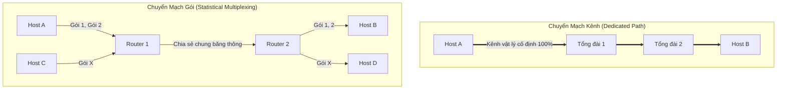
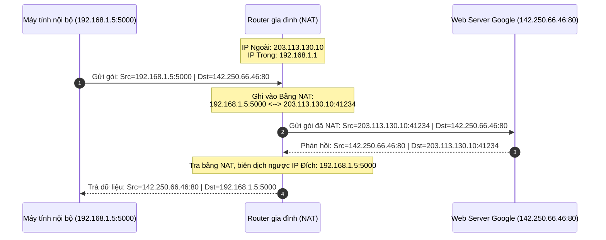
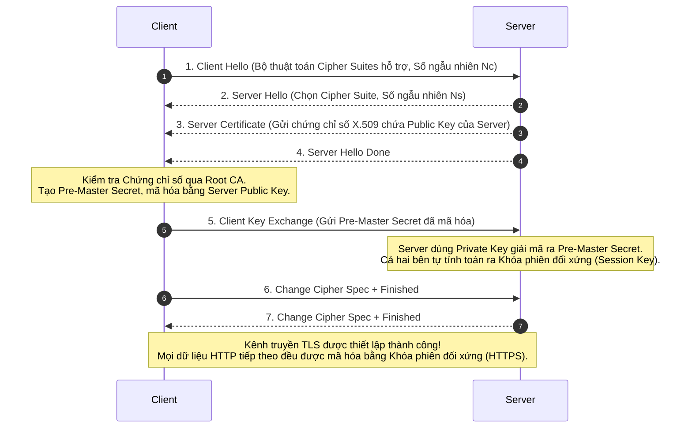

# CẨM NANG KHÁI NIỆM CỐT LÕI MẠNG MÁY TÍNH & INTERNET
## (Networking Core Concepts Handbook & Deep-Dive Guide)

*Tài liệu tham khảo kỹ thuật chuẩn hóa dựa trên giáo trình của GS. Charles Severance (University of Michigan)*  
*Biên soạn & Chuẩn hóa: Đội ngũ Giảng viên & Kỹ sư Mạng*

---

## MỤC LỤC
1. [Bảng Tra cứu Thuật ngữ Chuẩn hóa & Khắc phục Bẫy Dịch máy](#1-bảng-tra-cứu-thuật-ngữ-chuẩn-hóa--khắc-phục-bẫy-dịch-máy)
2. [Cơ chế 1: Chuyển mạch gói (Packet Switching) vs Chuyển mạch kênh (Circuit Switching)](#2-cơ-chế-1-chuyển-mạch-gói-packet-switching-vs-chuyển-mạch-kênh-circuit-switching)
3. [Cơ chế 2: Đóng gói (Encapsulation) & Mở gói (Decapsulation) Đa tầng](#3-cơ-chế-2-đóng-gói-encapsulation--mở-gói-decapsulation-đa-tầng)
4. [Cơ chế 3: Không gian Địa chỉ IPv4, Mạng nội bộ (RFC 1918) & Kỹ thuật NAT](#4-cơ-chế-3-không-gian-địa-chỉ-ipv4-mạng-nội-bộ-rfc-1918--kỹ-thuật-nat)
5. [Cơ chế 4: Trường TTL, Chống vòng lặp & Nguyên lý Hoạt động của Traceroute](#5-cơ-chế-4-trường-ttl-chống-vòng-lặp--nguyên-lý-hoạt-động-của-traceroute)
6. [Cơ chế 5: Giao thức TCP – Bắt tay 3 bước, Sequence Numbers & Cửa sổ trượt](#6-cơ-chế-5-giao-thức-tcp--bắt-tay-3-bước-sequence-numbers--cửa-sổ-trượt)
7. [Cơ chế 6: Cây Phân cấp DNS & Quy trình Phân giải Tên miền Toàn cầu](#7-cơ-chế-6-cây-phân-cấp-dns--quy-trình-phân-giải-tên-miền-toàn-cầu)
8. [Cơ chế 7: Tầng Ứng dụng, Giao thức Văn bản Thuần & Berkeley Sockets](#8-cơ-chế-7-tầng-ứng-dụng-giao-thức-văn-bản-thuần--berkeley-sockets)
9. [Cơ chế 8: Mật mã học, Khóa Bất đối xứng, Chuỗi Chứng chỉ CA & Bắt tay TLS/SSL](#9-cơ-chế-8-mật-mã-học-khóa-bất-đối-xứng-chuỗi-chứng-chỉ-ca--bắt-tay-tlsssl)
10. [Cơ chế 9: So sánh Đối chiếu Toàn diện Mô hình TCP/IP và Mô hình OSI 7 Tầng](#10-cơ-chế-9-so-sánh-đối-chiếu-toàn-diện-mô-hình-tcpip-và-mô-hình-osi-7-tầng)

---

## 1. BẢNG TRA CỨU THUẬT NGỮ CHUẨN HÓA & KHẮC PHỤC BẪY DỊCH MÁY
*(Standard Bilingual Glossary & Translation Pitfalls Correction)*

Trong các tài liệu dịch máy tự động cũ (như bản dịch thô `net-intro_VN_formatted4.txt`), rất nhiều thuật ngữ chuyên ngành mạng bị dịch sai lệch ngữ cảnh nghiêm trọng, gây hiểu lầm tai hại cho người học. Dưới đây là bảng đối chiếu, chỉnh sửa và định nghĩa chuẩn xác:

| Thuật ngữ Tiếng Anh | Lỗi dịch thô trong bản gốc | Thuật ngữ Tiếng Việt Chuẩn | Định nghĩa Kỹ thuật Chuẩn mực |
| :--- | :--- | :--- | :--- |
| **Router / Routing Table** | "r bánh xe", "bàn xoay" *(dịch nhầm wheel/turn table)* | **Bộ định tuyến / Bảng định tuyến** | Thiết bị mạng hoạt động ở Tầng 3 (Network Layer), có nhiệm vụ tra bảng định tuyến để chuyển tiếp gói tin (Packets) giữa các mạng khác nhau. |
| **Window Size / Sliding Window** | "kích thước gió" *(dịch nhầm Window sang gió - Wind)* | **Kích thước cửa sổ / Cửa sổ trượt** | Cơ chế kiểm soát luồng của TCP. Báo hiệu số lượng byte dữ liệu mà bên gửi được phép truyền đi trước khi bắt buộc phải nhận được gói tin xác nhận (ACK). |
| **Subdomain** | "tàu ngầm" *(dịch nhầm tiền tố sub sang submarine)* | **Tên miền con / Miền cấp dưới** | Tên miền phân cấp nằm dưới một miền cha trong cây DNS. Ví dụ: `mail.google.com` là subdomain của miền cha `google.com`. |
| **ACK (Acknowledgment)** | "Phát hiện ra rồi" *(dịch thô acknowledge = nhận ra/phát hiện)* | **Gói tin báo nhận / Xác nhận (ACK)** | Cờ điều khiển hoặc gói tin trong giao thức TCP gửi ngược về máy phát để khẳng định đã nhận vẹn toàn một khối dữ liệu cụ thể. |
| **OSI Model** | "hệ điều hành" *(nhầm lẫn OSI với OS - Operating System)* | **Mô hình Tham chiếu Kết nối Hệ thống Mở (OSI Model)** | Khung kiến trúc lý thuyết gồm 7 tầng do ISO phát triển nhằm chuẩn hóa các chức năng viễn thông và truyền thông dữ liệu. |
| **Switchboard Operator** | "người bầu cử" *(nhầm lẫn operator với elector/voter)* | **Tổng đài viên viễn thông** | Nhân viên điều khiển tại tổng đài viễn thông cổ điển, thủ công cắm các giắc cắm vật lý để nối thông mạch thoại giữa hai thuê bao. |
| **Transmission** | "sự truyền nhiễm" *(nhầm lẫn với lây nhiễm dịch bệnh)* | **Sự truyền dẫn / Truyền thông dữ liệu** | Quá trình phát và dẫn truyền tín hiệu điện từ, sóng vô tuyến hoặc quang học chứa thông tin dữ liệu qua môi trường vật lý. |
| **Private Key** | "chìa khóa phụ kiện" *(dịch sai lệch từ private/accessory)* | **Khóa riêng tư / Khóa bí mật** | Khóa toán học trong hệ mật mã bất đối xứng, bắt buộc phải được chủ sở hữu giữ bí mật tuyệt đối dùng để giải mã hoặc tạo chữ ký số. |
| **Public Key** | "chìa khóa công cộng" | **Khóa công khai** | Khóa toán học trong hệ mật mã bất đối xứng, được công bố rộng rãi cho mọi người dùng để mã hóa thông điệp hoặc kiểm tra chữ ký số. |
| **Port / Port Number** | "cảng / cảng biển" *(nhầm lẫn với hải cảng thương mại)* | **Cổng / Cổng dịch vụ mạng** | Số định danh logic 16-bit ở Tầng Giao vận (Transport Layer) giúp hệ điều hành phân phối dữ liệu mạng đến đúng tiến trình phần mềm đang chạy. |
| **Packet Hop** | "Papet hip", "chuyến nhảy" | **Chặng chuyển tiếp (Hop)** | Hành trình một gói tin di chuyển qua một thiết bị định tuyến (Router) trung gian trên đường từ nguồn tới đích. |
| **Certificate Authority (CA)** | "Chính quyền cấp cao" *(dịch thô Authority)* | **Tổ chức Chứng thực Số / Cơ quan Cấp phát Chứng chỉ (CA)** | Tổ chức trung gian uy tín chịu trách nhiệm kiểm tra danh tính thực thể và ký số chứng chỉ điện tử (X.509) đảm bảo an toàn cho TLS/SSL. |
| **Header** | "đầu trang" *(nhầm lẫn với header trang văn bản Word)* | **Tiêu đề gói tin / Phần đầu gói** | Khối dữ liệu điều khiển được gắn vào đầu mỗi đơn vị dữ liệu mạng chứa các thông tin định tuyến, địa chỉ, cờ kiểm soát và kiểm tra lỗi. |
| **Offset** | "bù đắp" *(dịch thô máy móc)* | **Độ lệch byte / Độ dời (Offset)** | Vị trí tương đối của một byte dữ liệu so với điểm bắt đầu của luồng dữ liệu hoặc phân đoạn gói tin. |
| **Listen State** | "Nghe này" *(dịch thô mệnh lệnh thức)* | **Trạng thái Lắng nghe (LISTEN)** | Trạng thái của một Socket máy chủ khi đã mở cổng thành công và đang thụ động chờ đợi yêu cầu kết nối từ các máy khách (Client). |
| **Carrier Sense** | "cảm giác người vận chuyển" | **Lắng nghe sóng mang (Carrier Sense)** | Khả năng của card mạng kiểm tra xem đường truyền vật lý (cáp đồng, sóng Wi-Fi) có đang bận truyền tín hiệu hay đang rảnh rỗi. |
| **Buffer / Buffering** | "đệm", "tạm thời giữ vào dữ liệu" | **Bộ nhớ đệm (Buffer)** | Vùng nhớ RAM tạm thời dùng để lưu trữ dữ liệu truyền/nhận trong khi chờ CPU hoặc ứng dụng xử lý kịp. |

---

## 2. CƠ CHẾ 1: CHUYỂN MẠCH GÓI (PACKET SWITCHING) VS CHUYỂN MẠCH KÊNH (CIRCUIT SWITCHING)

### 2.1. Bản chất Kỹ thuật
- **Chuyển mạch kênh (Circuit Switching):**
  - Mô hình kế thừa từ hệ thống mạng điện thoại truyền thống của thế kỷ 20.
  - Trước khi dữ liệu được truyền, một **kênh vật lý chuyên biệt và cố định** phải được thiết lập thông qua toàn bộ chuỗi tổng đài trung gian giữa hai nút đầu cuối.
  - Băng thông được cấp phát độc quyền (Dedicated Bandwidth). Nếu hai người gọi im lặng không nói gì, toàn bộ tài nguyên đường dây đó vẫn bị chiếm dụng 100% và không một ai khác được phép dùng chung.
- **Chuyển mạch gói (Packet Switching):**
  - Mô hình nền tảng cấu thành nên mạng Internet hiện đại do Paul Baran và Donald Davies phát minh độc lập vào thập niên 1960.
  - Dữ liệu ứng dụng có dung lượng lớn được chia nhỏ thành các đơn vị dữ liệu độc lập gọi là **Gói tin (Packets)**.
  - Mỗi gói tin mang theo đầy đủ thông tin Header (Địa chỉ IP nguồn, Địa chỉ IP đích, Mã định danh, Số thứ tự).
  - Các gói tin tự di chuyển độc lập qua hệ thống các Router trung gian theo nguyên lý **Lưu trữ và Chuyển tiếp (Store-and-Forward)**.

### 2.2. So sánh Toàn diện



| Tiêu chí So sánh | Chuyển mạch Kênh (Circuit Switching) | Chuyển mạch Gói (Packet Switching) |
| :--- | :--- | :--- |
| **Đường dẫn truyền dữ liệu** | Cố định xuyên suốt phiên kết nối. | Biến thiên động; mỗi gói có thể đi theo một lộ trình khác nhau. |
| **Chiếm dụng tài nguyên** | Dành riêng (Dedicated), không chia sẻ được. | Chia sẻ động thông qua **Ghép kênh Thống kê (Statistical Multiplexing)**. |
| **Hiệu quả truyền dữ liệu máy tính** | Rất thấp đối với dữ liệu dạng xung đột biến (Bursty Traffic). | Cực kỳ cao; tối ưu hóa triệt để năng lực đường truyền cáp quang. |
| **Khả năng chịu lỗi (Fault Tolerance)** | Kém; nếu một trạm cáp trung gian bị đứt, cuộc gọi lập tức bị ngắt. | Tuyệt vời; nếu một tuyến cáp bị đứt, Router tự chuyển hướng các gói tin tiếp theo qua tuyến dự phòng. |
| **Hiện tượng trễ và mất gói** | Trễ cố định (Jitter thấp), không có hiện tượng mất gói do hàng đợi. | Có thể xuất hiện độ trễ biến thiên (Jitter) và rủi ro rơi gói khi hàng đợi Router bị tràn (Buffer Overflow). |

---

## 3. CƠ CHẾ 2: ĐÓNG GÓI (ENCAPSULATION) & MỞ GÓI (DECAPSULATION) ĐA TẦNG

### 3.1. Nguyên lý Ẩn dụ Búp bê Nga (Matryoshka)
Internet hoạt động dựa trên sự phân tách trách nhiệm rõ ràng giữa các tầng. Mỗi tầng chỉ tập trung hoàn thành chức năng của mình mà không cần quan tâm chi tiết kỹ thuật của tầng khác.
- Khi dữ liệu đi từ Tầng Ứng dụng xuống các tầng thấp hơn để chuẩn bị truyền ra môi trường vật lý, quá trình đó gọi là **Đóng gói dữ liệu (Encapsulation)**. Mỗi tầng thêm vào phía trước một **Header** (và tầng Liên kết thêm đuôi **Trailer**).
- Khi dữ liệu đến máy nhận và đi từ dưới lên trên, quá trình đó gọi là **Mở gói dữ liệu (Decapsulation)**. Mỗi tầng bóc tách và phân tích Header tương ứng rồi chuyển giao phần ruột (Payload) lên tầng tiếp theo.

### 3.2. Cấu trúc Đơn vị Dữ liệu Giao thức (PDU) qua các Tầng

```
+-------------------------------------------------------------------------+
| TẦNG ỨNG DỤNG (Application Layer)                                       |
| Payload: [ Dữ liệu bản tin HTTP / Email / File ]                       |
+-------------------------------------------------------------------------+
                                  |
                                  v (Thêm TCP Header: Source/Dest Port, Seq, Ack, Window)
+-------------------------------------------------------------------------+
| TẦNG GIAO VẬN (Transport Layer) - Đơn vị: TCP SEGMENT                   |
| [ TCP Header (20B) ] [ HTTP Data / Payload                            ] |
+-------------------------------------------------------------------------+
                                  |
                                  v (Thêm IP Header: Source/Dest IP, TTL, Protocol)
+-------------------------------------------------------------------------+
| TẦNG MẠNG (Internet Layer) - Đơn vị: IP PACKET                          |
| [ IP Header (20B) ] [ TCP Header ] [ HTTP Data                        ] |
+-------------------------------------------------------------------------+
                                  |
                                  v (Thêm Ethernet Header & Trailer: Source/Dest MAC, FCS/CRC)
+-------------------------------------------------------------------------+
| TẦNG LIÊN KẾT (Link Layer) - Đơn vị: ETHERNET FRAME                     |
| [ MAC Header (14B) ] [ IP Header ] [ TCP Header ] [ HTTP Data ] [ CRC ]|
+-------------------------------------------------------------------------+
```

### 3.3. Chi tiết các trường thông tin trong Header
1. **Ethernet Header (14 Bytes):**
   - `Destination MAC` (6 Bytes): Địa chỉ phần cứng của thiết bị tiếp nhận trên cùng mạng LAN.
   - `Source MAC` (6 Bytes): Địa chỉ phần cứng của máy phát gói.
   - `EtherType` (2 Bytes): Định danh giao thức tầng mạng bên trong (ví dụ `0x0800` là IPv4, `0x86DD` là IPv6).
   - `FCS / CRC Trailer` (4 Bytes nằm ở đuôi): Dãy bit kiểm tra lỗi toàn vẹn dữ liệu trong quá trình truyền dẫn vật lý.
2. **IPv4 Header (Tối thiểu 20 Bytes):**
   - `Version` (4 bits): Giá trị `4`.
   - `TTL (Time to Live)` (8 bits): Số chặng nhảy tối đa trước khi gói bị hủy.
   - `Protocol` (8 bits): Giao thức tầng giao vận bên trong (`6` cho TCP, `17` cho UDP, `1` cho ICMP).
   - `Source IP Address` (32 bits): Địa chỉ IP của máy gửi gốc.
   - `Destination IP Address` (32 bits): Địa chỉ IP của máy nhận đích cuối cùng.
3. **TCP Header (Tối thiểu 20 Bytes):**
   - `Source Port` (16 bits): Cổng của ứng dụng gửi.
   - `Destination Port` (16 bits): Cổng của dịch vụ nhận (ví dụ 80, 443).
   - `Sequence Number` (32 bits): Số thứ tự byte dữ liệu bắt đầu của segment.
   - `Acknowledgment Number` (32 bits): Số thứ tự byte tiếp theo mà bên nhận đang mong đợi.
   - `Control Flags` (9 bits): `SYN`, `ACK`, `FIN`, `RST`, `PSH`, `URG`.
   - `Window Size` (16 bits): Dung lượng bộ đệm khả dụng của bên nhận (dùng để kiểm soát luồng).

---

## 4. CƠ CHẾ 3: KHÔNG GIAN ĐỊA CHỈ IPV4, MẠNG NỘI BỘ (RFC 1918) & KỸ THUẬT NAT

### 4.1. Kiến trúc Địa chỉ IPv4
Địa chỉ IPv4 là một số nhị phân dài 32 bit, được quy ước biểu diễn bằng dạng thập phân có dấu chấm (Dotted-decimal notation): 4 khối (Octet), mỗi khối từ 0 đến 255 (ví dụ: `192.168.1.50`).
- Tổng không gian địa chỉ lý thuyết: $2^{32} = 4.294.967.296$ địa chỉ.
- Cấu trúc địa chỉ gồm 2 phần:
  $$\text{Địa chỉ IP} = \text{Mã Mạng (Network ID)} + \text{Mã Máy (Host ID)}$$
- **Mặt nạ mạng con (Subnet Mask):** Chuỗi 32-bit gồm các bit 1 liên tiếp đại diện cho Network ID và các bit 0 đại diện cho Host ID. Ký pháp CIDR (Classless Inter-Domain Routing) dùng dấu gạch chéo `/` kèm số lượng bit mạng (ví dụ `/24` tương đương `255.255.255.0`).
- **Phép toán Logic AND:** Thiết bị mạng lấy `IP Address AND Subnet Mask` để trích xuất ra địa chỉ mạng (Network Address). Nếu hai máy tính có cùng Network Address, chúng có thể gửi trực tiếp khung Ethernet qua Switch; nếu khác Network Address, gói tin bắt buộc phải chuyển tới **Default Gateway (Router)**.

### 4.2. Địa chỉ IP Riêng tư (Private IP - Chuẩn RFC 1918)
Để đối phó với tình trạng cạn kiệt địa chỉ IPv4 toàn cầu, IETF đã ban hành chuẩn RFC 1918 dành riêng 3 dải địa chỉ IP cho mục đích sử dụng nội bộ (Intranet / LAN). Các Router công cộng trên Internet được cấu hình mặc định để **lập tức hủy bỏ và không bao giờ định tuyến** các gói tin có IP đích thuộc 3 dải này:

1. **Dải Lớp A:** `10.0.0.0` đến `10.255.255.255` (Ký pháp CIDR: `10.0.0.0/8`) $\rightarrow$ Cung cấp $16.777.216$ địa chỉ host (Dành cho tập đoàn lớn, trung tâm dữ liệu).
2. **Dải Lớp B:** `172.16.0.0` đến `172.31.255.255` (Ký pháp CIDR: `172.16.0.0/12`) $\rightarrow$ Gồm 16 mạng lớp B liên tiếp, cung cấp $1.048.576$ địa chỉ host (Dành cho trường đại học, doanh nghiệp vừa).
3. **Dải Lớp C:** `192.168.0.0` đến `192.168.255.255` (Ký pháp CIDR: `192.168.0.0/16`) $\rightarrow$ Gồm 256 dải mạng `/24`, cung cấp $65.536$ địa chỉ (Phổ biến nhất trong mạng gia đình, văn phòng nhỏ, quán cafe).

### 4.3. Kỹ thuật Biên dịch Địa chỉ Mạng (NAT / NAPT)
Do hàng triệu hộ gia đình và tổ chức cùng sử dụng trùng lặp dải địa chỉ `192.168.1.0/24`, thiết bị Router tại biên mạng (Border Router / Home Gateway) phải thực hiện kỹ thuật **NAPT (Network Address Port Translation)**:



- **Lợi ích:** Cho phép hàng trăm thiết bị nội bộ truy cập Internet đồng thời chỉ với 1 địa chỉ IP công cộng (Public IP) duy nhất được nhà mạng cấp.
- **Hạn chế:** Vi phạm nguyên lý thiết kế Đầu-cuối (End-to-End Principle). Các máy chủ bên ngoài không thể chủ động khởi tạo kết nối vào máy tính nội bộ nếu không cấu hình kỹ thuật mở cổng (Port Forwarding / DMZ).

---

## 5. CƠ CHẾ 4: TRƯỜNG TTL, CHỐNG VÒNG LẶP & NGUYÊN LÝ HOẠT ĐỘNG CỦA TRACEROUTE

### 5.1. Nguy cơ Vòng lặp Định tuyến (Routing Loop)
Trong một đồ thị mạng phức tạp với hàng trăm ngàn router, khi một tuyến đường bị đứt hoặc bảng định tuyến của các router chưa kịp đồng bộ (hội tụ - convergence), có thể xuất hiện tình trạng gói tin bị Router A đẩy sang Router B, rồi Router B lại đẩy ngược về Router A.
- Nếu không có cơ chế chặn đứng, các gói tin này sẽ bay vòng tròn vĩnh viễn trong mạng.
- Cứ mỗi giây hàng triệu gói tin mới đi vào vòng lặp $\rightarrow$ Dẫn tới **Cơn bão gói tin (Packet Storm)**, làm tê liệt CPU của router và nghẽn toàn bộ băng thông đường truyền.

### 5.2. Vai trò cứu sinh của trường TTL (Time to Live)
- Trường **TTL** nằm trong IPv4 Header, có kích thước 8 bit (giá trị nguyên từ 1 đến 255; hệ điều hành Linux thường đặt mặc định là 64, Windows là 128).
- **Quy tắc xử lý của Router:**
  1. Khi một Router nhận được một gói tin IP, việc đầu tiên nó làm là giảm giá trị của trường TTL đi 1 đơn vị:
     $$\text{TTL}_{\text{mới}} = \text{TTL}_{\text{cũ}} - 1$$
  2. Router tính toán lại trường kiểm tra lỗi `Header Checksum` của IPv4 Header.
  3. Nếu $\text{TTL}_{\text{mới}} > 0$: Router tra bảng định tuyến và chuyển tiếp gói tin sang chặng kế tiếp.
  4. Nếu $\text{TTL}_{\text{mới}} == 0$: Router **ngay lập tức loại bỏ (Drop)** gói tin đó, không chuyển tiếp nữa! Đồng thời, Router sinh ra một thông báo lỗi đặc biệt bằng giao thức ICMP (Internet Control Message Protocol) loại **Type 11: Time Exceeded** gửi ngược về cho địa chỉ IP nguồn ban đầu.

### 5.3. Giải mã Kỹ nghệ Traceroute
Công cụ `traceroute` (trên Unix/Linux) hoặc `tracert` (trên Windows) là minh chứng kinh điển cho tư duy sáng tạo của các kỹ sư mạng: biến một thông điệp báo lỗi mạng (ICMP Time Exceeded) thành một công cụ khảo sát bản đồ mạng tinh vi:

1. **Khởi tạo:** `traceroute` gửi gói tin thăm dò đầu tiên (Probe Packet: UDP hoặc ICMP Echo Request) với trường **`TTL = 1`**.
2. **Chặng 1:** Gói tin đến Router đầu tiên (Default Gateway của mạng bạn). Router 1 giảm TTL từ 1 xuống 0 $\rightarrow$ Gói tin bị hủy. Router 1 gửi thông điệp `ICMP Time Exceeded` về máy tính của bạn. `traceroute` ghi nhận IP của Router 1 và thời gian phản hồi (RTT).
3. **Chặng 2:** `traceroute` gửi gói tin thứ hai với **`TTL = 2`**. Router 1 giảm TTL xuống 1 và chuyển tiếp cho Router 2. Tại Router 2, TTL bị giảm từ 1 xuống 0 $\rightarrow$ Router 2 hủy gói và gửi phản hồi `ICMP Time Exceeded`. `traceroute` ghi nhận IP của Router 2!
4. **Tiến trình tiếp diễn:** TTL được tăng tuần tự $3, 4, 5...$ cho đến khi gói tin chạm tới máy chủ đích. Máy chủ đích sẽ gửi phản hồi `ICMP Echo Reply` (nếu dùng ping) hoặc `ICMP Port Unreachable` (nếu dùng UDP cổng lạ) $\rightarrow$ `traceroute` biết đã hoàn tất toàn bộ lộ trình và dừng lại!

---

## 6. CƠ CHẾ 5: GIAO THỨC TCP – BẮT TAY 3 BƯỚC, SEQUENCE NUMBERS & CỬA SỔ TRƯỢT

### 6.1. Tiến trình Bắt tay 3 bước (TCP Three-Way Handshake)
TCP là giao thức hướng kết nối (Connection-oriented). Mục tiêu của việc bắt tay 3 bước là đảm bảo cả hai bên:
- Đều có khả năng phát và nhận dữ liệu hai chiều tốt.
- Đồng thuận về số thứ tự khởi tạo ngẫu nhiên (**ISN - Initial Sequence Number**) nhằm chống việc trùng lặp gói tin cũ và ngăn ngừa tấn công đoán số thứ tự.

```
CLIENT                                                    SERVER
  |                                                         |
  | -------- 1. [SYN] Seq=1000, Win=65535, MSS=1460 ------> | (Server chuyển sang SYN_RCVD)
  |                                                         |
  | <------- 2. [SYN, ACK] Seq=5000, Ack=1001, Win=32768 -- |
  |                                                         | (Client chuyển sang ESTABLISHED)
  | -------- 3. [ACK] Seq=1001, Ack=5001 -----------------> |
  |                                                         | (Server chuyển sang ESTABLISHED)
```
- **Bước 1 (SYN):** Client chọn ngẫu nhiên `ISN_client = 1000`, bật cờ `SYN` và gửi tới Server yêu cầu kết nối.
- **Bước 2 (SYN-ACK):** Server nhận được, đồng ý kết nối. Server chọn số thứ tự riêng `ISN_server = 5000`, bật cờ `SYN` và bật cờ `ACK`, đặt số xác nhận `Ack = 1000 + 1 = 1001` (nghĩa là: *Tôi đã nhận đủ byte 1000 của bạn, hãy gửi byte tiếp theo là 1001*).
- **Bước 3 (ACK):** Client gửi gói tin có cờ `ACK`, xác nhận số thứ tự của Server `Ack = 5000 + 1 = 5001`. Kết nối logic chính thức mở, kênh truyền sẵn sàng trao đổi dữ liệu người dùng.

### 6.2. Cơ chế Đánh số Sequence Number và Acknowledgment
TCP không đánh số theo từng gói packet, mà đánh số theo **từng Byte dữ liệu** được gửi đi:
- Nếu Client gửi một Segment chứa 500 bytes dữ liệu với `Seq = 1001`, dải byte đó là từ $1001$ đến $1500$.
- Server khi nhận trọn vẹn 500 bytes này sẽ phản hồi một gói `ACK` với giá trị `Ack = 1501` (*Tôi đang chờ byte số 1501 từ bạn*).
- **Phát hiện mất gói và Gửi lại (Retransmission):** Bên gửi duy trì một đồng hồ đếm ngược (Retransmission Timer - RTO). Nếu sau một khoảng thời gian RTO mà chưa nhận được gói ACK cho dải byte tương ứng, bên gửi coi như gói tin đã bị rơi trên đường và tự động phát lại.

### 6.3. Cơ chế Cửa sổ trượt (Sliding Window Flow Control)
Nếu máy gửi truyền dữ liệu với tốc độ 1 Gbps trong khi máy nhận chỉ là một thiết bị di động có tốc độ xử lý 10 Mbps, bộ đệm tiếp nhận (Receive Buffer) của máy nhận sẽ đầy ứ sau vài phần trăm giây.

```
       Đã ACK        Đã gửi, chờ ACK     Được phép gửi ngay    Chưa được phép gửi
... | 1000 | 1001 | 1002 | 1003 | 1004 | 1005 | 1006 | 1007 | 1008 | 1009 | ...
                    [<----------- Window Size = 6 Bytes ---------->]
```
- Trường **Window Size (16 bits)** trong Header TCP cho phép bên nhận liên tục cập nhật dung lượng bộ đệm còn trống của mình về cho bên gửi:
  - Nếu bên nhận xử lý dữ liệu chậm, nó gửi gói tin có `Window Size` nhỏ lại (ví dụ giảm từ 65535 xuống 4096). Bên gửi nhận được tín hiệu này sẽ lập tức hãm tốc độ phát lại.
  - Nếu bộ đệm bên nhận bị đầy hoàn toàn, nó gửi thông báo **`Window Size = 0` (Zero Window)**. Bên gửi lập tức ngừng truyền hoàn toàn cho đến khi nhận được thông báo mở cửa sổ mới!
- **Tính chất "Trượt" (Sliding):** Khi các byte cũ được xác nhận (ACK), mép trái của cửa sổ trượt sang phải; đồng thời mép phải cũng dịch chuyển về phía trước tương ứng với dung lượng trống mới, cho phép liên tục nạp thêm dữ liệu mới vào luồng truyền mà không bị gián đoạn.

---

## 7. CƠ CHẾ 6: CÂY PHÂN CẤP DNS & QUY TRÌNH PHÂN GIẢI TÊN MIỀN TOÀN CẦU

### 7.1. Cấu trúc Hình cây Phân cấp của Tên miền
Hệ thống Tên miền (Domain Name System - DNS) là cơ sở dữ liệu phân tán có cấu trúc phân cấp hình cây (Hierarchical Tree Structure):

```
                       [ . ] (Root Domain)
                      /      \           \
                 [.com]     [.edu]       [.vn]  (Top-Level Domains - TLD)
                 /             \             \
          [google]          [umich]       [vnu] (Second-Level Domains)
          /      \          /     \
       [www]   [mail]    [www]   [cs]           (Subdomains / Hosts)
```
- Tên miền được đọc và phân tích **từ phải sang trái**:
  - `.` (Root): Gốc cao nhất của toàn bộ không gian tên mạng Internet.
  - TLD: Phân loại theo mục đích chung (gTLD: `.com`, `.org`, `.net`) hoặc theo mã quốc gia (ccTLD: `.vn`, `.jp`, `.uk`).
  - Second-Level Domain: Tên tổ chức/doanh nghiệp đăng ký bản quyền (ví dụ `google`, `vnu`).
  - Subdomain/Host: Các máy chủ hoặc dịch vụ cụ thể của tổ chức đó (ví dụ `www`, `api`, `mail`).

### 7.2. Bốn Loại Máy chủ DNS trong Quy trình Phân giải
1. **DNS Recursive Resolver (Máy chủ Phân giải Đệ quy):** Máy chủ do ISP (Viettel, VNPT, FPT) hoặc các hãng công nghệ công cộng (Google `8.8.8.8`, Cloudflare `1.1.1.1`) vận hành. Đóng vai trò "người thư ký cần mẫn", nhận yêu cầu từ máy tính người dùng và đi lùng sục khắp nơi để tìm ra câu trả lời.
2. **Root Nameservers (Cụm Máy chủ Gốc):** Toàn thế giới có **13 cụm địa chỉ IP máy chủ gốc** (đặt tên từ `a.root-servers.net` đến `m.root-servers.net`). Được nhân bản thành hàng ngàn máy chủ vật lý khắp địa cầu thông qua định tuyến Anycast. Chúng chỉ quản lý và chuyển hướng tới các máy chủ TLD.
3. **TLD Nameservers (Máy chủ Tên miền Cấp cao nhất):** Chịu trách nhiệm quản lý tất cả các tên miền kết thúc bằng đuôi tương ứng (ví dụ cụm TLD của Verisign quản lý `.com`).
4. **Authoritative Nameservers (Máy chủ Có thẩm quyền):** Nơi lưu trữ hồ sơ DNS chính thức cuối cùng của tên miền (các bản ghi `A`, `AAAA`, `CNAME`, `MX`). Khi nhận được câu hỏi từ Resolver, nó sẽ trả lời địa chỉ IP đích xác thực.

### 7.3. Bản ghi DNS Phổ biến
- **Bản ghi A (Address):** Ánh xạ tên miền sang địa chỉ **IPv4** 32-bit (ví dụ: `google.com` $\rightarrow$ `142.250.190.46`).
- **Bản ghi AAAA (Quad-A):** Ánh xạ tên miền sang địa chỉ **IPv6** 128-bit.
- **Bản ghi CNAME (Canonical Name):** Tạo bí danh (Alias) trỏ một tên miền này sang một tên miền khác (ví dụ: `www.example.com` $\rightarrow$ `example.com`).
- **Bản ghi MX (Mail Exchanger):** Chỉ định máy chủ nhận thư điện tử của tổ chức.
- **TTL (Time to Live) của bản ghi DNS:** Số giây mà máy chủ phân giải đệ quy hoặc trình duyệt được phép lưu kết quả tra cứu vào bộ nhớ đệm (Cache) trước khi phải gửi truy vấn mới.

---

## 8. CƠ CHẾ 7: TẦNG ỨNG DỤNG, GIAO THỨC VĂN BẢN THUẦN & BERKELEY SOCKETS

### 8.1. Bản chất Văn bản thuần của Giao thức Tầng Ứng dụng
Hầu hết các giao thức Internet cổ điển và kinh điển (HTTP/1.1, SMTP, POP3, IMAP) đều được thiết kế dựa trên các lệnh **Văn bản thuần (Plain Text)** có thể đọc trực tiếp bằng mắt thường.
- Điều này phản ánh triết lý của Internet: Đơn giản, dễ kiểm thử, dễ gỡ lỗi bằng cách sử dụng các công cụ đầu cuối cơ bản như `telnet` hoặc `netcat`.

### 8.2. Phân tích Cấu trúc Giao thức HTTP/1.1
Một phiên giao tiếp web điển hình gồm 2 pha:
1. **HTTP Request (Máy khách gửi lên Máy chủ):**
   ```http
   GET /index.html HTTP/1.1\r\n
   Host: www.example.com\r\n
   User-Agent: Mozilla/5.0 (Windows NT 10.0; Win64; x64)\r\n
   Accept: text/html,application/xhtml+xml\r\n
   Connection: close\r\n
   \r\n
   ```
   *Lưu ý:* Hai ký tự xuống dòng liên tiếp `\r\n\r\n` đánh dấu kết thúc phần Header của Request.
2. **HTTP Response (Máy chủ trả lời Máy khách):**
   ```http
   HTTP/1.1 200 OK\r\n
   Date: Mon, 09 Nov 2026 08:30:00 GMT\r\n
   Server: Apache/2.4.52\r\n
   Content-Type: text/html; charset=UTF-8\r\n
   Content-Length: 125\r\n
   \r\n
   <!DOCTYPE html>
   <html>
   <head><title>Test Page</title></head>
   <body><h1>Xin chao tu Web Server!</h1></body>
   </html>
   ```
   - **Mã trạng thái HTTP (Status Codes):**
     - `1xx` (Informational): Thông tin chỉ dẫn.
     - `2xx` (Success): Thành công rực rỡ (`200 OK`, `201 Created`).
     - `3xx` (Redirection): Chuyển hướng tài nguyên (`301 Moved Permanently`, `302 Found`).
     - `4xx` (Client Error): Lỗi do máy khách gửi yêu cầu sai (`400 Bad Request`, `401 Unauthorized`, `403 Forbidden`, `404 Not Found`).
     - `5xx` (Server Error): Lỗi sập hệ thống máy chủ (`500 Internal Server Error`, `502 Bad Gateway`, `503 Service Unavailable`).

### 8.3. Giao diện Lập trình Berkeley Sockets API
Socket là một trừu tượng hóa phần mềm do Đại học UC Berkeley giới thiệu trong hệ điều hành BSD UNIX năm 1983.
- Socket đóng vai trò như một **điểm mút truyền thông (Communication Endpoint)** được định danh bởi cặp:
  $$\text{Socket} = (\text{Địa chỉ IP}, \text{Số Cổng - Port})$$
- Vòng đời của một kết nối Socket tiêu chuẩn:
  - Phía Máy chủ (Server): `socket()` $\rightarrow$ `bind()` (gắn IP/Port) $\rightarrow$ `listen()` (chờ kết nối) $\rightarrow$ `accept()` (chấp nhận kết nối từ Client) $\rightarrow$ `recv()` / `send()` $\rightarrow$ `close()`.
  - Phía Máy khách (Client): `socket()` $\rightarrow$ `connect()` (bắt tay 3 bước) $\rightarrow$ `send()` / `recv()` $\rightarrow$ `close()`.

---

## 9. CƠ CHẾ 8: MẬT MÃ HỌC, KHÓA BẤT ĐỐI XỨNG, CHUỖI CHỨNG CHỈ CA & BẮT TAY TLS/SSL

### 9.1. So sánh Hai Phương pháp Mật mã học
1. **Mã hóa Đối xứng (Symmetric-Key Cryptography):**
   - Thuật toán tiêu biểu: **AES (Advanced Encryption Standard)**, ChaCha20, DES/3DES.
   - Cơ chế: Cả bên gửi và bên nhận đều dùng chung một chìa khóa bí mật duy nhất ($K$) để vừa mã hóa vừa giải mã.
   - Ưu điểm: Hiệu năng tính toán cực nhanh, tiêu thụ ít tài nguyên CPU, rất lý tưởng để mã hóa các dòng dữ liệu lớn (video, file tải về).
   - Nhược điểm: **Bài toán Phân phối Khóa (Key Distribution Problem)**. Làm sao truyền chiếc chìa khóa bí mật này qua Internet cho một người lạ ở nửa bên kia địa cầu mà không bị nghe lén?
2. **Mã hóa Bất đối xứng / Khóa Công khai (Asymmetric / Public-Key Cryptography):**
   - Thuật toán tiêu biểu: **RSA**, ECC (Elliptic Curve Cryptography), Diffie-Hellman.
   - Cơ chế: Mỗi thực thể sở hữu một cặp khóa toán học có liên hệ mật thiết:
     - **Khóa Công khai (Public Key):** Được xuất bản rộng rãi cho toàn thế giới biết.
     - **Khóa Riêng tư (Private Key):** Được giữ tuyệt mật, không bao giờ tiết lộ ra ngoài.
   - Tính chất một chiều: Dữ liệu đã bị mã hóa bằng Public Key thì **chỉ có duy nhất Private Key tương ứng mới giải mã được**.
   - Nhược điểm: Tính toán các phép nhân ma trận hoặc modulo số nguyên tố khổng lồ, khiến tốc độ chậm hơn mã hóa đối xứng từ 100 đến 1000 lần.

### 9.2. Chuỗi Tin cậy Chứng chỉ số (Certificate Chain of Trust)
Nếu Bob gửi cho Alice một Public Key qua mạng, làm sao Alice biết Public Key này thực sự là của Bob chứ không phải của kẻ mạo danh Eve (Tấn công Man-in-the-Middle)?
- **Giải pháp:** Sử dụng **Chứng chỉ số X.509 (Digital Certificate)** do **Cơ quan Chứng thực (Certificate Authority - CA)** cấp.
- **Quy trình ký số của CA:**
  1. Chủ sở hữu website `example.com` tạo một cặp Public/Private Key.
  2. Gửi Public Key kèm thông tin định danh công ty tới một CA uy tín (ví dụ: DigiCert, Let's Encrypt).
  3. CA xác minh danh tính và quyền sở hữu tên miền của công ty.
  4. CA tạo chứng chỉ số chứa: Tên miền, Public Key của website, Ngày hết hạn, và **Chữ ký số của chính CA** (được CA mã hóa bằng Private Key của CA).
  5. Hệ điều hành và trình duyệt của người dùng cài sẵn danh sách các **Root CA uy tín** cùng Public Key của các CA này. Khi truy cập web, trình duyệt dùng Public Key của CA để giải mã chữ ký, xác minh tính toàn vẹn và hợp lệ của chứng chỉ.

### 9.3. Toàn bộ Quy trình Bắt tay TLS 1.2 / 1.3 (Hybrid Cryptography)
Mô hình kết hợp (Lai ghép) tận dụng sự an toàn của Khóa Bất đối xứng để trao đổi an toàn một Khóa Phiên Đối xứng (Session Key), sau đó chuyển sang dùng Mã hóa Đối xứng để truyền dữ liệu:



---

## 10. CƠ CHẾ 9: SO SÁNH ĐỐI CHIẾU TOÀN DIỆN MÔ HÌNH TCP/IP VÀ MÔ HÌNH OSI 7 TẦNG

### 10.1. Nguồn gốc Lịch sử & Triết lý Thiết kế
- **Mô hình OSI (Open Systems Interconnection):**
  - Do Tổ chức Tiêu chuẩn hóa Quốc tế (**ISO**) khởi xướng vào cuối thập niên 1970.
  - Được thiết kế bởi các ủy ban tiêu chuẩn theo phương pháp tiếp cận hàn lâm, lý thuyết thuần túy từ trên xuống (Top-down). Mục tiêu là tạo ra một kiến trúc hoàn hảo, tường minh về mặt chức năng trước khi viết phần mềm.
- **Mô hình TCP/IP (Internet Architecture):**
  - Được tài trợ bởi Cơ quan Chỉ đạo các Dự án Nghiên cứu Tiên tiến Quốc phòng Hoa Kỳ (**DARPA**) và chuẩn hóa bởi **IETF**.
  - Thiết kế theo triết lý thực dụng từ dưới lên (Bottom-up): Tập trung giải quyết bài toán sống còn là kết nối các mạng không đồng nhất và khả năng sống sót khi chiến tranh xảy ra.

### 10.2. Bảng Đối chiếu Chi tiết 7 Tầng OSI và 4 Tầng TCP/IP

| Tầng OSI | Tên Tầng OSI | Chức năng Cốt lõi của Tầng OSI | Tầng TCP/IP Tương Ứng | Giao thức Tiêu biểu trong TCP/IP |
| :---: | :--- | :--- | :---: | :--- |
| **7** | **Application** | Giao diện tương tác trực tiếp với ứng dụng người dùng cuối. | <br>**Tầng Ứng dụng<br>(Application Layer)**<br><br>*(Gộp chung Tầng 5, 6, 7 của OSI)* | HTTP, HTTPS, DNS, SMTP, IMAP, SSH, FTP, DHCP |
| **6** | **Presentation** | Định dạng dữ liệu, chuyển đổi bảng mã ký tự (ASCII/UTF-8), nén dữ liệu và mã hóa bảo mật. | | |
| **5** | **Session** | Thiết lập, duy trì, đồng bộ hóa và giải phóng các phiên đối thoại (Sessions) giữa các ứng dụng. | | |
| **4** | **Transport** | Truyền thông tin cậy tiến trình - tiến trình (End-to-End); đánh số gói, kiểm soát lỗi và điều khiển luồng. | **Tầng Giao vận<br>(Transport Layer)** | TCP, UDP |
| **3** | **Network** | Định địa chỉ logic toàn cầu (IP Address) và định tuyến gói tin (Routing) qua các mạng trung gian. | **Tầng Mạng / Liên mạng<br>(Internet Layer)** | IPv4, IPv6, ICMP, ARP, BGP, OSPF |
| **2** | **Data Link** | Truyền khung (Frames) tin cậy trên một liên kết vật lý trực tiếp; địa chỉ phần cứng (MAC), phát hiện lỗi (CRC). | <br>**Tầng Liên kết<br>(Link Layer / Network Access)**<br><br>*(Gộp chung Tầng 1 và 2 của OSI)* | Ethernet (IEEE 802.3), Wi-Fi (IEEE 802.11), PPP |
| **1** | **Physical** | Dẫn truyền các chuỗi bit nhị phân thô (0 và 1) dưới dạng tín hiệu điện áp, ánh sáng quang hoặc sóng vô tuyến. | | Cáp đồng xoắn đôi (Cat5e/6), Cáp sợi quang, Bộ điều chế RF |

### 10.3. Nhận định Tổng kết của Dr. Chuck
- **OSI là Mô hình Tham chiếu (Reference Model):** Mặc dù bộ giao thức OSI thất bại trong cuộc chiến thương mại và không được ứng dụng thực tế trên diện rộng, mô hình 7 tầng của nó lại là công cụ sư phạm xuất sắc nhất. Nó cung cấp một ngôn ngữ kỹ thuật chuẩn mực để các kỹ sư mạng thảo luận, phân chia ranh giới thiết kế thiết bị phần cứng (Switch Layer 2, Router Layer 3, Tường lửa Layer 7) và chẩn đoán sự cố mạng theo phương pháp cô lập từng tầng (Layer-by-layer troubleshooting).
- **TCP/IP là Mô hình Kỹ nghệ Thực thi (Implementation Model):** Tinh gọn, linh hoạt, tập trung vào hiệu năng thực tế. Việc tích hợp các chức năng của Session và Presentation trực tiếp vào Tầng Ứng dụng giúp lập trình viên toàn quyền kiểm soát logic phần mềm mà không bị ràng buộc bởi các tiêu chuẩn cồng kềnh của hệ điều hành.
