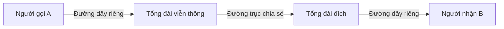
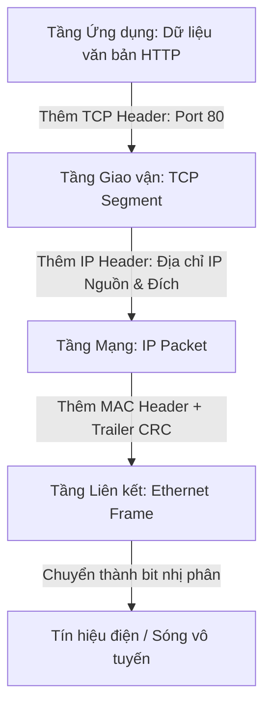
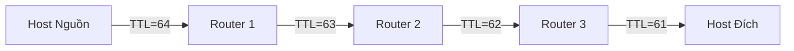
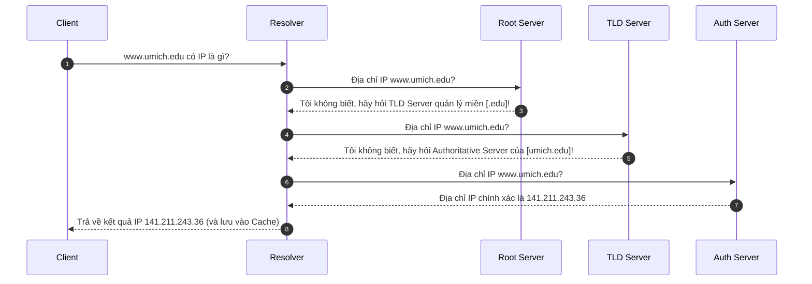
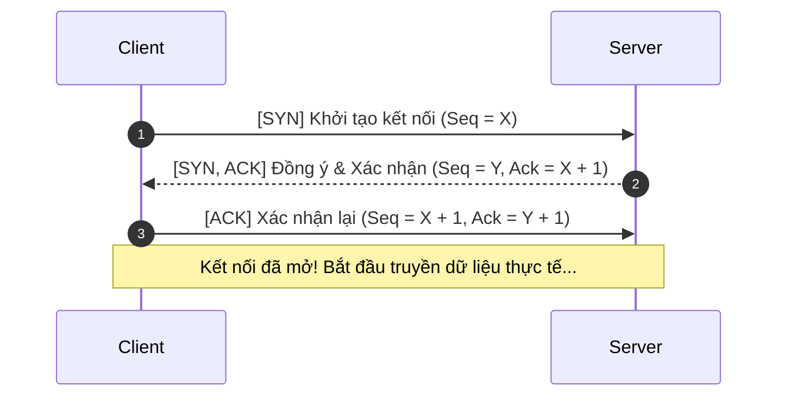
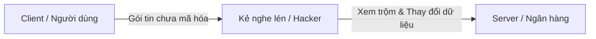
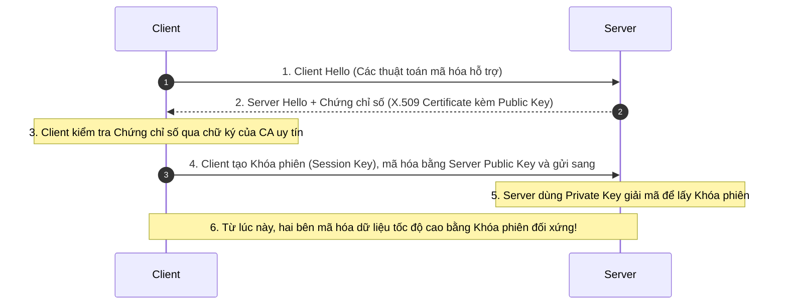
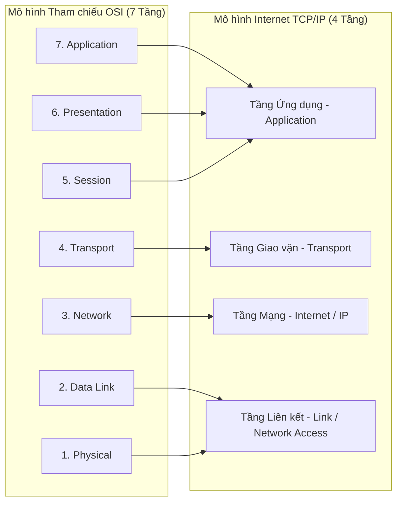

<!-- Slide 1: Cover Slide -->
# NHẬP MÔN MẠNG MÁY TÍNH & INTERNET
## How the Internet Works: Architecture, Protocols & Mechanisms
### Dựa trên giáo trình của GS. Charles Severance (Dr. Chuck)

<hr>

**Giảng viên:** Bộ môn Mạng & Truyền thông Dữ liệu  
**Mục tiêu:** Khám phá bản chất vận hành của Internet từ góc nhìn kỹ thuật thực tiễn

<!-- Note: Chào mừng các bạn học viên đến với khóa học Nhập môn Mạng Máy tính. Khóa học được thiết kế theo tư duy của Giáo sư Charles Severance (University of Michigan) - một trong những nhà sư phạm máy tính lỗi lạc. Chúng ta sẽ không học vẹt các khái niệm trừu tượng, mà sẽ tái hiện lại quá trình loài người giải quyết bài toán giao tiếp từ thời điện thoại đến mạng máy tính toàn cầu. -->

---

# LỘ TRÌNH BÀI GIẢNG (COURSE ROADMAP)

- **Phần 1:** Từ Điện thoại đến Mạng Gói (Circuit vs Packet Switching)
- **Phần 2:** Kiến trúc 4 tầng TCP/IP & Đóng gói dữ liệu (Encapsulation)
- **Phần 3:** Tầng Liên kết (Link Layer), CSMA/CD & Địa chỉ MAC
- **Phần 4:** Tầng Mạng (Internet Layer), IP, Định tuyến, TTL & NAT
- **Phần 5:** Hệ thống Phân giải Tên miền (DNS)
- **Phần 6:** Tầng Giao vận (Transport Layer), TCP vs UDP, Cửa sổ trượt
- **Phần 7:** Tầng Ứng dụng (Application Layer), HTTP & Lập trình Socket
- **Phần 8:** Bảo mật Mạng (Security), Mã hóa & Giao thức TLS/SSL
- **Phần 9:** Đối chiếu Mô hình TCP/IP và Mô hình Tham chiếu OSI 7 tầng

<!-- Note: Toàn bộ khóa học được cấu trúc thành 9 phần logic liền mạch, bám sát các chương của cuốn sách Net-Intro. Mỗi tầng mạng sẽ giải quyết một thách thức cụ thể trong việc truyền dữ liệu qua không gian và thời gian. -->

---

<!-- ARC 1: SLIDE 1 -->
# PHẦN 1: TỪ ĐIỆN THOẠI ĐẾN MẠNG GÓI
## Bài toán giao tiếp khoảng cách xa

- **Giao tiếp trực tiếp (Local Communication):**
  - Trong một phòng kín gồm 5 người, việc nói chuyện diễn ra tự nhiên qua môi trường sóng âm chung.
  - Điều kiện: Mọi người phải lịch sự, không nói đè lên nhau.
- **Thách thức khi khoảng cách tăng lên:**
  - Kéo dây trực tiếp giữa từng cặp: Số đường dây cần thiết là $\frac{N(N-1)}{2}$.
  - Với 100 người cần $4.950$ sợi cáp; với 1 triệu người $\rightarrow$ **Bất khả thi!**
- **Giải pháp điện thoại cổ điển (Năm 1900s):**
  - Thiết lập tổng đài trung tâm (Central Office).
  - Người dùng gọi đến tổng đài viên (Switchboard Operator).
  - Tổng đài viên cắm dây vật lý nối hai đầu dây trực tiếp với nhau.

<!-- Note: Hãy hình dung bài toán 5 người trong phòng của Dr. Chuck. Khi chuyển qua khoảng cách hàng chục dặm, chúng ta không thể kéo dây riêng giữa mọi cặp nhà. Đó là lý do chuyển mạch kênh ra đời với vai trò của tổng đài viên đóng vai trò thiết lập đường truyền. -->

---

<!-- ARC 1: SLIDE 2 -->
# CHUYỂN MẠCH KÊNH (CIRCUIT SWITCHING)
## Nguyên lý & Giới hạn kỹ thuật



- **Cơ chế hoạt động:**
  - Thiết lập kênh vật lý chuyên biệt và dành riêng trong suốt cuộc gọi.
  - Băng thông được bảo lưu 100% cho hai bên đàm thoại dù có nói chuyện hay im lặng.
- **Hạn chế đối với giao tiếp máy tính:**
  - Máy tính truyền dữ liệu theo **dạng xung đột biến (Bursty Traffic)**: Yên lặng thời gian dài, đột ngột gửi một khối lượng lớn dữ liệu rồi lại ngắt quãng.
  - Nếu áp dụng chuyển mạch kênh: Chi phí đắt đỏ, tài nguyên đường truyền bị lãng phí nghiêm trọng.

<!-- Note: Chuyển mạch kênh hoàn hảo cho giọng nói thời xưa vì tính liên tục. Nhưng máy tính không trò chuyện như người; ứng dụng tải dữ liệu trong vài mili-giây rồi nằm chờ người dùng tương tác. Dành riêng một đường truyền vật lý cho máy tính là cực kỳ lãng phí. -->

---

<!-- ARC 1: SLIDE 3 -->
# CHUYỂN MẠCH GÓI (PACKET SWITCHING)
## Cuộc cách mạng định hình Internet

- **Đột phá tư duy:** Thay vì giữ một đường dây vật lý liên tục, hãy cắt nhỏ thông điệp thành các **Gói tin (Packets)** độc lập.
- **Ẩn dụ của Dr. Chuck: Bưu điện và Bưu thiếp**
  - Bạn muốn gửi một cuốn tiểu thuyết? Hãy xé nó ra thành hàng ngàn tấm bưu thiếp!
  - Trên mỗi bưu thiếp, ghi rõ:
    1. Địa chỉ nguồn (Source Address)
    2. Địa chỉ đích (Destination Address)
    3. Số thứ tự bưu thiếp (Sequence Number: ví dụ trang 5/1000)
    4. Nội dung văn bản (Payload)
- **Ưu điểm vượt trội:**
  - **Ghép kênh thống kê (Statistical Multiplexing):** Nhiều máy tính chia sẻ chung một sợi cáp quang mà không xung đột.
  - **Khả năng chịu lỗi (Fault Tolerance):** Nếu một tuyến cáp bị đứt, các router tự động chuyển hướng gói tin qua tuyến cáp khác.

<!-- Note: Chuyển mạch gói chính là linh hồn của Internet. Dữ liệu được băm nhỏ thành các gói packet. Mỗi packet tự tìm đường đi trong mạng. Thiết bị nhận có nhiệm vụ gom các mảnh lại theo đúng số thứ tự. -->

---

<!-- ARC 2: SLIDE 1 -->
# PHẦN 2: KIẾN TRÚC 4 TẦNG TCP/IP
## Mô hình mạng thực tế của Internet

Internet sử dụng mô hình 4 tầng phân cấp độc lập:

| Tầng (Layer) | Tên tiếng Anh | Đơn vị Dữ liệu (PDU) | Chức năng chính | Giao thức tiêu biểu |
| :--- | :--- | :--- | :--- | :--- |
| **Tầng 4** | **Application** | Data / Message | Xử lý yêu cầu ứng dụng của người dùng | HTTP, DNS, IMAP, SSH |
| **Tầng 3** | **Transport** | Segment (TCP) / Datagram (UDP) | Truyền thông tiến trình - tiến trình; sửa lỗi & kiểm soát luồng | TCP, UDP |
| **Tầng 2** | **Internet** | Packet | Định tuyến liên mạng toàn cầu từ nguồn đến đích | IPv4, IPv6, ICMP |
| **Tầng 1** | **Link** | Frame | Truyền dữ liệu vật lý giữa hai thiết bị cùng mạng cục bộ | Ethernet, Wi-Fi (802.11) |

> **Nguyên lý Đầu-cuối (End-to-End Principle):** Mạng lõi (Routers) chỉ cần biết Tầng 1 và Tầng 2. Trí thông minh và xử lý phức tạp nằm ở hai đầu cuối (Tầng 3 và 4)!

<!-- Note: Bốn tầng này là chuẩn kiến trúc thực tiễn của IETF. Chú ý rằng các router ở giữa mạng internet toàn cầu chỉ quan tâm đến Tầng Internet (IP Packet) và Tầng Liên kết. Chúng không cần biết và không can thiệp vào dữ liệu Tầng Ứng dụng bên trong. -->

---

<!-- ARC 2: SLIDE 2 -->
# ĐÓNG GÓI DỮ LIỆU (ENCAPSULATION)
## Ẩn dụ "Búp bê Matryoshka" & Phong bì nhiều lớp



- **Quy trình gửi (Encapsulation - Đóng gói):** Mỗi tầng đi xuống sẽ bọc dữ liệu của tầng trên bằng **Header** (tiêu đề) và có thể thêm **Trailer** (đuôi kiểm tra).
- **Quy trình nhận (Decapsulation - Mở gói):** Thiết bị nhận bóc tách từng lớp vỏ bọc từ dưới lên trên, chuyển dữ liệu nguyên bản tới đúng ứng dụng đích.

<!-- Note: Encapsulation giống như việc bạn viết một bức thư, nhét vào phong bì có ghi số phòng (Port), nhét tiếp vào hộp bưu điện có ghi địa chỉ nhà (IP), và người vận chuyển dán mã số xe tải (MAC) lên thùng hàng. Khi đến nơi, bên nhận bóc từng lớp vỏ ra. -->

---

<!-- ARC 3: SLIDE 1 -->
# PHẦN 3: TẦNG LIÊN KẾT (LINK LAYER)
## Môi trường chia sẻ & Giao thức CSMA/CD

- **Thách thức:** Trong mạng cục bộ (LAN), nhiều máy tính nối chung vào một sợi cáp hoặc cùng phát sóng radio trong một không gian. Nếu hai máy cùng phát tín hiệu $\rightarrow$ **Xung đột tín hiệu (Collision)!**
- **Giải pháp: Giao thức CSMA/CD (Carrier Sense Multiple Access with Collision Detection)**
  - **Carrier Sense (Lắng nghe sóng mang):** "Lắng nghe trước khi nói". Nếu cáp đang bận, kiên nhẫn chờ.
  - **Multiple Access (Đa truy cập):** Mọi nút mạng đều có quyền bình đẳng truy cập môi trường.
  - **Collision Detection (Phát hiện va chạm):** Vừa nói vừa lắng nghe. Nếu phát hiện tín hiệu bị méo $\rightarrow$ Ngừng phát ngay lập tức!
  - **Thuật toán lùi ngẫu nhiên (Exponential Backoff):** Mỗi bên chờ một khoảng thời gian ngẫu nhiên khác nhau trước khi thử phát lại.

<!-- Note: CSMA/CD là quy tắc ứng xử lịch thiệp trong một căn phòng. Nếu hai người trót cất tiếng cùng một lúc, cả hai cùng im lặng, chờ một khoảng thời gian ngẫu nhiên ngắn rồi mới nói lại để tránh va chạm lần hai. -->

---

<!-- ARC 3: SLIDE 2 -->
# ĐỊA CHỈ MAC & KHUNG ETHERNET
## Định danh phần cứng trong mạng cục bộ

- **Địa chỉ MAC (Media Access Control Address):**
  - Độ dài: **48-bit (6 Bytes)**, viết dưới dạng 12 chữ số Hexadecimal: `00:1A:2B:3C:4D:5E`.
  - Được nhà sản xuất ghi cứng (burned-in) vào card mạng (NIC).
  - 24 bit đầu: Mã định danh nhà sản xuất (**OUI** - Organizationally Unique Identifier do IEEE cấp).
  - 24 bit sau: Số sê-ri card mạng do nhà sản xuất tự đánh số.
- **Cấu trúc Khung Ethernet (Ethernet Frame):**

| MAC Đích (6B) | MAC Nguồn (6B) | Loại Giao thức (Type 2B) | Dữ liệu Payload (46 - 1500 Bytes) | CRC / FCS (4B) |
| :---: | :---: | :---: | :---: | :---: |

> **Phạm vi hiệu lực:** Địa chỉ MAC chỉ có ý nghĩa trên một chặng kết nối vật lý (Single Hop). Khi qua Router, địa chỉ MAC sẽ bị thay đổi hoàn toàn!

<!-- Note: Địa chỉ MAC giống như số căn cước công dân gắn liền với phần cứng. Chú ý rằng địa chỉ MAC chỉ dùng để nói chuyện giữa hai thiết bị cắm chung một switch hoặc cùng kết nối một access point. Khi gói tin nhảy sang router khác, MAC cũ bị vứt bỏ và thay bằng MAC mới. -->

---

<!-- ARC 4: SLIDE 1 -->
# PHẦN 4: TẦNG MẠNG (INTERNET LAYER)
## Định vị toàn cầu với Địa chỉ IP

- **Địa chỉ IPv4:**
  - Độ dài: **32-bit (4 Bytes)**, chia thành 4 khối octet (Dotted-decimal): ví dụ `192.168.1.1`.
  - Không gian địa chỉ: $2^{32} \approx 4,3$ tỷ địa chỉ (Đã cạn kiệt trên thực tế!).
- **Cấu trúc phân cấp của địa chỉ IP:**
  - Gồm 2 phần: **Network ID (Mã mạng)** và **Host ID (Mã máy)**.
  - **Mặt nạ mạng con (Subnet Mask):** Giúp máy tính biết địa chỉ đích nằm cùng mạng cục bộ hay ở mạng bên ngoài (ví dụ `/24` = `255.255.255.0`).
- **Địa chỉ IPv6 - Lời giải cho tương lai:**
  - Độ dài: **128-bit (16 Bytes)**, viết dưới dạng Hexadecimal phân tách bởi dấu hai chấm.
  - Không gian địa chỉ: $2^{128} \approx 3,4 \times 10^{38}$ địa chỉ (Đủ cấp cho mỗi hạt cát trên Trái Đất hàng ngàn tỷ IP).

<!-- Note: Nếu địa chỉ MAC là căn cước công dân thì địa chỉ IP là địa chỉ gửi thư bưu điện (Số nhà, Tên đường, Quận, Thành phố). Địa chỉ IP có tính phân cấp theo vùng địa lý và nhà mạng, cho phép các router trên toàn cầu dễ dàng định tuyến. -->

---

<!-- ARC 4: SLIDE 2 -->
# ĐỊNH TUYẾN HOP-BY-HOP & TRƯỜNG TTL
## Cách thức Router chuyển tiếp gói tin & Ngăn ngừa vòng lặp



- **Định tuyến từng chặng (Hop-by-Hop Routing):**
  - Router chỉ nhìn vào IP Đích trong Header, tra bảng định tuyến (**Routing Table**), và đẩy gói tin ra cổng tiếp theo tối ưu. Không một Router nào cần nhớ toàn bộ bản đồ Internet.
- **Thảm họa Vòng lặp Định tuyến (Routing Loop) & Trường TTL:**
  - Nếu hai router cấu hình sai, chúng có thể ném qua ném lại gói tin mãi mãi $\rightarrow$ Làm nghẽn mạng!
  - **Trường TTL (Time to Live - 8 bit):** Giá trị khởi tạo (64 hoặc 128). Mỗi khi qua một Router, TTL bị trừ 1.
  - Khi **TTL = 0**: Router lập tức **vứt bỏ gói tin** và gửi lại thông báo lỗi **ICMP Time Exceeded** về cho máy nguồn!

<!-- Note: Trường TTL là một phát minh vĩ đại cứu sống Internet. Không có TTL, các gói tin lạc đường sẽ lưu hành vĩnh viễn và tạo thành cơn bão nuốt trọn băng thông toàn cầu. Cơ chế này cũng chính là nền tảng để công cụ traceroute hoạt động! -->

---

<!-- ARC 4: SLIDE 3 -->
# CƠ CHẾ HOẠT ĐỘNG CỦA TRACEROUTE
## Khai thác thông điệp lỗi ICMP Time Exceeded

Làm sao máy tính của bạn biết được danh sách tất cả các Router trên đường đến `google.com`?

1. **Gửi gói 1 với `TTL = 1`:** Gói tin tới Router đầu tiên (Default Gateway), TTL giảm về 0 $\rightarrow$ Router 1 gửi trả lỗi: *Tôi là Router 1, gói tin đã chết ở chỗ tôi!*
2. **Gửi gói 2 với `TTL = 2`:** Vượt qua Router 1 (TTL còn 1), tới Router 2 (TTL về 0) $\rightarrow$ Router 2 gửi trả lỗi: *Tôi là Router 2!*
3. **Gửi gói 3 với `TTL = 3`:** Vượt qua Router 1, 2, tới Router 3 $\rightarrow$ Nhận diện Router 3!
4. Quá trình tiếp diễn cho đến khi gói tin tới được máy chủ đích cuối cùng.

```
$ traceroute google.com
 1  192.168.1.1 (Gateway nội bộ)      1.2 ms
 2  10.20.0.1 (Router ISP Viettel)    5.4 ms
 3  203.113.130.45 (Trạm trung chuyển) 12.1 ms
 4  142.250.66.46 (Google Edge CDN)   14.8 ms
```

<!-- Note: Hãy chỉ cho học viên thấy vẻ đẹp thông minh của kỹ thuật này: Lấy một tính năng xử lý lỗi của mạng (ICMP Time Exceeded) để biến thành một công cụ thám hiểm và chẩn đoán đường đi mạng cực kỳ mạnh mẽ. -->

---

<!-- ARC 4: SLIDE 4 -->
# DHCP & BIÊN DỊCH ĐỊA CHỈ MẠNG (NAT)
## Giải pháp cứu cánh cho sự cạn kiệt IPv4

- **DHCP (Dynamic Host Configuration Protocol):**
  - Cấp phát IP động tự động cho thiết bị khi kết nối vào mạng theo chu trình **DORA**:
    `Discover` (Client tìm) $\rightarrow$ `Offer` (Server mời) $\rightarrow$ `Request` (Client xin) $\rightarrow$ `Acknowledge` (Server duyệt).
- **Kỹ thuật NAT (Network Address Translation - RFC 1918):**
  - **Địa chỉ IP Riêng (Private IP):** Chỉ dùng trong mạng nội bộ nhà bạn, không thể định tuyến trên Internet công cộng:
    - `10.0.0.0` - `10.255.255.255` (Lớp A)
    - `172.16.0.0` - `172.31.255.255` (Lớp B)
    - `192.168.0.0` - `192.168.255.255` (Lớp C)
  - **Bảng ánh xạ NAT:** Router thay đổi IP nguồn của gói tin nội bộ thành duy nhất 1 địa chỉ IP Công cộng (Public IP) kèm số Port ngẫu nhiên khi ra Internet. Hàng trăm thiết bị trong nhà cùng lướt web qua 1 địa chỉ IP công cộng duy nhất!

<!-- Note: Nhờ có NAT, hàng tỷ hộ gia đình trên thế giới đều có thể dùng dải 192.168.1.x cùng lúc mà không lo trùng lặp địa chỉ. Router gia đình đóng vai trò một biên dịch viên âm thầm thay thế địa chỉ nguồn và số cổng. -->

---

<!-- ARC 5: SLIDE 1 -->
# PHẦN 5: HỆ THỐNG PHÂN GIẢI TÊN MIỀN (DNS)
## Danh bạ điện thoại toàn cầu của Internet

- **Vấn đề:** Con người nhớ tên (`google.com`, `facebook.com`), nhưng máy tính và Router chỉ hiểu địa chỉ số (`142.250.190.46`).
- **Lịch sử sơ khai:** Tệp tin tĩnh `hosts.txt` do Viện nghiên cứu Stanford (SRI) duy trì thời ARPANET. Khi mạng bùng nổ hàng ngàn máy tính $\rightarrow$ Nghẽn cổ chai nghiêm trọng!
- **Kiến trúc Không gian Tên miền phân cấp (Hierarchical Tree):**
  - Tên miền được phân cấp và **đọc từ phải sang trái**:
    ```
    www.cs.umich.edu.
    [Subdomain] [SLD] [TLD] [Root]
    ```
  - Dấu chấm ngoài cùng bên phải (`.`): Gốc của toàn bộ cây DNS (**Root Domain**).
  - TLD (Top-Level Domain): `.com`, `.org`, `.edu`, `.vn`.
  - SLD (Second-Level Domain): `umich`, `google`, `vnexpress`.

<!-- Note: DNS giống như danh bạ điện thoại. Khi bạn nhập tên một ai đó, hệ thống phải tra cứu ra số điện thoại để bấm gọi. Quy tắc tối thượng của DNS là nó được đọc ngược từ phải sang trái: gốc cao nhất là dấu chấm root. -->

---

<!-- ARC 5: SLIDE 2 -->
# QUY TRÌNH PHÂN GIẢI DNS ĐỆ QUY
## Hành trình tìm kiếm địa chỉ IP từ tên miền



- **Hệ thống 13 Cụm máy chủ Gốc (Root Servers: A đến M):** Được điều hành bởi các tổ chức uy tín toàn cầu (dùng công nghệ Anycast với hàng ngàn bản sao vật lý).
- **Bộ nhớ đệm (DNS Caching):** Giảm tải lưu lượng khủng khiếp cho các máy chủ gốc bằng cách lưu tạm bản ghi trong thời gian TTL quy định.

<!-- Note: Nhấn mạnh sự khác biệt giữa Phân giải Đệ quy (Recursive Resolver - làm việc chăm chỉ đi hỏi khắp nơi giùm người dùng) và Phân giải Tuần tự/Chỉ điểm (Iterative - các máy chủ cấp trên chỉ đường xuống cấp dưới). -->

---

<!-- ARC 6: SLIDE 1 -->
# PHẦN 6: TẦNG GIAO VẬN (TRANSPORT LAYER)
## Cổng dịch vụ (Port Numbers) & Đa hợp kênh

- **Nhiệm vụ cốt lõi:** Cung cấp kênh truyền thông logic từ **Tiến trình đến Tiến trình (Process-to-Process)** giữa hai máy chủ.
- **Khái niệm Cổng (Port):**
  - Địa chỉ IP đưa gói tin đến đúng cánh cửa ngôi nhà (Máy tính).
  - Số Cổng (Port Number - 16-bit, từ 0 đến 65535) đưa gói tin đến đúng người trong nhà (Tiến trình phần mềm).
- **Phân loại dải cổng chuẩn:**
  - **Well-known Ports (0 - 1023):** Dành riêng cho các dịch vụ chuẩn (Yêu cầu quyền Administrator/Root):
    - Port `80`: HTTP | Port `443`: HTTPS
    - Port `53`: DNS  | Port `22`: SSH
    - Port `25`: SMTP | Port `993`: IMAP SSL
  - **Ephemeral Ports (49152 - 65535):** Cổng tạm thời do hệ điều hành cấp phát ngẫu nhiên cho các trình duyệt/ứng dụng client.

<!-- Note: Một chiếc máy tính bảng của bạn có thể vừa nghe nhạc Spotify, vừa lướt web Chrome, vừa nhận email Outlook. Tất cả dữ liệu đều đến cùng một card mạng và cùng một địa chỉ IP. Nhờ có Port, hệ điều hành mới biết gói tin nào đẩy vào Spotify, gói tin nào đẩy vào Chrome. -->

---

<!-- ARC 6: SLIDE 2 -->
# SO SÁNH TCP VÀ UDP
## Đánh đổi giữa Độ tin cậy và Tốc độ

| Tiêu chí | TCP (Transmission Control Protocol) | UDP (User Datagram Protocol) |
| :--- | :--- | :--- |
| **Bản chất kết nối** | **Hướng kết nối (Connection-Oriented)**: Phải bắt tay trước khi gửi dữ liệu | **Phi kết nối (Connectionless)**: Gửi trực tiếp, không bắt tay |
| **Độ tin cậy** | **Tuyệt đối**: Tự động truyền lại gói mất, loại bỏ gói trùng, ghép đúng thứ tự | **Không tin cậy (Best-effort)**: Mất gói không gửi lại, có thể đến lộn xộn |
| **Kiểm soát luồng & nghẽn** | Có cơ chế thích ứng (Sliding Window, Congestion Control) | Hoàn toàn không có |
| **Kích thước Header** | Lớn (Tối thiểu 20 Bytes) | Nhỏ, tinh gọn (Chỉ 8 Bytes) |
| **Trường hợp sử dụng** | Web (HTTP/HTTPS), Tải file (FTP), Gửi mail (SMTP), Truy cập từ xa (SSH) | Gọi điện VoIP, Họp Zoom, Game online thời gian thực, DNS queries |

> **Quy tắc vàng:** Cần chính xác từng byte dữ liệu $\rightarrow$ Chọn **TCP**! Cần độ trễ cực thấp, chấp nhận rơi vài khung hình $\rightarrow$ Chọn **UDP**!

<!-- Note: So sánh TCP như một cuộc gọi điện thoại (nhấc máy, alo, nghe rõ không, rồi mới nói chuyện), còn UDP như ném một tờ truyền đơn qua cửa sổ nhà người khác (không cần biết bên kia có nhặt đọc hay không). -->

---

<!-- ARC 6: SLIDE 3 -->
# BẮT TAY 3 BƯỚC TCP (3-WAY HANDSHAKE)
## Thiết lập kết nối logic tin cậy

Trước khi bất kỳ dữ liệu ứng dụng nào được truyền qua TCP, hai máy tính phải hoàn tất thủ tục bắt tay:



- **Cờ điều khiển trong TCP Header:**
  - `SYN` (Synchronize): Yêu cầu đồng bộ số thứ tự khởi tạo (**ISN** - Initial Sequence Number).
  - `ACK` (Acknowledge): Xác nhận đã nhận được gói tin của bên kia.
  - `FIN` (Finish): Yêu cầu đóng kết nối một cách êm đẹp.
  - `RST` (Reset): Ngắt kết nối khẩn cấp khi gặp lỗi bất thường.

<!-- Note: Bắt tay 3 bước giải quyết bài toán đồng thuận giữa hai thực thể qua một môi trường không đáng tin cậy. Cả hai bên thống nhất số thứ tự bắt đầu đếm byte để từ đó về sau không bị sót hay trùng lặp một byte dữ liệu nào. -->

---

<!-- ARC 6: SLIDE 4 -->
# KIỂM SOÁT LUỒNG VỚI CỬA SỔ TRƯỢT
## Sliding Window Flow Control

- **Bài toán:** Nếu máy gửi truyền dữ liệu quá nhanh trong khi máy nhận đang bận xử lý, bộ đệm (Buffer) của máy nhận sẽ bị tràn $\rightarrow$ Gói tin bị vứt bỏ lãng phí.
- **Giải pháp: Cửa sổ trượt (Sliding Window)**
  - Máy nhận chủ động thông báo cho máy gửi biết dung lượng bộ đệm còn trống thông qua trường **Window Size** trong TCP Header.
  - Máy gửi được phép truyền liên tục một khối lượng dữ liệu bằng đúng `Window Size` mà **không cần chờ đợi gói ACK**.
  - Khi máy nhận xử lý xong dữ liệu trong bộ đệm và gửi gói ACK xác nhận $\rightarrow$ Khung cửa sổ sẽ "trượt" về phía trước, cho phép gửi tiếp!
- **Kiểm soát nghẽn (Congestion Control):**
  - Tự động giảm tốc độ truyền khi phát hiện mạng bị nghẽn (rơi gói hoặc thời gian trễ tăng đột biến).

<!-- Note: Cửa sổ trượt là cơ chế điều tiết lưu lượng cực kỳ thông minh. Nó giống như việc bạn rót nước vào phễu: nếu thấy phễu sắp tràn nước, bạn phải giảm tốc độ rót lại. Đây là lý do TCP vừa truyền tin cậy vừa tối ưu hóa được băng thông đường truyền. -->

---

<!-- ARC 7: SLIDE 1 -->
# PHẦN 7: TẦNG ỨNG DỤNG (APPLICATION LAYER)
## Mô hình Client/Server & Giao thức HTTP

- **Kiến trúc Khách/Chủ (Client/Server Model):**
  - **Server (Máy phục vụ):** Luôn hoạt động 24/7, mở sẵn cổng và thụ động "lắng nghe" (Listen state).
  - **Client (Máy khách):** Do người dùng kích hoạt, chủ động gửi yêu cầu (Request) và đợi phản hồi (Response).
- **Giao thức HTTP (Hypertext Transfer Protocol - RFC 2616):**
  - Hoạt động dựa trên văn bản thuần (Plain text).
  - Bản tin Request mẫu của trình duyệt:
    ```http
    GET /code/romeo.txt HTTP/1.1
    Host: data.pr4e.org
    User-Agent: Mozilla/5.0
    Accept: text/html
    \r\n\r\n
    ```
  - Bản tin Response phản hồi từ Web Server:
    ```http
    HTTP/1.1 200 OK
    Content-Type: text/plain
    Content-Length: 167

    But soft what light through yonder window breaks?
    It is the east and Juliet is the sun!
    ```

<!-- Note: Tầng ứng dụng rất trực quan. Toàn bộ web mà chúng ta lướt hàng ngày thực chất chỉ là những câu lệnh văn bản tiếng Anh đơn giản được trao đổi qua lại giữa trình duyệt và web server. -->

---

<!-- ARC 7: SLIDE 2 -->
# LẬP TRÌNH SOCKET VỚI PYTHON
## Xóa bỏ rào cản trừu tượng về mạng

- **Socket API (Berkeley Sockets):** Giao diện trừu tượng hóa kết nối mạng của hệ điều hành. Đối với lập trình viên, thao tác trên mạng tương tự như thao tác đọc/ghi tệp tin thông thường!

```python
import socket

# 1. Tạo socket TCP (SOCK_STREAM) sử dụng IPv4 (AF_INET)
client_socket = socket.socket(socket.AF_INET, socket.SOCK_STREAM)

# 2. Bắt tay 3 bước kết nối đến Web Server qua Port 80
client_socket.connect(('data.pr4e.org', 80))

# 3. Gửi chuỗi yêu cầu HTTP GET thô
request = 'GET /code/romeo.txt HTTP/1.1\r\nHost: data.pr4e.org\r\n\r\n'
client_socket.send(request.encode('utf-8'))

# 4. Nhận và in dữ liệu phản hồi từ Web Server
while True:
    data = client_socket.recv(512)
    if len(data) < 1:
        break
    print(data.decode('utf-8'), end='')

# 5. Đóng kết nối
client_socket.close()
```

<!-- Note: Chỉ với 12 dòng code Python cơ bản, sinh viên đã có thể tự viết được một Web Client hoàn chỉnh. Điều này chứng minh cho người học thấy mạng máy tính không phải ma thuật cao siêu, mà là kỹ thuật cụ thể có thể điều khiển trực tiếp qua code. -->

---

<!-- ARC 8: SLIDE 1 -->
# PHẦN 8: BẢO MẬT MẠNG (SECURITY & TLS/SSL)
## Các mối đe dọa trên Internet

Nếu truyền dữ liệu thuần túy (Cleartext) qua Internet:
- **Nghe lén (Sniffing / Eavesdropping):** Bất kỳ ai ở cùng mạng Wi-Fi hoặc các Router trung gian đều có thể đọc trộm mật khẩu, thẻ tín dụng.
- **Sửa đổi gói tin (Tampering / Man-in-the-Middle):** Kẻ tấn công đứng giữa chỉnh sửa nội dung gói tin mà hai bên không hề hay biết.
- **Mạo danh (Impersonation):** Kẻ xấu giả mạo website ngân hàng để lừa người dùng đăng nhập.



> **Giải pháp:** Sử dụng Mật mã học (Cryptography) kết hợp với Giao thức **TLS (Transport Layer Security)**!

<!-- Note: Trong một mạng chuyển mạch gói mở toàn cầu, gói tin của bạn phải đi qua hàng chục router của nhiều tổ chức và quốc gia khác nhau. Nếu không mã hóa, việc gửi thông tin nhạy cảm qua mạng giống hệt như gửi một tấm bưu thiếp mở cho tất cả mọi người đọc. -->

---

<!-- ARC 8: SLIDE 2 -->
# MÃ HÓA ĐỐI XỨNG VS BẤT ĐỐI XỨNG
## Hai trụ cột của Mật mã học Hiện đại

- **Mã hóa Đối xứng (Symmetric Encryption - ví dụ: AES, ChaCha20):**
  - Dùng **cùng 1 chiếc khóa bí mật** cho cả việc mã hóa và giải mã.
  - **Ưu điểm:** Tốc độ mã hóa cực nhanh, tốn rất ít CPU.
  - **Nhược điểm cốt tử:** Làm thế nào để gửi chiếc khóa bí mật này cho đối tác qua mạng công cộng mà không bị hacker tóm được? (**Bài toán Phân phối khóa - Key Distribution Problem**).
- **Mã hóa Bất đối xứng (Asymmetric / Public-Key - ví dụ: RSA, ECC):**
  - Sử dụng một cặp khóa toán học: **Khóa Công khai (Public Key)** và **Khóa Riêng tư (Private Key)**.
  - Bất kỳ ai cũng có thể dùng Khóa Công khai để khóa hòm thư; nhưng **chỉ có duy nhất Khóa Riêng tư** mới có thể mở được!
  - **Nhược điểm:** Tốc độ tính toán chậm hơn mã hóa đối xứng hàng trăm lần.

<!-- Note: Mã hóa đối xứng giống như một chiếc két sắt có 1 chìa khóa duy nhất. Làm sao bạn chuyển chiếc chìa khóa đó qua bưu điện cho bạn của mình mà không sợ người giao hàng nhân bản chìa? Mã hóa bất đối xứng giải quyết hoàn hảo bài toán này bằng cơ chế ổ khóa công khai. -->

---

<!-- ARC 8: SLIDE 3 -->
# BẢO MẬT TẦNG GIAO VẬN (TLS/SSL HANDSHAKE)
## Mô hình lai và Chứng chỉ số CA

Internet kết hợp tinh hoa của cả hai phương pháp để tạo nên **TLS/SSL**:



- **Tổ chức cấp phát chứng chỉ số (Certificate Authority - CA):** Đóng vai trò như cơ quan cấp hộ chiếu số, xác thực danh tính chủ sở hữu tên miền để ngăn chặn tấn công mạo danh (Man-in-the-Middle).

<!-- Note: Đây là bức tranh hoàn chỉnh của giao thức HTTPS mà trình duyệt hiển thị ổ khóa xanh. TLS giải quyết cả 3 bài toán an ninh mạng: Bí mật (Confidentiality), Toàn vẹn (Integrity) và Xác thực danh tính (Authentication). -->

---

<!-- ARC 9: SLIDE 1 -->
# PHẦN 9: ĐỐI CHIẾU MÔ HÌNH TCP/IP VÀ OSI
## Cuộc đối đầu giữa Tiêu chuẩn Học thuật và Kỹ nghệ Thực tiễn



<!-- Note: Trong lịch sử công nghệ những năm 1980 đã diễn ra cuộc chiến tiêu chuẩn mạng. ISO đề xuất mô hình OSI 7 tầng rất đẹp đẽ và lý thuyết. Nhưng IETF với mô hình TCP/IP 4 tầng thực dụng hơn đã giành chiến thắng áp đảo. -->

---

<!-- ARC 9: SLIDE 2 -->
# ĐẶC ĐIỂM CỐT LÕI CỦA TỪNG MÔ HÌNH
## Khi nào dùng OSI? Khi nào dùng TCP/IP?

- **Mô hình Tham chiếu OSI (Open Systems Interconnection):**
  - Do tổ chức **ISO** phát triển theo cách tiếp cận hàn lâm, quy định chặt chẽ từ trên xuống (Top-down).
  - Tách bạch rõ ràng chức năng mã hóa/nén (Tầng 6 - Presentation) và duy trì phiên (Tầng 5 - Session).
  - **Giá trị ngày nay:** Đóng vai trò như **ngôn ngữ chuẩn mực chung** cho toàn ngành kỹ nghệ để giao tiếp, phân tích kiến trúc và khoanh vùng chẩn đoán sự cố mạng (Troubleshooting).
- **Mô hình TCP/IP (The Internet Model):**
  - Do cộng đồng các kỹ sư phát triển theo triết lý của **Dave Clark**:
    > *"We reject: kings, presidents, and voting. We believe in: rough consensus and running code."*
  - Gộp tất cả các chức năng trình diễn và quản lý phiên vào chính phần mềm ứng dụng.
  - **Giá trị ngày nay:** Là kiến trúc giao thức kỹ thuật thực tế đang vận hành toàn bộ thế giới số.

<!-- Note: Khi đi làm, các kỹ sư sẽ nói: 'Lỗi này xảy ra ở Tầng 2 hay Tầng 3?' - tức họ đang dùng ngôn ngữ của OSI. Nhưng khi cấu hình mạng và viết phần mềm, họ đang lập trình trên các giao thức của TCP/IP. -->

---

<!-- ARC 9: SLIDE 3 -->
# TỔNG KẾT BÀI HỌC (KEY TAKEAWAYS)

1. **Chuyển mạch gói (Packet Switching)** là nền tảng sống còn của Internet, tối ưu hóa đường truyền thông qua chia sẻ băng thông thống kê.
2. **Kiến trúc phân tầng & Đóng gói (Encapsulation)** giúp các hệ thống máy tính đa dạng trên toàn cầu kết nối được với nhau mà không cần phụ thuộc vào phần cứng cụ thể.
3. **Tầng Mạng (IP)** lo việc định vị toàn cầu và tìm đường (Hop-by-hop Routing); **TTL** ngăn ngừa thảm họa nghẽn mạng do vòng lặp.
4. **Tầng Giao vận (TCP/UDP)** giải quyết bài toán giao tiếp giữa các tiến trình phần mềm thông qua **Port**; **TCP** đảm bảo dữ liệu toàn vẹn tuyệt đối qua cơ chế **Cửa sổ trượt**.
5. **DNS** là danh bạ số của Internet; còn **TLS/SSL** tạo nên lớp giáp bảo mật vững chắc cho thương mại điện tử và xã hội số.

<!-- Note: Điểm lại 5 trụ cột kiến thức then chốt của bài giảng trước khi chuyển sang phần hỏi đáp và thực hành phòng Lab. Nhấn mạnh sự kết nối chặt chẽ giữa các tầng mạng: từ chuyển mạch gói vật lý, định tuyến IP chống bão loop nhờ TTL, độ tin cậy TCP cửa sổ trượt, đến hạ tầng danh bạ DNS và bảo mật TLS. -->

---

# CÂU HỎI THẢO LUẬN & LAB THỰC HÀNH
## Q & A Session

- Chuẩn bị công cụ cho buổi thực hành Lab:
  - Máy tính cài sẵn Wireshark, Python 3, và terminal hỗ trợ `ping`, `traceroute`, `nc`.
- Link tài liệu và Slide bài giảng trực tuyến:
  `http://www.net-intro.com/`

*Cảm ơn các bạn đã chú ý lắng nghe!*

<!-- Note: Kết thúc bài giảng. Mở phần hỏi đáp tự do cho sinh viên và giới thiệu nhanh về bài thực hành Lab 1 sẽ diễn ra ngay sau đây. -->
