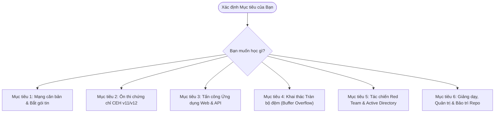

# CẨM NANG ĐIỀU PHỐI LỘ TRÌNH ĐỌC VÀ DUY TRÌ KIẾN THỨC
## MASTER READING COORDINATOR & NAVIGATION GUIDE
**Mã hiệu:** `SEC-GUIDE-COORDINATOR-2026`  
**Phiên bản:** `v3.1 - Production Standard (Pure Markdown & Lab Ecosystem)`  
**Đơn vị ban hành:** Ban Hội đồng Sư phạm & Đội ngũ Chuyên gia Tác chiến An toàn Thông tin (Red Team Operations)  
**Mục tiêu tối thượng:** Hướng dẫn chính xác người học và người bảo trì: **"Nên đọc tài liệu nào, thực hành bài lab nào, theo thứ tự nào, để phục vụ mục tiêu gì"**, đảm bảo không bỏ sót kiến thức, tiết kiệm thời gian và duy trì hệ thống lâu dài.

---

## I. NGUYÊN TẮC ĐIỀU PHỐI (CORE PRINCIPLES)

Kho tài liệu này được tinh giản và chuẩn hóa tối ưu: **toàn bộ 100% tài liệu được lưu trữ dưới định dạng Markdown (.md) thuần khiết**, loại bỏ hoàn toàn các file Word/PDF tự sinh dư thừa và tránh trùng lặp. Các tài liệu gốc chuyên sâu từ các tổ chức quốc tế (NIST, OWASP, SANS) được tải từ Internet và lưu trữ riêng biệt tại thư mục `docs/References/External_Downloads/`.

Để không bị "ngợp" hoặc đọc dàn trải thiếu hiệu quả, bạn cần xác định **Mục tiêu Hiện tại của Bạn là gì** và chọn đúng **Luồng Đọc (Reading Stream)** tương ứng:



---

## II. HƯỚNG DẪN ĐIỀU PHỐI CHI TIẾT THEO TỪNG MỤC TIÊU

### MỤC TIÊU 1: BẠN CẦN NẮM CHẮC NỀN TẢNG MẠNG & PHÂN TÍCH GÓI TIN
> Dành cho người mới bắt đầu hoặc người muốn lấp lỗ hổng kiến thức tầng gói tin trước khi học hack.

1. **Bước 1 (Tổng quan kiến trúc):**
   - Đọc: [study_guide.md](file:///mnt/second_drive/DOCS/SEC/01_Computer_Networking/Book_and_Slides/study_guide.md)
   - *Nội dung:* Nắm bức tranh toàn cảnh 5 tầng mạng, chức năng từng tầng.
2. **Bước 2 (Giải phẫu Tầng Giao vận & Bắt tay TCP):**
   - Đọc: [transport_layer.md](file:///mnt/second_drive/DOCS/SEC/01_Computer_Networking/Cheatsheets_and_Notes/transport_layer.md)
   - *Nội dung:* Bắt tay 3 bước SYN -> SYN-ACK -> ACK, các cờ TCP, kiểm soát luồng.
3. **Bước 3 (Tầng Mạng & Tầng Liên kết dữ liệu):**
   - Đọc: [network_layer.md](file:///mnt/second_drive/DOCS/SEC/01_Computer_Networking/Cheatsheets_and_Notes/network_layer.md) và [link_physical_layer.md](file:///mnt/second_drive/DOCS/SEC/01_Computer_Networking/Cheatsheets_and_Notes/link_physical_layer.md)
   - *Nội dung:* Định tuyến IP, ICMP, cơ chế phân giải địa chỉ ARP và lỗ hổng ARP Poisoning.
4. **Bước 4 (Thực hành Phân tích Gói tin Thực tế):**
   - Đọc giáo án: [Bài giảng N01 & N02](file:///mnt/second_drive/DOCS/SEC/docs/Lectures/02_Master_Lecture_and_Lab_Plan.md#bài-giảng-n01-giải-phẫu-mô-hình-5-tầng-tcpip--kỹ-thuật-bắt-gói-tin-wireshark)
   - Đọc tra cứu câu lệnh: [04_Network_Penetration_Testing_Cheatsheet.md](file:///mnt/second_drive/DOCS/SEC/docs/References/04_Network_Penetration_Testing_Cheatsheet.md)
   - Thực hành với Sniffer Container: Xem [Kịch bản 4 trong labs/README.md](file:///mnt/second_drive/DOCS/SEC/labs/README.md#kịch-bản-4-traffic-sniffing--phân-tích-gói-tin-bằng-tshark--wireshark)

---

### MỤC TIÊU 2: BẠN CẦN ÔN THI CHỨNG CHỈ CEH (CERTIFIED ETHICAL HACKER v12)
> Dành cho học viên cần nắm trọn vẹn 20 module lý thuyết và vượt qua các bài thi chứng chỉ EC-Council.

1. **Bước 1 (Lập kế hoạch):**
   - Đọc lộ trình tổng thể: [01_Master_Study_Roadmap.md](file:///mnt/second_drive/DOCS/SEC/docs/Roadmap/01_Master_Study_Roadmap.md)
2. **Bước 2 (Đọc Lý thuyết 20 Module):**
   - Đọc tuần tự các bài học trong [CEH-Notes](file:///mnt/second_drive/DOCS/SEC/CEH-Notes).
   - *Thứ tự ưu tiên cốt lõi:*
     - Khối Trinh sát & Dò quét: Module 02 (Footprinting) ➔ Module 03 (Scanning) ➔ Module 04 (Enumeration) ➔ Module 05 (Vulnerability Analysis).
     - Khối Tấn công Hệ điều hành: Module 06 (System Hacking) ➔ Module 07 (Malware) ➔ Module 08 (Sniffing) ➔ Module 11 (Session Hijacking).
     - Khối Ứng dụng & Mạng: Module 13 (Web Servers) ➔ Module 14 (Web Apps) ➔ Module 15 (SQLi) ➔ Module 16 (Wireless).
     - Khối Chuyên biệt: Module 17 (Mobile) ➔ Module 18 (IoT) ➔ Module 19 (Cloud) ➔ Module 20 (Cryptography).
3. **Bước 3 (Thực hành bài Lab tương ứng):**
   - Mở thư mục [03_Ethical_Hacking_Lab_Reports](file:///mnt/second_drive/DOCS/SEC/03_Ethical_Hacking_Lab_Reports) để xem báo cáo thực hành chi tiết bằng tiếng Việt.
   - Triển khai môi trường thực hành ảo: Chạy [labs/docker-compose.yml](file:///mnt/second_drive/DOCS/SEC/labs/docker-compose.yml) theo hướng dẫn tại [labs/README.md](file:///mnt/second_drive/DOCS/SEC/labs/README.md).
4. **Bước 4 (Thi thử trắc nghiệm Chuẩn Quốc tế):**
   - Đọc ngân hàng đề thi: [01_CEH_v12_Practice_Questions_Bank.md](file:///mnt/second_drive/DOCS/SEC/docs/Exams/01_CEH_v12_Practice_Questions_Bank.md) (125 câu hỏi chuẩn EC-Council có đáp án & giải thích chi tiết).
   - Làm bài thi thử tương tác bằng CLI:
     ```bash
     /usr/bin/python3.11 exam_simulator.py quiz --mode ceh --count 20
     ```

---

### MỤC TIÊU 3: BẠN MUỐN TRỞ THÀNH WEB & API PENETRATION TESTER (OWASP TOP 10)
> Dành cho người muốn chuyên sâu về kiểm thử bảo mật ứng dụng Web và API RESTful.

1. **Bước 1 (Lý thuyết nền tảng Web):**
   - Đọc: [Module 14 - Web Application Hacking.md](file:///mnt/second_drive/DOCS/SEC/CEH-Notes/Module%2014%20-%20Web%20Application%20Hacking.md)
   - Đọc: [Module 15 - SQL Injection.md](file:///mnt/second_drive/DOCS/SEC/CEH-Notes/Module%2015%20-%20SQL%20Injection.md)
2. **Bước 2 (Chuyên sâu Thực tế theo chuẩn Quốc tế):**
   - Đọc cẩm nang chuyên sâu: [03_OWASP_Top_10_and_API_Security_DeepDive.md](file:///mnt/second_drive/DOCS/SEC/docs/References/03_OWASP_Top_10_and_API_Security_DeepDive.md)
   - Đọc ma trận tiến hóa: [07_OWASP_Top_10_Evolution_Matrix.md](file:///mnt/second_drive/DOCS/SEC/docs/References/07_OWASP_Top_10_Evolution_Matrix.md)
   - Đọc tài liệu đối chiếu chính thức của OWASP: [OWASP_Web_Security_Testing_Guide_WSTG_v4.2.pdf](file:///mnt/second_drive/DOCS/SEC/docs/References/External_Downloads/OWASP_Web_Security_Testing_Guide_WSTG_v4.2.pdf) và [OWASP_API_Security_Top_10_Official.pdf](file:///mnt/second_drive/DOCS/SEC/docs/References/External_Downloads/OWASP_API_Security_Top_10_Official.pdf)
3. **Bước 3 (Thực hành Khai thác trên Phòng Lab):**
   - Đọc kịch bản thực hành tại [02_Master_Lecture_and_Lab_Plan.md#module-14-tấn-công-ứng-dụng-web-theo-chuẩn-owasp-top-10-web-app-hacking](file:///mnt/second_drive/DOCS/SEC/docs/Lectures/02_Master_Lecture_and_Lab_Plan.md).
   - Thực hành khai thác DVWA (Port 8080) và Vulnerable REST API (Port 5000): Xem [labs/README.md](file:///mnt/second_drive/DOCS/SEC/labs/README.md#kịch-bản-1-web-pentest-truyền-thống-trên-dvwa-port-8080).

---

### MỤC TIÊU 4: BẠN MUỐN NGHIÊN CỨU KHAI THÁC BỘ NHỚ (BUFFER OVERFLOW)
> Dành cho người muốn hiểu tận gốc cơ chế sập bộ nhớ và chuyển hướng luồng thực thi nhị phân.

1. **Bước 1 (Cơ chế Bộ nhớ & Đăng ký):**
   - Đọc lý thuyết về Stack, Heap, thanh ghi ESP, EBP, EIP trong [02_Master_Lecture_and_Lab_Plan.md#chuyên-đề-đặc-biệt-khai-thác-tràn-bộ-đệm-bộ-nhớ-nhị-phân-buffer-overflow](file:///mnt/second_drive/DOCS/SEC/docs/Lectures/02_Master_Lecture_and_Lab_Plan.md).
2. **Bước 2 (Hướng dẫn Thực hành Từng bước):**
   - Đọc: [Buffer Instructions.md](file:///mnt/second_drive/DOCS/SEC/CEH-Notes/Module-6-Buffer-Overflow/Buffer%20Instructions.md)
3. **Bước 3 (Phân tích Mã nguồn Khai thác Thực tế):**
   - Đọc và chạy thử script:
     - Script Fuzzing: [fuzzing.py](file:///mnt/second_drive/DOCS/SEC/CEH-Notes/Module-6-Buffer-Overflow/fuzzing.py)
     - Script Tìm Offset: [offset.py](file:///mnt/second_drive/DOCS/SEC/CEH-Notes/Module-6-Buffer-Overflow/offset.py)
     - Script Khai thác Shellcode: [shellcode.py](file:///mnt/second_drive/DOCS/SEC/CEH-Notes/Module-6-Buffer-Overflow/shellcode.py)

---

### MỤC TIÊU 5: BẠN MUỐN TRỞ THÀNH RED TEAM OPERATOR (ACTIVE DIRECTORY & EDR EVASION)
> Đỉnh cao tác chiến: Mô phỏng đối thủ thực tế trong môi trường mạng doanh nghiệp lớn.

1. **Bước 1 (Hiểu Khung Chiến thuật Toàn cầu):**
   - Đọc cẩm nang 14 chiến thuật: [01_MITRE_ATTCK_Enterprise_Matrix_Guide.md](file:///mnt/second_drive/DOCS/SEC/docs/References/01_MITRE_ATTCK_Enterprise_Matrix_Guide.md)
2. **Bước 2 (Làm chủ Tấn công Hạ tầng Active Directory):**
   - Đọc playbook chiến thuật: [02_Active_Directory_Attack_and_Defense_Playbook.md](file:///mnt/second_drive/DOCS/SEC/docs/References/02_Active_Directory_Attack_and_Defense_Playbook.md)
   - *Thứ tự thực hành:* Lập bản đồ bằng `BloodHound` ➔ Kerberoasting bằng `GetUserSPNs.py` ➔ Di chuyển ngang bằng `Pass-the-Hash` ➔ Dump toàn bộ DC bằng `DCSync` (`secretsdump.py`) ➔ Cắm vé tối cao `Golden Ticket`.
3. **Bước 3 (Vượt mặt EDR & Kỹ thuật Living Off The Land):**
   - Đọc cẩm nang Evasion: [05_EDR_Evasion_and_Living_Off_The_Land_LOLBAS.md](file:///mnt/second_drive/DOCS/SEC/docs/References/05_EDR_Evasion_and_Living_Off_The_Land_LOLBAS.md)
   - *Nội dung:* Vượt qua AMSI, vô hiệu hóa ETW log, Direct Syscalls (Hell's Gate), và danh sách câu lệnh LOLBAS (`certutil`, `bitsadmin`, `mshta`).
4. **Bước 4 (Đường hầm Pivot Mạng Nội bộ):**
   - Đọc cẩm nang Pivot: [04_Network_Penetration_Testing_Cheatsheet.md](file:///mnt/second_drive/DOCS/SEC/docs/References/04_Network_Penetration_Testing_Cheatsheet.md)
   - Xem tài liệu tham khảo: [SANS_PenTest_Pivots_and_Payloads.pdf](file:///mnt/second_drive/DOCS/SEC/docs/References/External_Downloads/SANS_PenTest_Pivots_and_Payloads.pdf)
5. **Bước 5 (Luyện 50 Kịch bản Phỏng vấn Red Team):**
   - Đọc tài liệu: [02_Red_Team_Scenario_Interview_Questions.md](file:///mnt/second_drive/DOCS/SEC/docs/Exams/02_Red_Team_Scenario_Interview_Questions.md)
   - Chạy mô phỏng phỏng vấn bằng CLI:
     ```bash
     /usr/bin/python3.11 exam_simulator.py scenario --count 5
     ```

---

### MỤC TIÊU 6: BẠN LÀ GIẢNG VIÊN / QUẢN TRỊ VIÊN CẦN BẢO TRÌ & MỞ RỘNG REPO
> Dành cho người duy trì, cập nhật tài liệu hoặc kiểm định chất lượng định kỳ.

1. **Tra cứu Móc nối Tri thức:**
   - Mở bảng ma trận tổng thể: [03_Knowledge_Linkage_and_Cross_Reference_Matrix.md](file:///mnt/second_drive/DOCS/SEC/docs/Matrix/03_Knowledge_Linkage_and_Cross_Reference_Matrix.md)
2. **Tra cứu nhanh bằng Công cụ Điều hướng Tự động:**
   - Chạy lệnh tìm kiếm tức thì:
     ```bash
     /usr/bin/python3.11 sec_navigator.py search "Active Directory"
     /usr/bin/python3.11 sec_navigator.py stream 5
     /usr/bin/python3.11 sec_navigator.py stats
     ```
3. **Kiểm thử Toàn vẹn Hệ thống Tự động (Automated Test Suite):**
   - Chạy kiểm thử pytest:
     ```bash
     /usr/bin/python3.11 -m pytest -v tests/test_sec_curriculum_integrity.py
     ```

---

## III. BẢNG TRA CỨU "MỘT CHẠM": TÔI MUỐN LÀM X ➔ ĐỌC TÀI LIỆU Y

| Khi bạn cần thực hiện tác vụ | Tài liệu chỉ dẫn trực tiếp | Định dạng & Trọng tâm |
|---|---|---|
| **Lên kế hoạch học tập 24 tuần** | [01_Master_Study_Roadmap.md](file:///mnt/second_drive/DOCS/SEC/docs/Roadmap/01_Master_Study_Roadmap.md) | Kế hoạch 24 tuần Markdown |
| **Soạn bài giảng / Flashcards** | [02_Master_Lecture_and_Lab_Plan.md](file:///mnt/second_drive/DOCS/SEC/docs/Lectures/02_Master_Lecture_and_Lab_Plan.md) | 24 bài giảng sư phạm Markdown |
| **Tra cứu câu lệnh Nmap / Wireshark** | [04_Network_Penetration_Testing_Cheatsheet.md](file:///mnt/second_drive/DOCS/SEC/docs/References/04_Network_Penetration_Testing_Cheatsheet.md) | Cheatsheet tác chiến mạng Markdown |
| **Tấn công Active Directory (Kerberoasting, DCSync)** | [02_Active_Directory_Attack_and_Defense_Playbook.md](file:///mnt/second_drive/DOCS/SEC/docs/References/02_Active_Directory_Attack_and_Defense_Playbook.md) | Playbook AD chuyên sâu Markdown |
| **Kiểm thử Web theo OWASP Top 10** | [03_OWASP_Top_10_and_API_Security_DeepDive.md](file:///mnt/second_drive/DOCS/SEC/docs/References/03_OWASP_Top_10_and_API_Security_DeepDive.md) | Cẩm nang Web/API Pentest Markdown |
| **Vượt qua Windows Defender, AMSI, EDR** | [05_EDR_Evasion_and_Living_Off_The_Land_LOLBAS.md](file:///mnt/second_drive/DOCS/SEC/docs/References/05_EDR_Evasion_and_Living_Off_The_Land_LOLBAS.md) | Playbook EDR Evasion Markdown |
| **Ánh xạ chiến thuật theo MITRE ATT&CK** | [01_MITRE_ATTCK_Enterprise_Matrix_Guide.md](file:///mnt/second_drive/DOCS/SEC/docs/References/01_MITRE_ATTCK_Enterprise_Matrix_Guide.md) | Khung MITRE 14 chiến thuật Markdown |
| **Luyện tập khai thác Buffer Overflow** | [Buffer Instructions.md](file:///mnt/second_drive/DOCS/SEC/CEH-Notes/Module-6-Buffer-Overflow/Buffer%20Instructions.md) | Hướng dẫn BoF từng bước Markdown |
| **Xem báo cáo thực hành bài Lab CEH tiếng Việt** | [03_Ethical_Hacking_Lab_Reports](file:///mnt/second_drive/DOCS/SEC/03_Ethical_Hacking_Lab_Reports) | 11 báo cáo chi tiết Markdown |
| **Dựng phòng Lab Docker thực hành** | [labs/README.md](file:///mnt/second_drive/DOCS/SEC/labs/README.md) & [labs/docker-compose.yml](file:///mnt/second_drive/DOCS/SEC/labs/docker-compose.yml) | Hạ tầng Lab Docker 5 container |
| **Ôn thi 125 câu trắc nghiệm CEH v12** | [01_CEH_v12_Practice_Questions_Bank.md](file:///mnt/second_drive/DOCS/SEC/docs/Exams/01_CEH_v12_Practice_Questions_Bank.md) | Đề thi 125 câu chuẩn EC-Council |
| **Luyện 50 kịch bản phỏng vấn Red Team** | [02_Red_Team_Scenario_Interview_Questions.md](file:///mnt/second_drive/DOCS/SEC/docs/Exams/02_Red_Team_Scenario_Interview_Questions.md) | 50 kịch bản thực chiến OffSec |
| **Thi thử trắc nghiệm tương tác bằng CLI** | [exam_simulator.py](file:///mnt/second_drive/DOCS/SEC/exam_simulator.py) | Trình giả lập đề thi CLI Python |
| **Đọc tài liệu chuẩn của Viện NIST Hoa Kỳ** | [06_NIST_SP_800-115_Technical_Guide.md](file:///mnt/second_drive/DOCS/SEC/docs/References/06_NIST_SP_800-115_Technical_Guide.md) | Chuẩn NIST SP 800-115 tiếng Việt Markdown |
| **Mẫu báo cáo VAPT doanh nghiệp chuẩn NIST** | [01_Enterprise_VAPT_Report_Template_vi.md](file:///mnt/second_drive/DOCS/SEC/docs/Reports/01_Enterprise_VAPT_Report_Template_vi.md) | Báo cáo kiểm thử xâm nhập thực tế |
| **Báo cáo tổng kết diễn tập Red Team** | [02_Red_Team_Operation_Debrief_Sample_vi.md](file:///mnt/second_drive/DOCS/SEC/docs/Reports/02_Red_Team_Operation_Debrief_Sample_vi.md) | Báo cáo diễn biến & Blue Team debrief |
| **100 Câu lệnh tác chiến Red Team One-Liners** | [01_Red_Team_One_Liners_Cheatsheet.md](file:///mnt/second_drive/DOCS/SEC/docs/Cheatsheets/01_Red_Team_One_Liners_Cheatsheet.md) | Cheatsheet câu lệnh thực chiến |
| **Bảng mã Event ID & KQL phát hiện tấn công** | [02_Blue_Team_Detection_and_Event_IDs.md](file:///mnt/second_drive/DOCS/SEC/docs/Cheatsheets/02_Blue_Team_Detection_and_Event_IDs.md) | Cẩm nang giám sát SOC / Blue Team |
| **Bộ công cụ Arsenal Scripts thực hành** | [scripts/arsenal/README.md](file:///mnt/second_drive/DOCS/SEC/scripts/arsenal/README.md) | JWT Tool, Reverse Shell, AD Analyzer, BoF Fuzzer |
| **Ứng cứu sự cố Ransomware chuẩn NIST** | [01_Incident_Response_Playbook_Ransomware.md](file:///mnt/second_drive/DOCS/SEC/docs/Playbooks/01_Incident_Response_Playbook_Ransomware.md) | Quy trình IR 6 bước & Cô lập khẩn cấp |
| **Săn lùng mối nguy hiểm Active Directory** | [02_Threat_Hunting_Playbook_Active_Directory.md](file:///mnt/second_drive/DOCS/SEC/docs/Playbooks/02_Threat_Hunting_Playbook_Active_Directory.md) | 6 Chiến dịch săn lùng KQL & DCSync |
| **Bộ thử thách CTF Lab kèm Walkthrough** | [01_Hands_On_Lab_Flags_and_Walkthroughs.md](file:///mnt/second_drive/DOCS/SEC/labs/challenges/01_Hands_On_Lab_Flags_and_Walkthroughs.md) | 5 Thử thách cờ SQLi, BOLA, SSRF, Shell |

---

## IV. THƯ VIỆN TÀI LIỆU THỰC TẾ TẢI TỪ INTERNET (AUTHENTIC EXTERNAL DOWNLOADS)

Để phục vụ nhu cầu đọc các tài liệu gốc chuyên sâu từ các tổ chức an toàn thông tin quốc tế (NIST, OWASP Foundation, SANS Institute, Rapid7), hệ thống đã tải về và lưu trữ **19 tài liệu thực tế (hơn 40 MB)** tại [Thư mục External_Downloads](file:///mnt/second_drive/DOCS/SEC/docs/References/External_Downloads/README.md):

| Tên Tài Liệu Gốc | Định Dạng | Kích Thước | Chuyên Đề & Mục Đích Sử Dụng |
|---|:---:|:---:|---|
| [NIST_SP_800-115_Technical_Guide_Official.pdf](file:///mnt/second_drive/DOCS/SEC/docs/References/External_Downloads/NIST_SP_800-115_Technical_Guide_Official.pdf) | **PDF** | 532 KB | Bản gốc 80 trang tiêu chuẩn kỹ thuật kiểm thử an toàn thông tin của Viện NIST Hoa Kỳ |
| [Enterprise_VAPT_Report_NIST_SP800-115_Sample.docx](file:///mnt/second_drive/DOCS/SEC/docs/References/External_Downloads/Enterprise_VAPT_Report_NIST_SP800-115_Sample.docx) | **DOCX** | **4.2 MB** | Mẫu báo cáo VAPT thực chiến doanh nghiệp đầy đủ theo chuẩn NIST SP 800-115 |
| [Enterprise_VAPT_Report_NIST_SP800-115_Sample.pdf](file:///mnt/second_drive/DOCS/SEC/docs/References/External_Downloads/Enterprise_VAPT_Report_NIST_SP800-115_Sample.pdf) | **PDF** | **2.8 MB** | Bản in PDF của mẫu báo cáo kiểm thử thâm nhập doanh nghiệp thực tế |
| [SANS_PenTest_Rules_of_Engagement_Worksheet.pdf](file:///mnt/second_drive/DOCS/SEC/docs/References/External_Downloads/SANS_PenTest_Rules_of_Engagement_Worksheet.pdf) | **PDF** | 27 KB | Biểu mẫu xác lập Quy tắc Giao chiến (RoE) chuẩn SANS Institute |
| [SANS_Ultimate_Pen_Test_Poster.pdf](file:///mnt/second_drive/DOCS/SEC/docs/References/External_Downloads/SANS_Ultimate_Pen_Test_Poster.pdf) | **PDF** | **2.6 MB** | Poster phương pháp luận và quy trình kiểm thử xâm nhập toàn diện của SANS |
| [OWASP_Web_Security_Testing_Guide_WSTG_v4.2.pdf](file:///mnt/second_drive/DOCS/SEC/docs/References/External_Downloads/OWASP_Web_Security_Testing_Guide_WSTG_v4.2.pdf) | **PDF** | **9.8 MB** | Cẩm nang Web Security Testing Guide v4.2 chính thức từ OWASP (Hơn 500 trang) |
| [OWASP_API_Security_Top_10_Official.pdf](file:///mnt/second_drive/DOCS/SEC/docs/References/External_Downloads/OWASP_API_Security_Top_10_Official.pdf) | **PDF** | **3.2 MB** | Ấn bản chính thức của tổ chức OWASP về 10 rủi ro bảo mật API phổ biến |
| [OWASP_Top_Ten_Historical_Comparison_2003_to_2021.pdf](file:///mnt/second_drive/DOCS/SEC/docs/References/External_Downloads/OWASP_Top_Ten_Historical_Comparison_2003_to_2021.pdf) | **PDF** | 112 KB | Bảng đối chiếu tiến hóa danh mục OWASP Top 10 qua 7 thế hệ phát hành |
| [SANS_Burp_Suite_Web_Pentest_CheatSheet.pdf](file:///mnt/second_drive/DOCS/SEC/docs/References/External_Downloads/SANS_Burp_Suite_Web_Pentest_CheatSheet.pdf) | **PDF** | 282 KB | Bảng tra cứu phím tắt và tính năng tấn công Web bằng Burp Suite Pro |
| [SQLMap_Injection_CheatSheet_v1.0.pdf](file:///mnt/second_drive/DOCS/SEC/docs/References/External_Downloads/SQLMap_Injection_CheatSheet_v1.0.pdf) | **PDF** | 317 KB | Cẩm nang câu lệnh tham số nâng cao tấn công CSDL bằng SQLMap |
| [SANS_BloodHound_Active_Directory_CheatSheet.pdf](file:///mnt/second_drive/DOCS/SEC/docs/References/External_Downloads/SANS_BloodHound_Active_Directory_CheatSheet.pdf) | **PDF** | 411 KB | Bảng tra cứu Cypher query vẽ đường leo thang đặc quyền Active Directory |
| [SANS_PenTest_Pivots_and_Payloads.pdf](file:///mnt/second_drive/DOCS/SEC/docs/References/External_Downloads/SANS_PenTest_Pivots_and_Payloads.pdf) | **PDF** | **9.4 MB** | Poster kỹ thuật định tuyến ngầm Pivoting, Port Forwarding & Lateral Movement |
| [SANS_PowerShell_PenTest_CheatSheet_v41.pdf](file:///mnt/second_drive/DOCS/SEC/docs/References/External_Downloads/SANS_PowerShell_PenTest_CheatSheet_v41.pdf) | **PDF** | 151 KB | Bảng tra cứu lệnh PowerShell tấn công Active Directory từ khóa SANS SEC560 |
| [Metasploit_Framework_CheatSheet.pdf](file:///mnt/second_drive/DOCS/SEC/docs/References/External_Downloads/Metasploit_Framework_CheatSheet.pdf) | **PDF** | 101 KB | Cẩm nang câu lệnh khai thác thực chiến với Metasploit Framework |
| [SANS_TCPIP_Packet_CheatSheet_2021.pdf](file:///mnt/second_drive/DOCS/SEC/docs/References/External_Downloads/SANS_TCPIP_Packet_CheatSheet_2021.pdf) | **PDF** | 692 KB | Sơ đồ cấu trúc Header gói tin TCP, UDP, IP, ICMP, ARP chuẩn SANS |
| [Wireshark_Display_Filters_CheatSheet.pdf](file:///mnt/second_drive/DOCS/SEC/docs/References/External_Downloads/Wireshark_Display_Filters_CheatSheet.pdf) | **PDF** | 38 KB | Bảng tra cứu bộ lọc hiển thị Wireshark để điều tra phân tích gói tin |
| [SANS_Malware_Analysis_and_Reverse_Engineering.pdf](file:///mnt/second_drive/DOCS/SEC/docs/References/External_Downloads/SANS_Malware_Analysis_and_Reverse_Engineering.pdf) | **PDF** | 191 KB | Cẩm nang phân tích dịch ngược mã độc, PE Header và Assembly |
| [SANS_Cloud_Security_AWS_Azure_GCP.pdf](file:///mnt/second_drive/DOCS/SEC/docs/References/External_Downloads/SANS_Cloud_Security_AWS_Azure_GCP.pdf) | **PDF** | **5.6 MB** | Poster cấu hình và kiểm thử an toàn hạ tầng đám mây AWS, Azure, GCP |
| [OpenVAS_Vulnerability_Scan_Report_Sample.pdf](file:///mnt/second_drive/DOCS/SEC/docs/References/External_Downloads/OpenVAS_Vulnerability_Scan_Report_Sample.pdf) | **PDF** | 342 KB | Mẫu kết quả quét lỗ hổng mạng thực tế từ OpenVAS Scanner |

---
*Cẩm nang này là kim chỉ nam điều phối tri thức cho toàn bộ kho tài liệu. Hãy lưu lại và mở file này đầu tiên mỗi khi bạn bắt đầu một buổi nghiên cứu, thực hành phòng lab hoặc bảo trì hệ thống!*
