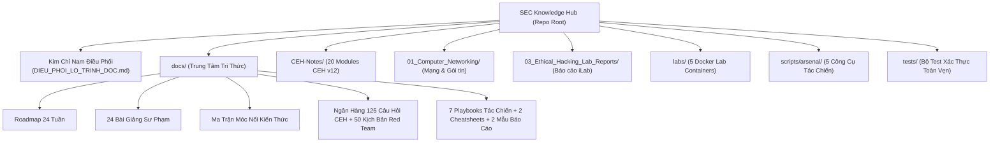

# CEH v12, Red Team Operations & Cybersecurity Engineering Ecosystem

<p align="center">
  
  
  
  
  
  
  
</p>

---

## 📖 Tổng Quan Dự Án (Executive Summary)

**Hệ sinh thái Tri thức & Tác chiến An toàn Thông tin Toàn diện** được thiết kế bài bản theo tiêu chuẩn quốc tế (EC-Council CEH v12, NIST SP 800-115, MITRE ATT&CK Enterprise, OWASP Top 10 Web/API). Toàn bộ kho tài liệu được biên soạn và bảo toàn theo chuẩn **100% Pure Markdown (`.md`) thuần khiết**, loại bỏ hoàn toàn các file Word/PDF tự sinh trùng lặp, tích hợp sẵn phòng thực hành Docker, bộ công cụ CLI Arsenal tự phát triển, hệ thống thi thử trắc nghiệm và cẩm nang diễn tập thực chiến.



---

## 🧭 Điều Phối Lộ Trình Học & Nghiên Cứu

Trước khi đi sâu vào từng tài liệu cụ thể, hãy bắt đầu từ tài liệu điều phối trung tâm:
- 📑 **Tài liệu Điều Phối Toàn Hệ Thống:** [DIEU_PHOI_LO_TRINH_DOC.md](file:///mnt/second_drive/DOCS/SEC/DIEU_PHOI_LO_TRINH_DOC.md)
- 🗺️ **Lộ trình Đào tạo 24 Tuần Chi Tiết:** [docs/Roadmap/01_Master_Study_Roadmap.md](file:///mnt/second_drive/DOCS/SEC/docs/Roadmap/01_Master_Study_Roadmap.md)
- 🎓 **24 Bài Giảng Sư Phạm & Lệnh Thực Hành:** [docs/Lectures/02_Master_Lecture_and_Lab_Plan.md](file:///mnt/second_drive/DOCS/SEC/docs/Lectures/02_Master_Lecture_and_Lab_Plan.md)
- 🔗 **Ma Trận Đối Chiếu Đa Chiều:** [docs/Matrix/03_Knowledge_Linkage_and_Cross_Reference_Matrix.md](file:///mnt/second_drive/DOCS/SEC/docs/Matrix/03_Knowledge_Linkage_and_Cross_Reference_Matrix.md)
- 📚 **Tổng quan Danh mục Tri thức Hub:** [docs/README.md](file:///mnt/second_drive/DOCS/SEC/docs/README.md)

### 6 Luồng Đọc Định Hướng (Core Learning Tracks)
1. **Luồng 1 - Nền tảng Mạng & Phân tích Gói tin:** [`01_Computer_Networking/`](file:///mnt/second_drive/DOCS/SEC/01_Computer_Networking)
2. **Luồng 2 - Luyện thi Chứng chỉ Quốc tế CEH v11/v12:** [`CEH-Notes/`](file:///mnt/second_drive/DOCS/SEC/CEH-Notes) & [`docs/Exams/01_CEH_v12_Practice_Questions_Bank.md`](file:///mnt/second_drive/DOCS/SEC/docs/Exams/01_CEH_v12_Practice_Questions_Bank.md)
3. **Luồng 3 - Tấn công Ứng dụng Web & API Hiện đại:** [`docs/References/03_OWASP_Top_10_and_API_Security_DeepDive.md`](file:///mnt/second_drive/DOCS/SEC/docs/References/03_OWASP_Top_10_and_API_Security_DeepDive.md) & [`labs/`](file:///mnt/second_drive/DOCS/SEC/labs)
4. **Luồng 4 - Kỹ thuật Tràn bộ đệm & Khai thác Nhị phân:** [`CEH-Notes/Module-6-Buffer-Overflow/`](file:///mnt/second_drive/DOCS/SEC/CEH-Notes/Module-6-Buffer-Overflow) & [`scripts/arsenal/buffer_overflow_fuzzer.py`](file:///mnt/second_drive/DOCS/SEC/scripts/arsenal/buffer_overflow_fuzzer.py)
5. **Luồng 5 - Tác chiến Red Team Doanh nghiệp & Active Directory:** [`docs/References/02_Active_Directory_Attack_and_Defense_Playbook.md`](file:///mnt/second_drive/DOCS/SEC/docs/References/02_Active_Directory_Attack_and_Defense_Playbook.md) & [`docs/Exams/02_Red_Team_Scenario_Interview_Questions.md`](file:///mnt/second_drive/DOCS/SEC/docs/Exams/02_Red_Team_Scenario_Interview_Questions.md)
6. **Luồng 6 - Dành cho Giảng viên & Quản trị viên Repo:** [`docs/README.md`](file:///mnt/second_drive/DOCS/SEC/docs/README.md)

---

## ⚡ Hướng Dẫn Nhanh (Quick Start)

### 1. Khởi động Phòng Lab Thực hành Docker (Hands-on Labs)
Môi trường lab gồm 5 container cô lập trên dải mạng riêng `172.28.0.0/16`:
```bash
# Khởi động toàn bộ 5 container và kiểm tra tính toàn vẹn
./labs/start_labs.sh

# Khi hoàn thành thực hành, tắt lab an toàn
./labs/stop_labs.sh
```

| Mục Tiêu Lab | Cổng Truy Cập | Địa Chỉ IP Subnet | Mô Tả Trọng Tâm |
| :--- | :--- | :--- | :--- |
| **DVWA** | `http://localhost:8080` | `172.28.0.10` | SQLi, XSS, CSRF, Command Injection, File Upload |
| **OWASP Juice Shop** | `http://localhost:3000` | `172.28.0.20` | NoSQLi, Broken Authentication, JWT, SSRF |
| **Custom Vulnerable REST API** | `http://localhost:5000` | `172.28.0.30` | OWASP API Top 10 (BOLA/IDOR, Mass Assignment, BFLA) |
| **Metasploitable Linux Target** | `2121(FTP), 2222(SSH), 8088(HTTP)` | `172.28.0.40` | Khai thác dịch vụ mạng cũ, leo thang đặc quyền Linux |
| **Netshoot Sniffer Pod** | `sec_lab_sniffer` | `172.28.0.50` | Bắt gói tin pcap, nmap, tshark trực tiếp trong mạng nội bộ |

> Xem chi tiết 5 bài hướng dẫn giải CTF có cờ tại [`labs/challenges/01_Hands_On_Lab_Flags_and_Walkthroughs.md`](file:///mnt/second_drive/DOCS/SEC/labs/challenges/01_Hands_On_Lab_Flags_and_Walkthroughs.md).

---

### 2. Luyện Thi Trắc Nghiệm & Phỏng Vấn CLI (Exam Simulator)
Động cơ Python 3.11 thuần (Zero-Dependency) hỗ trợ luyện đề CEH v12 và phỏng vấn tình huống:
```bash
# 1. Thi thử trắc nghiệm ngẫu nhiên 20 câu CEH v12
python3 exam_simulator.py quiz --mode ceh --count 20

# 2. Luyện phỏng vấn kịch bản Red Team (5 tình huống bất kỳ)
python3 exam_simulator.py scenario --count 5

# 3. Xem bảng thống kê ngân hàng đề
python3 exam_simulator.py stats
```

---

### 3. Tra Cứu Tri Thức Nhanh (Inverted Index Search CLI)
Tìm kiếm toàn văn trên 92+ tài liệu Markdown bằng thuật toán TF-IDF tự tạo:
```bash
# Tìm kiếm kỹ thuật Kerberoasting
python3 sec_navigator.py search "Kerberoasting"

# Tìm kiếm kỹ thuật EDR Evasion & AMSI Bypass
python3 sec_navigator.py search "AMSI Bypass"

# Xem danh mục cấu trúc repository
python3 sec_navigator.py tree
```

---

### 4. Kho Vũ Khí Kỹ Thuật Tác Chiến (Red Team Arsenal)
Thư mục [`scripts/arsenal/`](file:///mnt/second_drive/DOCS/SEC/scripts/arsenal) chứa 5 công cụ Python 3.11 thực chiến:
```bash
# 1. Kiểm tra và khai thác JWT (none-algorithm, HMAC secret cracking)
python3 scripts/arsenal/jwt_tool_lite.py decode <TOKEN>
python3 scripts/arsenal/jwt_tool_lite.py exploit-none <TOKEN>

# 2. Sinh payload Reverse Shell đa nền tảng (Bash, PowerShell, Python, Socat)
python3 scripts/arsenal/reverse_shell_generator.py --ip 10.10.14.5 --port 4444 --type bash-base64

# 3. Phân tích đồ thị ACL Active Directory (BloodHound JSON analyzer)
python3 scripts/arsenal/ad_bloodhound_analyzer.py --users users.json --acls acls.json

# 4. Trinh sát subdomain thụ động qua Certificate Transparency Logs (crt.sh)
python3 scripts/arsenal/subdomain_recon_lite.py --domain target.com

# 5. Fuzzer và tính toán offset cho khai thác Tràn bộ đệm (BOF)
python3 scripts/arsenal/buffer_overflow_fuzzer.py pattern-create 1000
python3 scripts/arsenal/buffer_overflow_fuzzer.py pattern-offset 0x39694438
```

---

### 5. Bộ Test Kiểm Tra Tính Toàn Vẹn Hệ Thống (Pytest Suite)
```bash
# Cài đặt thư viện kiểm thử (nếu chưa có)
pip install -r requirements.txt

# Chạy toàn bộ 13 bài test toàn vẹn
/usr/bin/python3.11 -m pytest -v tests/test_sec_curriculum_integrity.py
```

---

## 📂 Danh Mục Cấu Trúc Hệ Thống (Repository Structure)

```text
/mnt/second_drive/DOCS/SEC/
├── DIEU_PHOI_LO_TRINH_DOC.md           # Kim chỉ nam điều phối đọc theo 6 mục tiêu
├── README.md                           # Trang chủ dự án (Executive Readme)
├── requirements.txt                    # Thư viện phụ thuộc cho CI/CD và kiểm thử
├── exam_simulator.py                   # Động cơ CLI luyện thi CEH v12 & Phỏng vấn
├── sec_navigator.py                    # Động cơ CLI tra cứu tri thức toàn văn TF-IDF
│
├── .github/workflows/
│   └── ci.yml                          # GitHub Actions CI pipeline tự động kiểm thử
│
├── 01_Computer_Networking/             # Nền tảng Mạng máy tính & Phân tích Gói tin
│   ├── 01_OSI_Model.md                 # 7 tầng OSI & Nguyên lý đóng gói
│   ├── 02_TCPIP_Protocols.md           # Giao thức TCP/IP, 3-Way Handshake
│   ├── 04_Routing_Switching.md         # Bảng định tuyến, VLAN, ARP Spoofing
│   └── 07_DNS_DHCP_Security.md         # DNS Tunneling, Rogue DHCP
│
├── CEH-Notes/                          # Trọn bộ 20 Module chuẩn EC-Council CEH v12
│   ├── Module 01 - Introduction to Ethical Hacking.md
│   ├── Module 02 - Footprinting and Reconnaissance.md
│   ├── Module 03 - Scanning Networks.md
│   ├── Module 04 - Enumeration.md
│   ├── Module 05 - Vulnerability Analysis.md
│   ├── Module 06 - System Hacking.md
│   ├── Module 07 - Malware Threats.md
│   ├── Module 08 - Sniffing.md
│   ├── Module 09 - Social Engineering.md
│   ├── Module 10 - Denial-of-Service.md
│   ├── Module 11 - Session Hijacking.md
│   ├── Module 12 - Evading IDS, Firewalls, and Honeypots.md
│   ├── Module 13 - Hacking Web Servers.md
│   ├── Module 14 - Web Application Hacking.md
│   ├── Module 15 - SQL Injection.md
│   ├── Module 16 - Hacking Wireless Networks.md
│   ├── Module 17 - Hacking Mobile Platforms.md
│   ├── Module 18 - IoT and OT Hacking.md
│   ├── Module 19 - Cloud Computing.md
│   ├── Module 20 - Cryptography.md
│   └── Module-6-Buffer-Overflow/       # Tràn bộ đệm x86, Fuzzing & Shellcoding
│
├── 03_Ethical_Hacking_Lab_Reports/     # Báo cáo thực hành chi tiết theo Module CEH
│   ├── Module_01_Introduction_to_Ethical_Hacking_Lab_Report.md
│   ├── Module_02_Footprinting_and_Reconnaissance_Lab_Report.md
│   └── Module_03_Scanning_Networks_Lab_Report.md ... (11 files)
│
├── docs/                               # Trung tâm tài liệu nâng cao & Sư phạm
│   ├── README.md                       # Danh mục tổng quan thư viện tri thức
│   ├── Roadmap/
│   │   └── 01_Master_Study_Roadmap.md  # Lộ trình học 24 tuần phân tầng
│   ├── Lectures/
│   │   └── 02_Master_Lecture_and_Lab_Plan.md # 24 giáo án sư phạm bài bản
│   ├── Matrix/
│   │   └── 03_Knowledge_Linkage_and_Cross_Reference_Matrix.md # Ma trận đối chiếu
│   ├── References/                     # 7 Sổ tay tác chiến chuyên sâu
│   │   ├── 01_MITRE_ATTCK_Enterprise_Matrix_Guide.md
│   │   ├── 02_Active_Directory_Attack_and_Defense_Playbook.md
│   │   ├── 03_OWASP_Top_10_and_API_Security_DeepDive.md
│   │   ├── 04_Network_Penetration_Testing_Cheatsheet.md
│   │   ├── 05_EDR_Evasion_and_Living_Off_The_Land_LOLBAS.md
│   │   ├── 06_NIST_SP_800-115_Technical_Guide.md
│   │   ├── 07_OWASP_Top_10_Evolution_Matrix.md
│   │   └── External_Downloads/         # 19 tài liệu chính hãng NIST, OWASP, SANS
│   ├── Exams/
│   │   ├── 01_CEH_v12_Practice_Questions_Bank.md # 125 câu trắc nghiệm có đáp án
│   │   └── 02_Red_Team_Scenario_Interview_Questions.md # 50 kịch bản phỏng vấn
│   ├── Reports/                        # Mẫu báo cáo chuyên nghiệp
│   │   ├── 01_Enterprise_VAPT_Report_Template_vi.md # Báo cáo VAPT chuẩn NIST SP 800-115
│   │   └── 02_Red_Team_Operation_Debrief_Sample_vi.md # Báo cáo tổng kết diễn tập Red Team
│   ├── Cheatsheets/
│   │   ├── 01_Red_Team_One_Liners_Cheatsheet.md # 100 câu lệnh tấn công một dòng
│   │   └── 02_Blue_Team_Detection_and_Event_IDs.md # Event ID & KQL Detection Rules
│   └── Playbooks/
│       ├── 01_Incident_Response_Playbook_Ransomware.md # Ứng cứu sự cố Ransomware
│       └── 02_Threat_Hunting_Playbook_Active_Directory.md # Săn lùng mối nguy AD
│
├── labs/                               # Môi trường thực hành Docker Compose
│   ├── docker-compose.yml              # Cấu hình 5 container lab
│   ├── README.md                       # Hướng dẫn bài tập và sơ đồ mạng
│   ├── start_labs.sh                   # Script khởi động 1-click
│   ├── stop_labs.sh                    # Script dọn dẹp lab an toàn
│   ├── challenges/                     # 5 bài tập CTF có cờ và lời giải
│   ├── scripts/                        # Script xác thực cấu hình lab
│   └── vulnerable-api/                 # Mã nguồn Flask API mục tiêu OWASP Top 10
│
├── scripts/arsenal/                    # 5 công cụ Python 3.11 tác chiến
│   ├── jwt_tool_lite.py
│   ├── reverse_shell_generator.py
│   ├── ad_bloodhound_analyzer.py
│   ├── subdomain_recon_lite.py
│   ├── buffer_overflow_fuzzer.py
│   └── README.md
│
└── tests/                              # Bộ kiểm thử tự động
    └── test_sec_curriculum_integrity.py # 13 bài test kiểm tra toàn vẹn
```

---

## ⚖️ Quy Tắc Đạo Đức & Miễn Trừ Trách Nhiệm (Legal & Ethical Disclaimer)

Tài liệu, mã nguồn và kịch bản tấn công trong kho lưu trữ này được xây dựng **chỉ phục vụ mục đích giáo dục, nghiên cứu an toàn thông tin phòng thủ và phục vụ các đợt kiểm thử xâm nhập đã được phê duyệt bằng văn bản pháp lý hợp lệ** (Rules of Engagement - RoE). Tác giả và ban biên soạn không chịu bất kỳ trách nhiệm pháp lý nào đối với các hành vi sử dụng trái phép, gây thiệt hại hoặc vi phạm pháp luật hiện hành.

---

## 📜 Giấy Phép Sử Dụng (License)

Dự án này được phát hành theo giấy phép **[MIT License](LICENSE)**. Mọi cá nhân, tổ chức có thể tự do tham khảo, học tập và phát triển tiếp nối cho cộng đồng An toàn Thông tin Việt Nam.
