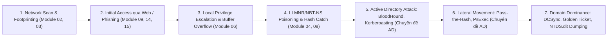

# MA TRẬN MÓC NỐI KIẾN THỨC VÀ BẢN ĐỒ THAM CHIẾU CHÉO TOÀN DIỆN
## COMPREHENSIVE KNOWLEDGE LINKAGE & CROSS-REFERENCE MATRIX
**Mã hiệu:** `SEC-MATRIX-LINKAGE-2026`  
**Phiên bản:** `v3.2 - Pure Markdown Standard (Zero Bloat, Zero Duplicates)`  
**Đơn vị ban hành:** Ban Hội đồng Sư phạm & Đội ngũ Chuyên gia Tác chiến An toàn Thông tin (Red Team)  
**Mục tiêu cốt lõi:** Móc nối 100% tài liệu hiện có trong kho dữ liệu (Computer Networking, CEH-Notes, Courseware, iLab Reports) với kiến thức thực chiến trên mạng (MITRE ATT&CK, Active Directory, Web Pentesting, EDR Evasion) hoàn toàn dưới định dạng Markdown (.md) thuần khiết.

---

## I. MA TRẬN MÓC NỐI CHÉO ĐA CHIỀU (MULTI-DIMENSIONAL MAPPING)

Bảng dưới đây thiết lập mối liên kết mắt xích giữa **Lý thuyết Gốc (Mạng & CEH)** ➔ **Thực hành (iLab)** ➔ **Chuẩn Tác chiến Thực tế (MITRE ATT&CK)** ➔ **Công cụ Hiện đại** ➔ **Cẩm nang Tham khảo Chuyên sâu (.md)**:

| STT | Chủ đề Mạng / Nền tảng | Module CEH Lý thuyết (.md) | Báo cáo Thực hành iLab (.md) | Kỹ thuật MITRE ATT&CK | Công cụ Red Team Thực chiến | Cẩm nang Chuyên sâu (.md) |
|---|---|---|---|---|---|---|
| **01** | Mô hình 5 tầng TCP/IP, PDU, Đóng gói dữ liệu | [Module 01 - Introduction.md](file:///mnt/second_drive/DOCS/SEC/CEH-Notes/Module%2001%20-%20Introduction.md) | [Module 01 Courseware](file:///mnt/second_drive/DOCS/SEC/02_Ethical_Hacking_Courseware/Module_01_Introduction/Module_01_Introduction_Ethical_Hacking_vi.md) | Pre-ATT&CK / Planning | Wireshark, Scapy, tcpdump | [04_Network_Cheatsheet.md](file:///mnt/second_drive/DOCS/SEC/docs/References/04_Network_Penetration_Testing_Cheatsheet.md) |
| **02** | DNS Protocol, WHOIS, BGP Looking Glass | [Module 02 - FootPrinting.md](file:///mnt/second_drive/DOCS/SEC/CEH-Notes/Module%2002%20-%20FootPrinting.md) | [ilab 1 footprinting recconessaince_vi.md](file:///mnt/second_drive/DOCS/SEC/03_Ethical_Hacking_Lab_Reports/ilab%201%20footprinting%20recconessaince_vi.md) | Gather Victim Org Info (`T1591`), Search Open Tech (`T1593`) | Amass, Sublist3r, theHarvester, Shodan, crt.sh | [01_MITRE_ATTCK_Guide.md](file:///mnt/second_drive/DOCS/SEC/docs/References/01_MITRE_ATTCK_Enterprise_Matrix_Guide.md) |
| **03** | Bắt tay TCP, Flags (SYN, ACK, RST), ICMP Codes | [Module 03 - Network Scanning.md](file:///mnt/second_drive/DOCS/SEC/CEH-Notes/Module%2003%20-%20Network%20Scanning.md) | [lab 3 network scanning_vi.md](file:///mnt/second_drive/DOCS/SEC/03_Ethical_Hacking_Lab_Reports/lab%203%20network%20scanning_vi.md) | Network Service Discovery (`T1046`), Active Scanning (`T1595`) | Nmap, Masscan, Rustscan, Hping3 | [04_Network_Cheatsheet.md](file:///mnt/second_drive/DOCS/SEC/docs/References/04_Network_Penetration_Testing_Cheatsheet.md) |
| **04** | Dịch vụ SMB (445), NetBIOS (139), SNMP (161), LDAP (389) | [Module 04 - Enumeration.md](file:///mnt/second_drive/DOCS/SEC/CEH-Notes/Module%2004%20-%20Enumeration.md) | [lab 4 Ennumeration_vi.md](file:///mnt/second_drive/DOCS/SEC/03_Ethical_Hacking_Lab_Reports/lab%204%20Ennumeration_vi.md) | Account Discovery (`T1087`), Domain Trust Discovery (`T1482`) | enum4linux-ng, CrackMapExec, snmpwalk, ldapsearch | [02_Active_Directory_Playbook.md](file:///mnt/second_drive/DOCS/SEC/docs/References/02_Active_Directory_Attack_and_Defense_Playbook.md) |
| **05** | Phân tích CSDL Lỗ hổng, Thang điểm CVSS, CVE Tracking | [Module 05 - Vulnerability Analysis.md](file:///mnt/second_drive/DOCS/SEC/CEH-Notes/Module%2005%20-%20Vulnerability%20Analysis.md) | [lab 5 cws_vi.md](file:///mnt/second_drive/DOCS/SEC/03_Ethical_Hacking_Lab_Reports/lab%205%20cws_vi.md) | Vulnerability Scanning (`T1595.002`) | Nessus, OpenVAS, Nuclei, Nikto | [06_NIST_SP_800-115_Guide.md](file:///mnt/second_drive/DOCS/SEC/docs/References/06_NIST_SP_800-115_Technical_Guide.md) |
| **06** | Windows SAM, LSASS, Linux Shadow, NTLM Hash | [Module 06 - System Hacking.md](file:///mnt/second_drive/DOCS/SEC/CEH-Notes/Module%2006%20-%20System%20Hacking.md) | [ilab 6 system hacking_vi.md](file:///mnt/second_drive/DOCS/SEC/03_Ethical_Hacking_Lab_Reports/ilab%206%20system%20hacking_vi.md) | OS Credential Dumping (`T1003`), Pass the Hash (`T1550.002`) | Mimikatz, Impacket (secretsdump, psexec), Hashcat, Responder | [02_Active_Directory_Playbook.md](file:///mnt/second_drive/DOCS/SEC/docs/References/02_Active_Directory_Attack_and_Defense_Playbook.md) |
| **06B** | Kiến trúc Bộ nhớ x86/x64, Stack, EIP, Shellcode | [Buffer Instructions.md](file:///mnt/second_drive/DOCS/SEC/CEH-Notes/Module-6-Buffer-Overflow/Buffer%20Instructions.md) | `Module-6-Buffer-Overflow/fuzzing.py` | Exploitation for Client Execution (`T1203`) | x32dbg, Mona.py, msfvenom, Pwntools | [05_EDR_Evasion_and_LOLBAS.md](file:///mnt/second_drive/DOCS/SEC/docs/References/05_EDR_Evasion_and_Living_Off_The_Land_LOLBAS.md) |
| **07** | Phân tích PE Header, Packers, Crypters, Trojan C2 | [Module 07 - Malware Threats.md](file:///mnt/second_drive/DOCS/SEC/CEH-Notes/Module%2007%20-%20Malware%20Threats.md) | [ilab 7 Malware threat_vi.md](file:///mnt/second_drive/DOCS/SEC/03_Ethical_Hacking_Lab_Reports/ilab%207%20Malware%20threat_vi.md) | Obfuscated Files (`T1027`), Masquerading (`T1036`) | Ghidra, x64dbg, Process Hacker, YARA, Cape Sandbox | [05_EDR_Evasion_and_LOLBAS.md](file:///mnt/second_drive/DOCS/SEC/docs/References/05_EDR_Evasion_and_Living_Off_The_Land_LOLBAS.md) |
| **08** | Giao thức ARP, Bảng CAM, SSL/TLS Handshake | [Module 08 - Sniffing.md](file:///mnt/second_drive/DOCS/SEC/CEH-Notes/Module%2008%20-%20Sniffing.md) | [ilab 8 sniffing_vi.md](file:///mnt/second_drive/DOCS/SEC/03_Ethical_Hacking_Lab_Reports/ilab%208%20sniffing_vi.md) | Network Sniffing (`T1040`), Adversary-in-the-Middle (`T1557`) | Bettercap, Ettercap, Arpspoof, Wireshark | [04_Network_Cheatsheet.md](file:///mnt/second_drive/DOCS/SEC/docs/References/04_Network_Penetration_Testing_Cheatsheet.md) |
| **09** | Giao thức SMTP, SPF, DKIM, DMARC | [Module 09 - Social Engineering.md](file:///mnt/second_drive/DOCS/SEC/CEH-Notes/Module%2009%20-%20Social%20Engineering.md) | `CEH-Notes/Module 09` | Spearphishing Link (`T1566.002`), Social Engineering (`TA0001`) | GoPhish, Evilginx2 (MFA Bypass), SET (Social-Engineer Toolkit) | [01_MITRE_ATTCK_Guide.md](file:///mnt/second_drive/DOCS/SEC/docs/References/01_MITRE_ATTCK_Enterprise_Matrix_Guide.md) |
| **10** | Quản lý Hàng đợi TCP, SYN Backlog, HTTP Keep-Alive | [Module 10 - DOS and DDOS.md](file:///mnt/second_drive/DOCS/SEC/CEH-Notes/Module%2010%20-%20DOS%20and%20DDOS.md) | [ilab 10 dos attack_vi.md](file:///mnt/second_drive/DOCS/SEC/03_Ethical_Hacking_Lab_Reports/ilab%2010%20dos%20attack_vi.md) | Network DoS (`T1498`), Endpoint DoS (`T1499`) | Slowloris, Hping3, LOIC, GoldenEye | [04_Network_Cheatsheet.md](file:///mnt/second_drive/DOCS/SEC/docs/References/04_Network_Penetration_Testing_Cheatsheet.md) |
| **11** | HTTP Cookies, Session Tokens, TCP Seq Numbers | [Module 11 - Session Hijacking.md](file:///mnt/second_drive/DOCS/SEC/CEH-Notes/Module%2011%20-%20Session%20Hijacking.md) | [i lab 11 System hijack_vi.md](file:///mnt/second_drive/DOCS/SEC/03_Ethical_Hacking_Lab_Reports/i%20lab%2011%20System%20hijack_vi.md) | Steal Web Session Cookie (`T1539`), Session Hijacking (`T1557`) | Burp Suite, Cookie-Editor, Shrip | [03_OWASP_Top_10_DeepDive.md](file:///mnt/second_drive/DOCS/SEC/docs/References/03_OWASP_Top_10_and_API_Security_DeepDive.md) |
| **12** | Tường lửa Stateful, IDS Snort/Suricata, Phân mảnh IP | [Module 12 - topics.md](file:///mnt/second_drive/DOCS/SEC/CEH-Notes/Module%2012%20-%20Evading%20IDS,%20Firewall%20and%20HoneyPots/topics.md) | `01_Computer_Networking/Cheatsheets/security_network.md` | Impair Defenses (`T1562`), Protocol Tunneling (`T1572`) | Chisel, Ligolo-ng, Proxychains, ptunnel, dnscat2 | [05_EDR_Evasion_and_LOLBAS.md](file:///mnt/second_drive/DOCS/SEC/docs/References/05_EDR_Evasion_and_Living_Off_The_Land_LOLBAS.md) |
| **13** | HTTP Server Config, WebDAV, Virtual Hosts | [Module 13 - topics.md](file:///mnt/second_drive/DOCS/SEC/CEH-Notes/Module%2013%20-%20Hacking%20web%20Servers/topics.md) | [Chuong 02 Application Layer](file:///mnt/second_drive/DOCS/SEC/01_Computer_Networking/Vietnamese_Translation/Chuong_02_Application_Layer.md) | Exploit Public-Facing App (`T1190`) | Nikto, Cadaver, Davtest, Wpscan | [03_OWASP_Top_10_DeepDive.md](file:///mnt/second_drive/DOCS/SEC/docs/References/03_OWASP_Top_10_and_API_Security_DeepDive.md) |
| **14** | HTTP Request/Response, OWASP Top 10 Web | [Module 14 - Web App Hacking.md](file:///mnt/second_drive/DOCS/SEC/CEH-Notes/Module%2014%20-%20Web%20Application%20Hacking.md) | [07_OWASP_Evolution_Matrix.md](file:///mnt/second_drive/DOCS/SEC/docs/References/07_OWASP_Top_10_Evolution_Matrix.md) | Exploit Public-Facing App (`T1190`), Server-Side Request Forgery (`T1621`) | Burp Suite Pro, OWASP ZAP, ffuf, Gobuster | [03_OWASP_Top_10_DeepDive.md](file:///mnt/second_drive/DOCS/SEC/docs/References/03_OWASP_Top_10_and_API_Security_DeepDive.md) |
| **15** | CSDL Quan hệ SQL, Câu lệnh SELECT/UNION, File I/O | [Module 15 - SQL Injection.md](file:///mnt/second_drive/DOCS/SEC/CEH-Notes/Module%2015%20-%20SQL%20Injection.md) | `docs/References/03_OWASP_Top_10...` | Exploit Public-Facing App (`T1190`), OS Credential Dumping (`T1003`) | sqlmap, Burp Suite SQLi extension, Ghauri | [03_OWASP_Top_10_DeepDive.md](file:///mnt/second_drive/DOCS/SEC/docs/References/03_OWASP_Top_10_and_API_Security_DeepDive.md) |
| **16** | Chuẩn 802.11, Khung Beacon, Bắt tay 4 bước WPA2 | [Module 16 - Wireless Networks.md](file:///mnt/second_drive/DOCS/SEC/CEH-Notes/Module%2016%20-%20Wireless%20Networks.md) | [Chuong 07 Wireless Networks](file:///mnt/second_drive/DOCS/SEC/01_Computer_Networking/Vietnamese_Translation/Chuong_07_Wireless_and_Mobile_Networks.md) | Wireless Compromise (`T1200`) | Aircrack-ng, Wifite, Kismet, Bettercap | [04_Network_Cheatsheet.md](file:///mnt/second_drive/DOCS/SEC/docs/References/04_Network_Penetration_Testing_Cheatsheet.md) |
| **17** | Hệ điều hành Android, Java/Kotlin, Sandbox, Dalvik | [Module 17 - topics.md](file:///mnt/second_drive/DOCS/SEC/CEH-Notes/Module%2017%20-%20Mobile%20Platform/topics.md) | [ialb 17 Android_vi.md](file:///mnt/second_drive/DOCS/SEC/03_Ethical_Hacking_Lab_Reports/ialb%2017%20Android_vi.md) | Mobile Tactics: Insecure Data Storage | Jadx, Apktool, Frida, Objection, MobSF | [01_MITRE_ATTCK_Guide.md](file:///mnt/second_drive/DOCS/SEC/docs/References/01_MITRE_ATTCK_Enterprise_Matrix_Guide.md) |
| **18** | Giao thức MQTT, CoAP, Zigbee, Hệ nhúng Firmware | [Module 18 - topics.md](file:///mnt/second_drive/DOCS/SEC/CEH-Notes/Module%2018%20-%20IOT%20Hacking/topics.md) | `01_Computer_Networking/Cheatsheets_and_Notes/wireless_iot.md` | Inhibit Response Function (`T0831`) | Binwalk, Firmware Mod Kit, Wireshark, RouterSploit | [04_Network_Cheatsheet.md](file:///mnt/second_drive/DOCS/SEC/docs/References/04_Network_Penetration_Testing_Cheatsheet.md) |
| **19** | Hạ tầng AWS/Azure/GCP, IAM, S3 Bucket, Metadata 169.254 | [Module 19 - topics.md](file:///mnt/second_drive/DOCS/SEC/CEH-Notes/Module%2019%20-%20Cloud%20Computing/topics.md) | [ila 19 cloud security_vi.md](file:///mnt/second_drive/DOCS/SEC/03_Ethical_Hacking_Lab_Reports/ila%2019%20cloud%20security_vi.md) | Cloud Infrastructure Discovery (`T1580`), SSRF (`T1621`) | Pacu, ScoutSuite, Prowler, aws-cli | [03_OWASP_Top_10_DeepDive.md](file:///mnt/second_drive/DOCS/SEC/docs/References/03_OWASP_Top_10_and_API_Security_DeepDive.md) |
| **20** | Mã hóa Khóa đối xứng AES, Khóa công khai RSA, Hàm băm | [Module 20 - topics.md](file:///mnt/second_drive/DOCS/SEC/CEH-Notes/Module%2020%20-%20Cryptography/topics.md) | [Chuong 08 Security in Networks](file:///mnt/second_drive/DOCS/SEC/01_Computer_Networking/Vietnamese_Translation/Chuong_08_Security_in_Computer_Networks.md) | Credential Access (`TA0006`) | OpenSSL, CyberChef, Hashcat, John | [06_NIST_SP_800-115_Guide.md](file:///mnt/second_drive/DOCS/SEC/docs/References/06_NIST_SP_800-115_Technical_Guide.md) |

---

## II. BẢN ĐỒ CHIẾN THUẬT RED TEAM NÂNG CAO (ADVANCED RED TEAM BRIDGING)

Phần này móc nối kiến thức CEH cơ bản sang **Tác chiến Red Team nâng cao** trong môi trường doanh nghiệp quy mô lớn (Enterprise Active Directory & EDR Evasion):



### 1. Ánh xạ Chuỗi Khai thác Active Directory Doanh nghiệp:
1. **Trinh sát & Lập bản đồ Domain:**
   - Dùng `SharpHound` thu thập dữ liệu AD -> Nhập vào `BloodHound` để tìm đường dẫn ngắn nhất đến Domain Admin.
2. **Khai thác Kerberos:**
   - **AS-REP Roasting:** Nhắm vào user không yêu cầu Kerberos Pre-auth (`GetNPUsers.py`).
   - **Kerberoasting:** Yêu cầu TGS ticket của tài khoản SPN (`GetUserSPNs.py`) -> Bẻ khóa bằng Hashcat mode `13100`.
3. **Leo thang đặc quyền qua Phân quyền (ACL Abuse):**
   - Khai thác quyền `GenericAll`, `GenericWrite`, `WriteDacl` trên Group hoặc User đối tượng để thêm tài khoản vào nhóm `Domain Admins`.
4. **Chiếm đoạt Domain Controller qua DCSync:**
   - Sử dụng `impacket-secretsdump` mô phỏng quyền Directory Replication Service (DRS) để dump toàn bộ cơ sở dữ liệu `NTDS.dit` từ Domain Controller:
   ```bash
   secretsdump.py domain.local/user:'password'@10.10.10.1 -just-dc-ntlm
   ```
5. **Duy trì quyền lực tối thượng (Domain Persistence):**
   - Tạo **Golden Ticket** từ NTLM hash của tài khoản `krbtgt` để có quyền truy cập vô hạn trong 10 năm vào mọi tài nguyên của Domain:
   ```bash
   mimikatz # kerberos::golden /user:Administrator /domain:corp.local /sid:S-1-5-21-... /krbtgt:hash /id:500
   ```

---

## III. BẢNG PHÂN BỔ TRỌNG TÂM CÁC TÀI LIỆU CỐT LÕI

| Mục tiêu Nghiên cứu | Tài liệu Cốt lõi (.md) | Vị trí Thư mục |
|---|---|---|
| **Lộ trình Tổng thể 24 Tuần** | [01_Master_Study_Roadmap.md](file:///mnt/second_drive/DOCS/SEC/docs/Roadmap/01_Master_Study_Roadmap.md) | `docs/Roadmap/` |
| **Giáo án 24 Bài & Kịch bản Lab** | [02_Master_Lecture_and_Lab_Plan.md](file:///mnt/second_drive/DOCS/SEC/docs/Lectures/02_Master_Lecture_and_Lab_Plan.md) | `docs/Lectures/` |
| **Ma trận Móc nối Tri thức Chéo** | [03_Knowledge_Linkage_and_Cross_Reference_Matrix.md](file:///mnt/second_drive/DOCS/SEC/docs/Matrix/03_Knowledge_Linkage_and_Cross_Reference_Matrix.md) | `docs/Matrix/` |
| **14 Chiến thuật MITRE ATT&CK** | [01_MITRE_ATTCK_Enterprise_Matrix_Guide.md](file:///mnt/second_drive/DOCS/SEC/docs/References/01_MITRE_ATTCK_Enterprise_Matrix_Guide.md) | `docs/References/` |
| **Tác chiến Active Directory** | [02_Active_Directory_Attack_and_Defense_Playbook.md](file:///mnt/second_drive/DOCS/SEC/docs/References/02_Active_Directory_Attack_and_Defense_Playbook.md) | `docs/References/` |
| **Khai thác Web & API OWASP** | [03_OWASP_Top_10_and_API_Security_DeepDive.md](file:///mnt/second_drive/DOCS/SEC/docs/References/03_OWASP_Top_10_and_API_Security_DeepDive.md) | `docs/References/` |
| **Tra cứu Lệnh Mạng & Pentest** | [04_Network_Penetration_Testing_Cheatsheet.md](file:///mnt/second_drive/DOCS/SEC/docs/References/04_Network_Penetration_Testing_Cheatsheet.md) | `docs/References/` |
| **Vượt mặt EDR, AMSI & LOLBAS** | [05_EDR_Evasion_and_Living_Off_The_Land_LOLBAS.md](file:///mnt/second_drive/DOCS/SEC/docs/References/05_EDR_Evasion_and_Living_Off_The_Land_LOLBAS.md) | `docs/References/` |
| **Chuẩn NIST SP 800-115** | [06_NIST_SP_800-115_Technical_Guide.md](file:///mnt/second_drive/DOCS/SEC/docs/References/06_NIST_SP_800-115_Technical_Guide.md) | `docs/References/` |
| **Tiến hóa OWASP Top 10** | [07_OWASP_Top_10_Evolution_Matrix.md](file:///mnt/second_drive/DOCS/SEC/docs/References/07_OWASP_Top_10_Evolution_Matrix.md) | `docs/References/` |

---
*Ma trận được thiết kế tối ưu 100% định dạng Markdown (.md) để phục vụ tra cứu nhanh, quản lý mã nguồn Git và bảo trì liên tục.*
