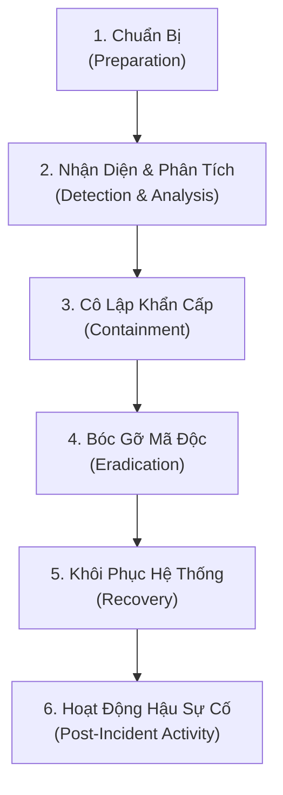

# PLAYBOOK ỨNG CỨU SỰ CỐ MÃ ĐỘC TỐNG TIỀN (RANSOMWARE INCIDENT RESPONSE PLAYBOOK)

> **Mã hiệu tài liệu:** `SEC-IR-RANSOM-2026`  
> **Tiêu chuẩn chuẩn hóa:** `NIST SP 800-61 Rev. 2 (Computer Security Incident Handling Guide)`  
> **Đơn vị ban hành:** Đội phản ứng sự cố an toàn thông tin mạng (CSIRT / SOC L2/L3)  
> **Mục tiêu:** Hướng dẫn quy trình chuẩn từng phút từ khi phát hiện dấu hiệu mã độc tống tiền (Ransomware) đến khi cô lập, ngăn chặn lây lan diện rộng, bóc gỡ và khôi phục hệ thống an toàn.
>
> **Liên kết điều phối:** Xem [DIEU_PHOI_LO_TRINH_DOC.md](file:///mnt/second_drive/DOCS/SEC/DIEU_PHOI_LO_TRINH_DOC.md) | [02_Blue_Team_Detection_and_Event_IDs.md](file:///mnt/second_drive/DOCS/SEC/docs/Cheatsheets/02_Blue_Team_Detection_and_Event_IDs.md).

---

## 1. QUY TRÌNH 6 BƯỚC CHUẨN NIST SP 800-61r2



---

## 2. CHI TIẾT TỪNG GIAI ĐOẠN TÁC CHIẾN

### GIAI ĐOẠN 1: CHUẨN BỊ (PREPARATION)
- **Quy tắc sao lưu 3-2-1:**
  - 3 bản sao dữ liệu quan trọng.
  - 2 loại phương tiện lưu trữ khác nhau.
  - 1 bản sao lưu ngoại tuyến hoàn toàn tách biệt khỏi mạng (Air-gapped / Immutable Backup).
- **Phân tách quyền hạn Active Directory:** Cấm tài khoản Domain Admin đăng nhập máy trạm người dùng.
- **Danh bạ liên lạc khẩn cấp (War-Room Contacts):** Trưởng ban ứng cứu (CISO), Đội ngũ mạng, Đội ngũ máy chủ, Chuyên gia pháp chế và Đơn vị điều tra tội phạm mạng.

---

### GIAI ĐOẠN 2: NHẬN DIỆN & PHÂN TÍCH (DETECTION & ANALYSIS)

#### 2.1. Các chỉ số xâm phạm nguy cấp (Critical IOCs)
1. **Lệnh xóa bản sao lưu Volume Shadow Copy trên Windows:**
   - Tiến trình thực thi: `vssadmin.exe delete shadows /all /quiet` hoặc `wmic shadowcopy delete`.
   - Lệnh tắt tính năng sửa lỗi tự động: `bcdedit /set {default} recoveryenabled No`.
2. **Sự kiện ghi nhận:**
   - **Event ID 4688 / Sysmon Event 1:** Chứa các tham số dòng lệnh trên.
   - **Sysmon Event 11 (FileCreate):** Xuất hiện hàng loạt tệp tin bị đổi đuôi mã hóa (ví dụ `.lockbit`, `.blackcat`, `.crypto`) và tệp thông báo tống tiền `README_RESTORE_FILES.txt`.
3. **Lưu lượng mạng bất thường:** Hàng loạt kết nối SMB (cổng 445) dồn dập từ 1 máy tính tới tất cả các dải IP nội bộ (hành vi lây lan lateral movement).

#### 2.2. Lệnh PowerShell kiểm tra tức thì trên máy nghi ngờ
```powershell
# Kiểm tra các tiến trình đang mở tệp ồ ạt hoặc chiếm CPU cao
Get-Process | Sort-Object CPU -Descending | Select-Object -First 10

# Kiểm tra các kết nối mạng Outbound khả nghi
Get-NetTCPConnection -State Established | Where-Object { $_.RemotePort -notin 80,443,53 }

# Tìm các tệp ghi chú đòi tiền chuộc mới tạo trong 2 giờ qua
Get-ChildItem -Path C:\ -Recurse -Filter "*README*" -ErrorAction SilentlyContinue | Where-Object { $_.CreationTime -gt (Get-Date).AddHours(-2) }
```

---

### GIAI ĐOẠN 3: CÔ LẬP KHẨN CẤP (CONTAINMENT - PHẢN ỨNG TRONG 15 PHÚT ĐẦU)

> [!CAUTION]
> **QUY TẮC SỐNG CÒN:** KHÔNG ĐƯỢC TẮT NGUỒN (POWER OFF) MÁY TÍNH BỊ NHIỄM! Việc tắt nguồn sẽ làm mất sạch dữ liệu trong bộ nhớ RAM (nơi chứa khóa mã hóa đối xứng AES, mã độc không qua tệp và dấu vết kết nối C2).

1. **Rút cáp mạng vật lý (Disconnect Physical Cable) hoặc ngắt card Wi-Fi:** Ngăn chặn ngay lập tức quá trình mã hóa chia sẻ mạng (Network Shares) và ngăn mã độc gửi tín hiệu về C2.
2. **Cô lập tại tầng Switch / Firewall:**
   - Chặn toàn bộ cổng SMB (TCP 445), RPC (TCP 135), RDP (TCP 3389) giữa các phân vùng mạng (Inter-VLAN).
   - Ngắt kết nối các ổ đĩa sao lưu qua mạng (NAS/SAN/iSCSI) ngay lập tức.
3. **Khóa tài khoản quản trị bị nghi ngờ thỏa hiệp:**
   ```powershell
   Disable-ADAccount -Identity "compromised_admin"
   ```
4. **Thu thập ảnh bộ nhớ RAM (Memory Dump) trước khi cô lập tiến trình:**
   - Dùng WinPmem hoặc DumpIt lưu trữ tệp `.raw` ra USB an toàn phục vụ phân tích điều tra số.

---

### GIAI ĐOẠN 4: BÓC GỠ MÃ ĐỘC (ERADICATION)

1. **Truy tìm nguồn lây nhiễm ban đầu (Patient Zero):**
   - Rà soát log tường lửa VPN, log Email Gateway (Spear-phishing) và Event ID 4624 (Logon Type 10 - RDP Brute-force).
2. **Gỡ bỏ cơ chế duy trì quyền truy cập (Persistence Mechanisms):**
   - Quét và xóa Scheduled Tasks độc hại: `Get-ScheduledTask | Where-Object { $_.TaskPath -notlike "\Microsoft*" }`.
   - Rà soát Registry Run Keys: `HKLM\Software\Microsoft\Windows\CurrentVersion\Run`.
   - Rà soát WMI Event Subscriptions: `Get-CimInstance -Namespace root\subscription -ClassName __EventFilter`.
3. **Cài đặt lại hệ điều hành (Clean Rebuild):** Đối với các máy chủ đã bị mã hóa sâu, khuyến nghị cài đặt lại hoàn toàn hệ điều hành từ ảnh đĩa sạch chuẩn (Golden Image), không cố gắng chắp vá.

---

### GIAI ĐOẠN 5: KHÔI PHỤC HỆ THỐNG AN TOÀN (RECOVERY)

1. **Đổi mật khẩu tài khoản `krbtgt` của Domain Controller hai lần liên tiếp** (mỗi lần cách nhau 24 giờ).
2. **Đổi toàn bộ mật khẩu tài khoản quản trị viên và tài khoản dịch vụ (Service Accounts).**
3. **Khôi phục dữ liệu từ bản sao lưu ngoại tuyến (Offline Backup):**
   - Quét mã độc toàn bộ dữ liệu sao lưu trước khi nạp lại vào máy chủ sản xuất.
4. **Mở kết nối mạng từng bước (Staged Network Re-connection):**
   - Đưa hệ thống vào phân vùng kiểm soát (Quarantine Zone) có giám sát EDR chuyên sâu trong 48 giờ trước khi mở lại lưu lượng cho người dùng cuối.

---

### GIAI ĐOẠN 6: HOẠT ĐỘNG HẬU SỰ CỐ (POST-INCIDENT ACTIVITY)

- **Họp đánh giá bài học kinh nghiệm (Lessons Learned):** Thực hiện trong vòng 7 ngày sau khi dập tắt sự cố.
- **Lập báo cáo nguyên nhân gốc rễ (Root Cause Analysis - RCA):** Trả lời chính xác lỗ hổng nào bị khai thác ban đầu.
- **Chia sẻ chỉ số IOC:** Cập nhật hash, IP, domain độc hại vào hệ thống Threat Intelligence để bảo vệ hệ sinh thái trong tương lai.
