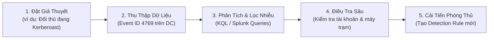

# PLAYBOOK SĂN LÙNG MỐI NGUY HIỂM ACTIVE DIRECTORY (THREAT HUNTING PLAYBOOK - ACTIVE DIRECTORY)

> **Mã hiệu:** `SEC-HUNT-AD-2026`  
> **Đối tượng áp dụng:** Threat Hunters, SOC L3 Analysts, Detection Engineers  
> **Mục tiêu:** Cung cấp phương pháp luận chủ động (proactive) rà soát các dấu hiệu tấn công tiềm ẩn trong Active Directory trước khi đối thủ hoàn tất mục tiêu phá hoại.
>
> **Liên kết điều phối:** Xem [DIEU_PHOI_LO_TRINH_DOC.md](file:///mnt/second_drive/DOCS/SEC/DIEU_PHOI_LO_TRINH_DOC.md) | [02_Active_Directory_Attack_and_Defense_Playbook.md](file:///mnt/second_drive/DOCS/SEC/docs/References/02_Active_Directory_Attack_and_Defense_Playbook.md).

---

## 1. PHƯƠNG PHÁP LUẬN SĂN LÙNG THREAT HUNTING

Khác với giám sát thụ động (chờ cảnh báo SIEM), Threat Hunting đặt giả định **"Hệ thống đã bị xâm nhập" (Assume Breach)** và chủ động đặt ra các giả thuyết (Hypothesis-Driven Hunting) để tìm kiếm các bất thường trong tập dữ liệu nhật ký sự kiện lớn.



---

## 2. CHI TIẾT 6 CHIẾN DỊCH SĂN LÙNG CHUYÊN SÂU (HUNTING MISSIONS)

### CHIẾN DỊCH 1: SĂN LÙNG TẤN CÔNG KERBEROASTING
- **Giả thuyết:** Kẻ tấn công trong mạng nội bộ đang yêu cầu hàng loạt vé dịch vụ TGS với thuật toán mã hóa yếu RC4 để bẻ khóa mật khẩu offline.
- **Nguồn dữ liệu:** Windows Security Event Log trên Domain Controller (Event ID 4769).
- **Thuộc tính cần lọc:**
  - `TicketEncryptionType == "0x17"` (RC4-HMAC).
  - `ServiceName !endswith "$"` (Không phải tài khoản máy tính).
  - Tần suất yêu cầu: Nhiều hơn 5 SPN khác nhau từ cùng một địa chỉ IP trong vòng 10 phút.
- **Truy vấn KQL (Microsoft Sentinel):**
  ```kql
  SecurityEvent
  | where EventID == 4769
  | where TicketEncryptionType == "0x17"
  | where ServiceName !endswith "$" and ServiceName !in ("krbtgt", "kadmin")
  | summarize SPN_Count = dcount(ServiceName), SPN_List = make_set(ServiceName) by IpAddress, TargetUserName, bin(TimeGenerated, 10m)
  | where SPN_Count >= 3
  | project TimeGenerated, IpAddress, TargetUserName, SPN_Count, SPN_List
  ```

---

### CHIẾN DỊCH 2: SĂN LÙNG TẤN CÔNG DCSYNC (MS-DRSR EXPLOITATION)
- **Giả thuyết:** Kẻ tấn công đã leo lên quyền trung gian và gửi yêu cầu đồng bộ bản ghi NTDS.dit từ một máy trạm trái phép ngoài Domain Controller.
- **Nguồn dữ liệu:** Event ID 4662 (Directory Service Access) trên Domain Controller.
- **Thuộc tính nhận diện:**
  - `AccessMask == 0x100` (Control Access).
  - Thuộc tính chứa GUID nhân bản danh mục:
    - `1131f6aa-9c07-11d1-f79f-00c04fc2dcd2` (DS-Replication-Get-Changes).
    - `1131f6ad-9c07-11d1-f79f-00c04fc2dcd2` (DS-Replication-Get-Changes-All).
  - `SubjectUserName` KHÔNG kết thúc bằng dấu `$` hoặc không nằm trong danh sách các DC hợp lệ.
- **Truy vấn KQL (Microsoft Sentinel):**
  ```kql
  SecurityEvent
  | where EventID == 4662
  | where ObjectServer == "DS"
  | where AccessMask has "0x100"
  | where Properties has "1131f6aa-9c07-11d1-f79f-00c04fc2dcd2" or Properties has "1131f6ad-9c07-11d1-f79f-00c04fc2dcd2"
  | where Account !endswith "$"
  | project TimeGenerated, Computer, Account, Activity, Properties
  ```

---

### CHIẾN DỊCH 3: SĂN LÙNG CÔNG CỤ TRINH SÁT SHARPHOUND / BLOODHOUND
- **Giả thuyết:** Kẻ tấn công đang chạy SharpHound để quét các quan hệ bảo mật trong Active Directory.
- **Dấu hiệu hành vi:**
  1. Hàng ngàn truy vấn LDAP phân trang (LDAP Paged Searches) dồn dập trong vài phút.
  2. Kết nối tới cổng TCP 445 mở pipe `\pipe\samr` trên hàng trăm máy trạm liên tục để liệt kê nhóm cục bộ (Local Group Enumeration).
  3. Lọc Sysmon Event 3 (Network Connection) kết hợp Sysmon Event 1 (Process Creation).
- **Lệnh PowerShell kiểm tra phiên truy cập SAMR bất thường:**
  ```powershell
  # Kiểm tra các máy trạm gửi lượng truy vấn LDAP đột biến trên Domain Controller
  Get-WinEvent -FilterHashtable @{LogName='Directory Service'; ID=1644} -MaxEvents 50 | Select-Object TimeCreated, Message
  ```

---

### CHIẾN DỊCH 4: SĂN LÙNG TẤN CÔNG PASS-THE-HASH (PTH) QUA SMB
- **Giả thuyết:** Đối thủ sử dụng mã băm NTLM để xác thực ngang qua mạng tới các máy chủ thành viên.
- **Nguồn dữ liệu:** Event ID 4624 trên máy chủ đích (Target Server).
- **Thuộc tính nhận diện:**
  - `LogonType == 3` (Network Logon).
  - `AuthenticationPackageName == "NTLM"`.
  - `KeyLength == 0` (Dấu hiệu đặc trưng của PtH khi trao đổi challenge-response NTLM mà không qua NTLMv2 đầy đủ).
  - `WorkstationName` bị bỏ trống hoặc mang tên ngẫu nhiên do Impacket/CrackMapExec sinh ra.

---

### CHIẾN DỊCH 5: SĂN LÙNG SHADOW CREDENTIALS (msDS-KeyCredentialLink)
- **Giả thuyết:** Đối thủ thêm khóa công khai vào thuộc tính `msDS-KeyCredentialLink` của tài khoản máy tính hoặc tài khoản người dùng đích để lấy vé Kerberos TGT (công cụ Whisker / pywhisker).
- **Nguồn dữ liệu:** Event ID 5136 (A directory service object was modified) trên Domain Controller.
- **Thuộc tính nhận diện:**
  - `AttributeLDAPDisplayName == "msDS-KeyCredentialLink"`.
  - `OperationType == "Value Added"`.
  - Nếu đối tượng bị sửa đổi là tài khoản không sử dụng Windows Hello for Business, đây là hành vi xâm nhập 100%.

---

### CHIẾN DỊCH 6: SĂN LÙNG KHAI THÁC LỖ HỔNG AD CS (CERTIFICATE TEMPLATE ESC1)
- **Giả thuyết:** Người dùng thường yêu cầu chứng chỉ số với Subject Alternative Name (SAN) mạo danh Quản trị viên miền.
- **Nguồn dữ liệu:** Certification Authority (CA) Event ID 4886 (Certificate Services received a certificate request) và 4887 (Certificate Services approved and issued a certificate).
- **Thuộc tính nhận diện:**
  - `Requester`: Tài khoản domain user bình thường (ví dụ `jdoe`).
  - `SAN / UPN`: Chứa tài khoản có đặc quyền cao (ví dụ `administrator@corp.local`).
