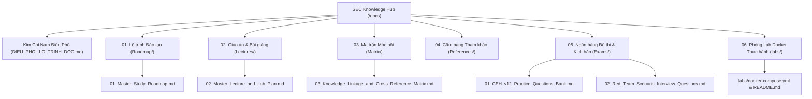

# TRUNG TÂM TRI THỨC VÀ TÀI LIỆU AN TOÀN THÔNG TIN & RED TEAM
## MASTER CYBERSECURITY & RED TEAM OPERATIONS KNOWLEDGE HUB
**Mã hiệu dự án:** `SEC-ENTERPRISE-HUB-2026`  
**Phiên bản:** `v3.3 - Pure Markdown Standard (Zero Bloat, Integrated Labs & Exams)`  
**Đơn vị chủ quản:** Ban Hội đồng Sư phạm Công nghệ Thông tin & Đội ngũ Chuyên gia Tác chiến An toàn Thông tin (Red Team Operations)  
**Tình trạng:** `Sẵn sàng sử dụng, duy trì và mở rộng (Production Ready & Maintainable)`

---

## I. TỔNG QUAN HỆ THỐNG TÀI LIỆU (REPOSITORY ARCHITECTURE)

Kho tài liệu này được cấu trúc theo nguyên tắc **100% Markdown (.md) thuần khiết**: mọi tài liệu, giáo án, lộ trình đào tạo, cẩm nang tác chiến, ngân hàng đề thi và báo cáo thực hành đều được lưu trữ trực tiếp dưới dạng văn bản Markdown chuẩn Git, loại bỏ hoàn toàn các file Word/PDF tự sinh dư thừa và tránh trùng lặp nội dung.



---

## II. KIM CHỈ NAM ĐIỀU PHỐI ĐỌC TÀI LIỆU (MASTER COORDINATOR)

Trước khi đọc bất kỳ tài liệu cụ thể nào, hãy mở tài liệu điều phối tại thư mục gốc để xác định đúng luồng nghiên cứu theo mục tiêu:
- **Tài liệu Điều phối:** [DIEU_PHOI_LO_TRINH_DOC.md](file:///mnt/second_drive/DOCS/SEC/DIEU_PHOI_LO_TRINH_DOC.md)
- **6 Luồng Đọc Định Hướng:**
  1. *Luồng 1:* Nền tảng Mạng & Bắt gói tin (Networking Baseline)
  2. *Luồng 2:* Luyện thi Chứng chỉ CEH v11/v12 (20 Modules & 125 câu hỏi trắc nghiệm)
  3. *Luồng 3:* Tấn công Ứng dụng Web & API (OWASP Web/API & DVWA Lab)
  4. *Luồng 4:* Kỹ thuật Tràn bộ đệm & Khai thác nhị phân (Buffer Overflow)
  5. *Luồng 5:* Tác chiến Doanh nghiệp Red Team & Active Directory (50 kịch bản thực tế)
  6. *Luồng 6:* Dành cho Giảng viên & Quản trị viên Repo duy trì kiến thức

---

## III. DANH MỤC TRUY CẬP TÀI LIỆU CHÍNH (MASTER DIRECTORY)

### 1. Trục Cốt Lõi Lộ Trình, Giáo Án & Ma Trận
| STT | Tài liệu Cốt lõi | Bản Markdown (.md) | Mô tả Trọng tâm |
| :---: | :--- | :--- | :--- |
| **01** | **Lộ trình Đào tạo Red Team** | [01_Master_Study_Roadmap.md](file:///mnt/second_drive/DOCS/SEC/docs/Roadmap/01_Master_Study_Roadmap.md) | Lộ trình 24 tuần phân tầng từ Nền tảng Mạng ➔ CEH ➔ AD & EDR Evasion. |
| **02** | **Giáo án Bài giảng & Thực hành** | [02_Master_Lecture_and_Lab_Plan.md](file:///mnt/second_drive/DOCS/SEC/docs/Lectures/02_Master_Lecture_and_Lab_Plan.md) | 24 bài giảng sư phạm kết hợp lệnh thực hành lab và câu hỏi Active-Recall. |
| **03** | **Ma trận Móc nối Tri thức** | [03_Knowledge_Linkage_and_Cross_Reference_Matrix.md](file:///mnt/second_drive/DOCS/SEC/docs/Matrix/03_Knowledge_Linkage_and_Cross_Reference_Matrix.md) | Bảng ánh xạ đa chiều giữa Mạng máy tính ↔ 20 Module CEH ↔ iLab Reports ↔ MITRE. |

---

### 2. Ngân Hàng Đề Thi & Kịch Bản Phỏng Vấn (Exams & Scenarios)
| STT | Tài liệu Ngân hàng Đề | Bản Markdown (.md) | Trọng tâm Đào tạo |
| :---: | :--- | :--- | :--- |
| **01** | **Ngân hàng 125 Câu hỏi CEH v12** | [01_CEH_v12_Practice_Questions_Bank.md](file:///mnt/second_drive/DOCS/SEC/docs/Exams/01_CEH_v12_Practice_Questions_Bank.md) | 125 câu hỏi trắc nghiệm chuẩn EC-Council có đáp án & phân tích chuyên sâu. |
| **02** | **50 Kịch bản Phỏng vấn Red Team** | [02_Red_Team_Scenario_Interview_Questions.md](file:///mnt/second_drive/DOCS/SEC/docs/Exams/02_Red_Team_Scenario_Interview_Questions.md) | 50 tình huống tấn công thực tế (AD, EDR Evasion, Pivoting, Web, C2 OPSEC). |
| **CLI**| **Trình Giả Lập Thi Thử CLI** | [exam_simulator.py](file:///mnt/second_drive/DOCS/SEC/exam_simulator.py) | Luyện thi tương tác CLI: `/usr/bin/python3.11 exam_simulator.py quiz --mode ceh`. |

---

### 3. Phòng Thực Hành Mạng & Web Tự Động (Hands-on Docker Labs)
| STT | Thành phần Lab | Liên kết | Mục đích Huấn luyện |
| :---: | :--- | :--- | :--- |
| **01** | **Hướng dẫn Vận hành Lab** | [labs/README.md](file:///mnt/second_drive/DOCS/SEC/labs/README.md) | Sơ đồ IP, 5 kịch bản thực hành (DVWA, API, Scan, Sniff, Report). |
| **02** | **Cấu hình Docker Compose** | [labs/docker-compose.yml](file:///mnt/second_drive/DOCS/SEC/labs/docker-compose.yml) | 5 container: DVWA, OWASP Juice Shop, Vulnerable REST API, Metasploitable, Sniffer. |
| **03** | **Vulnerable REST API Target** | [labs/vulnerable-api/app.py](file:///mnt/second_drive/DOCS/SEC/labs/vulnerable-api/app.py) | API Python 3.11 mô phỏng BOLA/IDOR, Mass Assignment, BFLA, SSRF. |

---

### 4. Thư Viện Cẩm Nang Tham Khảo Thực Chiến (Field References)
| STT | Chuyên đề Nghiên cứu | Bản Markdown (.md) | Trọng tâm Kỹ thuật |
| :---: | :--- | :--- | :--- |
| **01** | **MITRE ATT&CK Matrix Guide** | [01_MITRE_ATTCK_Enterprise_Matrix_Guide.md](file:///mnt/second_drive/DOCS/SEC/docs/References/01_MITRE_ATTCK_Enterprise_Matrix_Guide.md) | 14 Tactics từ Reconnaissance đến Impact, TTPs chi tiết. |
| **02** | **Active Directory Playbook** | [02_Active_Directory_Attack_and_Defense_Playbook.md](file:///mnt/second_drive/DOCS/SEC/docs/References/02_Active_Directory_Attack_and_Defense_Playbook.md) | Kerberoasting, AS-REP Roasting, DCSync, BloodHound, Golden Ticket. |
| **03** | **OWASP Web & API DeepDive** | [03_OWASP_Top_10_and_API_Security_DeepDive.md](file:///mnt/second_drive/DOCS/SEC/docs/References/03_OWASP_Top_10_and_API_Security_DeepDive.md) | Phân tích sâu 10 lỗ hổng Web (2021) và 10 lỗ hổng API (2023). |
| **04** | **Network Pentesting Cheatsheet** | [04_Network_Penetration_Testing_Cheatsheet.md](file:///mnt/second_drive/DOCS/SEC/docs/References/04_Network_Penetration_Testing_Cheatsheet.md) | Nmap flags, Wireshark filters, Ligolo-ng, Chisel, Metasploit. |
| **05** | **EDR Evasion & LOLBAS** | [05_EDR_Evasion_and_Living_Off_The_Land_LOLBAS.md](file:///mnt/second_drive/DOCS/SEC/docs/References/05_EDR_Evasion_and_Living_Off_The_Land_LOLBAS.md) | AMSI Bypass, ETW Patching, Direct Syscalls, Process Injection. |
| **06** | **NIST SP 800-115 Guide** | [06_NIST_SP_800-115_Technical_Guide.md](file:///mnt/second_drive/DOCS/SEC/docs/References/06_NIST_SP_800-115_Technical_Guide.md) | Chuẩn quốc tế về Kiểm thử & Đánh giá an toàn thông tin của NIST Hoa Kỳ. |
| **07** | **OWASP Evolution Matrix** | [07_OWASP_Top_10_Evolution_Matrix.md](file:///mnt/second_drive/DOCS/SEC/docs/References/07_OWASP_Top_10_Evolution_Matrix.md) | Bảng đối chiếu tiến hóa toàn bộ danh mục OWASP Top 10 từ 2003 đến 2021. |

---

### 5. Mẫu Báo Cáo VAPT & Diễn Tập Red Team (Reports & Debriefs)
| STT | Tài liệu Báo cáo | Bản Markdown (.md) | Mục đích Tài liệu |
| :---: | :--- | :--- | :--- |
| **01** | **Báo cáo VAPT Doanh nghiệp Chuẩn NIST** | [01_Enterprise_VAPT_Report_Template_vi.md](file:///mnt/second_drive/DOCS/SEC/docs/Reports/01_Enterprise_VAPT_Report_Template_vi.md) | Mẫu báo cáo kiểm thử xâm nhập thực tế có điểm CVSS v3.1, PoC và Gantt chart. |
| **02** | **Báo cáo Tổng kết Diễn tập Red Team** | [02_Red_Team_Operation_Debrief_Sample_vi.md](file:///mnt/second_drive/DOCS/SEC/docs/Reports/02_Red_Team_Operation_Debrief_Sample_vi.md) | Hồ sơ diễn tập chiếm Domain Controller, DCSync và phân tích điểm mù Blue Team. |

---

### 6. Cẩm Nang Tra Cứu Tác Chiến & Giám Sát (Cheatsheets & Blue Team)
| STT | Sổ tay Tra cứu | Bản Markdown (.md) | Trọng tâm Nghiên cứu |
| :---: | :--- | :--- | :--- |
| **01** | **100 Câu lệnh Red Team One-Liners** | [01_Red_Team_One_Liners_Cheatsheet.md](file:///mnt/second_drive/DOCS/SEC/docs/Cheatsheets/01_Red_Team_One_Liners_Cheatsheet.md) | Bộ câu lệnh Nmap, Impacket, Mimikatz, LOLBAS, SUID cô đọng. |
| **02** | **Bảng mã Event ID & KQL Phát hiện** | [02_Blue_Team_Detection_and_Event_IDs.md](file:///mnt/second_drive/DOCS/SEC/docs/Cheatsheets/02_Blue_Team_Detection_and_Event_IDs.md) | Windows Security Event Log, Sysmon, KQL Queries cho SOC. |

---

### 7. Bộ Công Cụ Tác Chiến Thực Hành (Arsenal Scripts)
- **Tập tin hướng dẫn:** [scripts/arsenal/README.md](file:///mnt/second_drive/DOCS/SEC/scripts/arsenal/README.md)
- **Công cụ dòng lệnh tích hợp:**
  - `jwt_tool_lite.py`: Giải mã JWT, kiểm tra lỗi thuật toán `none`, tấn công vét cạn secret key.
  - `reverse_shell_generator.py`: Trình sinh mã kết nối ngược 7 nền tảng kèm cờ mã hóa URL và Base64.
  - `ad_bloodhound_analyzer.py`: Phân tích đồ thị Active Directory, phát hiện Kerberoasting và ACL nguy hiểm.
  - `subdomain_recon_lite.py`: Thu thập tên miền con thụ động qua Certificate Transparency logs (crt.sh).
  - `buffer_overflow_fuzzer.py`: Sinh chuỗi cyclic pattern, tìm offset EIP, sinh badchars và xuất mã exploit x86.

---

### 8. Playbook Ứng Cứu Sự Cố & Threat Hunting (Incident Response & Hunting)
| STT | Tài liệu Playbook | Bản Markdown (.md) | Trọng tâm Tác chiến |
| :---: | :--- | :--- | :--- |
| **01** | **Ứng cứu Sự cố Ransomware chuẩn NIST** | [01_Incident_Response_Playbook_Ransomware.md](file:///mnt/second_drive/DOCS/SEC/docs/Playbooks/01_Incident_Response_Playbook_Ransomware.md) | Quy trình 6 bước NIST SP 800-61r2, xử lý cô lập trong 15 phút, khôi phục. |
| **02** | **Săn lùng Mối nguy hiểm Active Directory** | [02_Threat_Hunting_Playbook_Active_Directory.md](file:///mnt/second_drive/DOCS/SEC/docs/Playbooks/02_Threat_Hunting_Playbook_Active_Directory.md) | 6 Chiến dịch săn lùng Kerberoasting, DCSync, PtH, BloodHound, Shadow Credentials. |

---

### 9. Thử Thách CTF Phòng Lab Kèm Lời Giải (Hands-on CTF Walkthroughs)
- **Tập tin hướng dẫn:** [01_Hands_On_Lab_Flags_and_Walkthroughs.md](file:///mnt/second_drive/DOCS/SEC/labs/challenges/01_Hands_On_Lab_Flags_and_Walkthroughs.md)
- **5 Thử thách cờ thực hành:**
  1. `CTF-01` (DVWA): Khai thác SQLi Union-based dump hash admin (100 pts)
  2. `CTF-02` (API): Khai thác BOLA/IDOR đọc hồ sơ tài chính admin (150 pts)
  3. `CTF-03` (API): Leo thang đặc quyền người dùng bằng Mass Assignment (200 pts)
  4. `CTF-04` (API): Tấn công SSRF đột nhập mạng nội bộ (250 pts)
  5. `CTF-05` (Metasploitable): Khai thác dịch vụ mạng chiếm quyền Shell root Linux (300 pts)

---

### 10. Các Kho Tri Thức Gốc Trong Dự Án (Core Knowledge Repositories)
- **CEH-Notes ([CEH-Notes/](file:///mnt/second_drive/DOCS/SEC/CEH-Notes)):** 28 bài học Markdown ghi chép chi tiết toàn bộ 20 module lý thuyết CEH v12 và hướng dẫn kỹ thuật Buffer Overflow.
- **Computer Networking ([01_Computer_Networking/](file:///mnt/second_drive/DOCS/SEC/01_Computer_Networking)):** Tài liệu chi tiết 5 tầng mạng, slide bài giảng, câu hỏi ôn thi và trọn bộ 10 chương bản dịch tiếng Việt Markdown.
- **Báo cáo Thực hành iLab ([03_Ethical_Hacking_Lab_Reports/](file:///mnt/second_drive/DOCS/SEC/03_Ethical_Hacking_Lab_Reports)):** 11 báo cáo thực hành bài Lab CEH tiếng Việt dạng Markdown chi tiết.
- **Giáo trình CEH v13 ([02_Ethical_Hacking_Courseware/](file:///mnt/second_drive/DOCS/SEC/02_Ethical_Hacking_Courseware/Module_01_Introduction/Module_01_Introduction_Ethical_Hacking_vi.md)):** Bản dịch tiếng Việt tài liệu sinh viên chính thức của EC-Council Module 01.

---

### 6. Thư Viện Tài Liệu Thực Tế Tải Từ Internet (Authentic External References)
Kho lưu trữ tích hợp thư viện tài liệu gốc ngoại tuyến hơn 41 MB tại [External_Downloads](file:///mnt/second_drive/DOCS/SEC/docs/References/External_Downloads/README.md):
- **Chuẩn Quốc Tế & Quy Trình VAPT:**
  - [NIST_SP_800-115_Technical_Guide_Official.pdf](file:///mnt/second_drive/DOCS/SEC/docs/References/External_Downloads/NIST_SP_800-115_Technical_Guide_Official.pdf) (Bản gốc 80 trang từ NIST)
  - [Enterprise_VAPT_Report_NIST_SP800-115_Sample.docx](file:///mnt/second_drive/DOCS/SEC/docs/References/External_Downloads/Enterprise_VAPT_Report_NIST_SP800-115_Sample.docx) & [Bản PDF](file:///mnt/second_drive/DOCS/SEC/docs/References/External_Downloads/Enterprise_VAPT_Report_NIST_SP800-115_Sample.pdf)
  - [SANS_PenTest_Rules_of_Engagement_Worksheet.pdf](file:///mnt/second_drive/DOCS/SEC/docs/References/External_Downloads/SANS_PenTest_Rules_of_Engagement_Worksheet.pdf)
  - [SANS_Ultimate_Pen_Test_Poster.pdf](file:///mnt/second_drive/DOCS/SEC/docs/References/External_Downloads/SANS_Ultimate_Pen_Test_Poster.pdf)
  - [OpenVAS_Vulnerability_Scan_Report_Sample.pdf](file:///mnt/second_drive/DOCS/SEC/docs/References/External_Downloads/OpenVAS_Vulnerability_Scan_Report_Sample.pdf)
- **Kiểm Thử Ứng Dụng Web & API (OWASP & Tools):**
  - [OWASP_Web_Security_Testing_Guide_WSTG_v4.2.pdf](file:///mnt/second_drive/DOCS/SEC/docs/References/External_Downloads/OWASP_Web_Security_Testing_Guide_WSTG_v4.2.pdf) (Hơn 500 trang)
  - [OWASP_API_Security_Top_10_Official.pdf](file:///mnt/second_drive/DOCS/SEC/docs/References/External_Downloads/OWASP_API_Security_Top_10_Official.pdf)
  - [OWASP_Top_Ten_Historical_Comparison_2003_to_2021.pdf](file:///mnt/second_drive/DOCS/SEC/docs/References/External_Downloads/OWASP_Top_Ten_Historical_Comparison_2003_to_2021.pdf)
  - [SANS_Burp_Suite_Web_Pentest_CheatSheet.pdf](file:///mnt/second_drive/DOCS/SEC/docs/References/External_Downloads/SANS_Burp_Suite_Web_Pentest_CheatSheet.pdf)
  - [SQLMap_Injection_CheatSheet_v1.0.pdf](file:///mnt/second_drive/DOCS/SEC/docs/References/External_Downloads/SQLMap_Injection_CheatSheet_v1.0.pdf)
- **Active Directory, Pivoting & Doanh Nghiệp:**
  - [SANS_BloodHound_Active_Directory_CheatSheet.pdf](file:///mnt/second_drive/DOCS/SEC/docs/References/External_Downloads/SANS_BloodHound_Active_Directory_CheatSheet.pdf)
  - [SANS_PenTest_Pivots_and_Payloads.pdf](file:///mnt/second_drive/DOCS/SEC/docs/References/External_Downloads/SANS_PenTest_Pivots_and_Payloads.pdf)
  - [SANS_PowerShell_PenTest_CheatSheet_v41.pdf](file:///mnt/second_drive/DOCS/SEC/docs/References/External_Downloads/SANS_PowerShell_PenTest_CheatSheet_v41.pdf)
  - [Metasploit_Framework_CheatSheet.pdf](file:///mnt/second_drive/DOCS/SEC/docs/References/External_Downloads/Metasploit_Framework_CheatSheet.pdf)
- **Mạng Máy Tính, Mã Độc & Đám Mây:**
  - [SANS_TCPIP_Packet_CheatSheet_2021.pdf](file:///mnt/second_drive/DOCS/SEC/docs/References/External_Downloads/SANS_TCPIP_Packet_CheatSheet_2021.pdf)
  - [Wireshark_Display_Filters_CheatSheet.pdf](file:///mnt/second_drive/DOCS/SEC/docs/References/External_Downloads/Wireshark_Display_Filters_CheatSheet.pdf)
  - [SANS_Malware_Analysis_and_Reverse_Engineering.pdf](file:///mnt/second_drive/DOCS/SEC/docs/References/External_Downloads/SANS_Malware_Analysis_and_Reverse_Engineering.pdf)
  - [SANS_Cloud_Security_AWS_Azure_GCP.pdf](file:///mnt/second_drive/DOCS/SEC/docs/References/External_Downloads/SANS_Cloud_Security_AWS_Azure_GCP.pdf)

---

## IV. QUY TRÌNH BẢO TRÌ VÀ CẬP NHẬT TÀI LIỆU (MAINTENANCE WORKFLOW)

Để duy trì hệ thống tài liệu nhanh chóng, người quản trị tuân thủ quy trình chuẩn:

1. **Chỉnh sửa / Thêm mới:** Sửa tệp `.md` nguồn trong thư mục chuyên đề tương ứng.
2. **Cập nhật Ma trận:** Kiểm tra ánh xạ tại [03_Knowledge_Linkage_and_Cross_Reference_Matrix.md](file:///mnt/second_drive/DOCS/SEC/docs/Matrix/03_Knowledge_Linkage_and_Cross_Reference_Matrix.md).
3. **Kiểm tra Toàn vẹn Liên kết:** Chạy bộ kiểm thử tự động:
   ```bash
   /usr/bin/python3.11 -m pytest -v tests/test_sec_curriculum_integrity.py
   ```
4. **Tra cứu & Thống kê Kho:**
   ```bash
   /usr/bin/python3.11 sec_navigator.py stats
   /usr/bin/python3.11 exam_simulator.py stats
   ```
