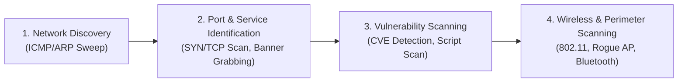
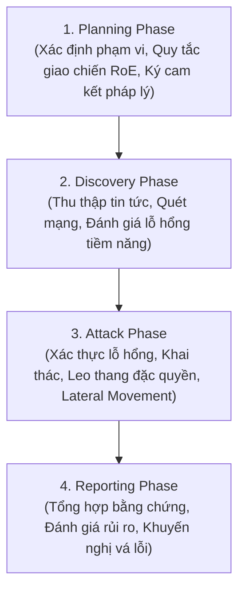

# Hướng Dẫn Kỹ Thuật Đánh Giá & Kiểm Thử An Toàn Thông Tin NIST SP 800-115
*(NIST Special Publication 800-115: Technical Guide to Information Security Testing and Assessment)*

---

## 1. Tổng Quan & Phạm Vi Tiêu Chuẩn NIST SP 800-115

**NIST SP 800-115** là tiêu chuẩn hướng dẫn kỹ thuật cốt lõi do Viện Tiêu chuẩn và Công nghệ Quốc gia Hoa Kỳ (NIST) ban hành, đóng vai trò nền tảng cho việc lập kế hoạch, thực thi, phân tích và báo cáo các hoạt động kiểm thử an toàn thông tin (Security Testing & Examination) trong mọi tổ chức từ cấp độ chính phủ đến doanh nghiệp.

### 1.1. Phân Biệt Giữa "Kiểm Tra" (Examination) và "Kiểm Thử" (Testing)
Theo NIST SP 800-115, quy trình đánh giá kỹ thuật được phân thành hai nhóm phương pháp luận chính:
1. **Examination (Kiểm tra/Thẩm tra tĩnh & bán tĩnh):**
   - Không tương tác trực tiếp gây rủi ro lên luồng vận hành của mục tiêu.
   - Tập trung vào phân tích tài liệu thiết kế, rà soát cấu hình (Configuration Review), kiểm tra tập luật tường lửa/IDS (Ruleset Review), rà soát nhật ký sự kiện (Log Review), và kiểm tra tính toàn vẹn tập tin (File Integrity Monitoring - FIM).
2. **Testing (Kiểm thử thực nghiệm & tương tác động):**
   - Tác động trực tiếp vào hệ thống thông qua việc gửi tín hiệu, gói tin thăm dò, quét cổng, đánh giá lỗ hổng và khai thác điểm yếu có kiểm soát.
   - Bao gồm: Network Discovery, Vulnerability Scanning, Password Cracking, Social Engineering, và Penetration Testing.

### 1.2. Các Góc Nhìn Đánh Giá (Testing Viewpoints)
- **External vs. Internal (Ngoại vi và Nội bộ):**
  - *External Testing:* Đứng từ Internet nhìn vào vùng biên (DMZ, VPN Gateway, Web Public) nhằm đánh giá năng lực phòng thủ chu vi.
  - *Internal Testing:* Đứng từ mạng LAN/nội bộ mô phỏng kịch bản kẻ tấn công đã vượt qua chu vi (Assume Breach) hoặc hiểm họa nội gián (Insider Threat).
- **Overt vs. Covert (Công khai và Bí mật / Red Teaming):**
  - *Overt (White-hat Assessment / Crystal Box):* Đội phòng thủ (Blue Team/SOC) được thông báo đầy đủ lịch trình, hỗ trợ tối đa để tìm ra nhiều lỗ hổng nhất trong thời gian ngắn.
  - *Covert (Red Team Simulation / Black Box):* Đội phòng thủ hoàn toàn không được báo trước; kiểm tra toàn diện cả con người, quy trình phát hiện (EDR/SIEM/SOC alert) và khả năng ứng phó sự cố (IR).

---

## 2. Kỹ Thuật Thẩm Tra & Đánh Giá Tĩnh (Review Techniques)

NIST SP 800-115 Chương 3 chỉ định 6 kỹ thuật thẩm tra cốt lõi:

| STT | Kỹ Thuật (Technique) | Mục Tiêu & Cơ Chế Thực Hiện | Công Cụ & Hiện Vật Khảo Sát |
| :--- | :--- | :--- | :--- |
| **3.1** | **Documentation Review** | Thẩm tra chính sách an toàn, sơ đồ kiến trúc mạng, thủ tục vận hành chuẩn (SOP). | Chính sách ISO 27001, hồ sơ thiết kế mạng, sơ đồ IP Addressing. |
| **3.2** | **Log Review** | Phân tích nhật ký hệ thống, xác thực, máy chủ, tường lửa nhằm tìm dấu vết bất thường. | SIEM (Splunk, Elastic, Loki), Event Viewer, `/var/log/syslog`, `auth.log`. |
| **3.3** | **Ruleset Review** | Đánh giá tập luật tường lửa, Access Control Lists (ACLs), quy tắc IDS/IPS để loại bỏ rule "Any/Any" hoặc rule bị bóng (Shadowed Rules). | Cisco ASA, iptables, pfSense, FortiGate config, Suricata/Snort rules. |
| **3.4** | **System Configuration Review** | Đối chiếu cấu hình thực tế của OS/Database/Web Server với chuẩn bảo mật CIS Benchmarks. | CIS-CAT, Microsoft Security Compliance Toolkit, Lynis, OpenSCAP. |
| **3.5** | **Network Sniffing** | Bắt gói tin thụ động trên mạng để phát hiện truyền tải dữ liệu nhạy cảm dạng rõ (Cleartext HTTP, FTP, Telnet). | Wireshark, tcpdump, TShark, Network TAP, Port Mirroring (SPAN). |
| **3.6** | **File Integrity Checking (FIM)** | So khớp mã băm mật mã (SHA-256) của các tập tin nhị phân hệ thống để phát hiện Rootkit/Trojan. | OSSEC, Wazuh, Tripwire, Aide, Samhain. |

---

## 3. Kỹ Thuật Nhận Dạng & Phân Tích Mục Tiêu (Target Identification & Analysis)

NIST SP 800-115 Chương 4 định nghĩa các bước thu thập thông tin và phát hiện mục tiêu có kiểm soát:

### 3.1. Network Discovery & Port Identification
- **Khám phá mạng:** Sử dụng ICMP Echo, TCP SYN ping, ARP scan để xác định danh sách các Host còn hoạt động (Live Hosts).
- **Nhận diện cổng và dịch vụ:**
  - *TCP SYN Scan (`-sS`):* Kỹ thuật quét tàng hình nửa mở (Half-open) không hoàn tất bắt tay 3 bước, giảm thiểu ghi log trên ứng dụng.
  - *Service Version Detection (`-sV`):* Thăm dò giao thức tầng ứng dụng, phân tích banner trả về để xác định chính xác tên phần mềm và số hiệu phiên bản.
  - *OS Fingerprinting (`-O`):* Đo lường các đặc tính TCP/IP stack (Initial Sequence Number randomness, Window size, TTL) để phán đoán hệ điều hành mục tiêu.

### 3.2. Quét Lỗ Hổng Kỹ Thuật (Vulnerability Scanning)
- Phân biệt giữa **Unauthenticated Scanning** (quét từ bên ngoài, chỉ kiểm tra phản hồi bề mặt) và **Authenticated Scanning** (cung cấp tài khoản SSH/SMB/WMI để quét cấu hình bên trong host).
- Đánh giá mức độ nghiêm trọng bằng chuẩn **CVSS v3/v4** (Common Vulnerability Scoring System).

### 3.3. Quét Mạng Không Dây & Thiết Bị Ngoại Vi
- **Passive Wireless Scanning:** Lắng nghe khung truyền 802.11 Beacon Frames mà không phát sóng; lập bản đồ SSID, kênh tần số và chuẩn mã hóa (WPA2/WPA3).
- **Active Wireless Scanning:** Gửi Probe Request để tìm các mạng ẩn SSID (Hidden SSID).
- **Rogue AP Detection:** Truy tìm các điểm truy cập trái phép được nhân viên tự ý cắm vào switch nội bộ hoặc các thiết bị giả mạo Evil Twin.

---

## 4. Kỹ Thuật Xác Thực Lỗ Hổng & Kiểm Thử Xâm Nhập (Target Vulnerability Validation)

NIST SP 800-115 Chương 5 cung cấp khuôn khổ kiểm thử xâm nhập chuyên sâu:

### 4.1. 4 Giai Đoạn Cốt Lõi của Penetration Testing theo NIST

1. **Planning Phase (Lập kế hoạch & Thỏa thuận):**
   - Thiết lập mục tiêu cụ thể, phạm vi hệ thống (In-scope IPs, Domains, Excluded Assets).
   - Xác định **Rules of Engagement (RoE):** khung giờ kiểm thử (Maintenance window), số điện thoại liên lạc khẩn cấp khi hệ thống bị treo, danh mục hành vi bị nghiêm cấm (ví dụ: cấm tấn công DoS, cấm phá hủy database).
2. **Discovery Phase (Khám phá & Thăm dò):**
   - Thực hiện thu thập thông tin mã nguồn mở (OSINT) và quét mạng kỹ thuật số.
   - Lọc và phân tích các bề mặt tấn công tiềm năng.
3. **Attack Phase (Thực hiện tấn công có kiểm soát):**
   - *Gaining Access:* Khai thác lỗ hổng đã xác định (Web RCE, SQLi, Buffer Overflow, Password Spraying).
   - *Privilege Escalation:* Chiếm quyền quản trị hệ thống (SYSTEM/root) thông qua misconfiguration, vulnerable kernel driver, hoặc abuse token.
   - *System Browsing & Pivoting:* Sử dụng máy chủ đã chiếm làm bàn đạp để định tuyến sang các dải mạng cô lập (VLAN nội bộ, Database zone).
   - *Data Exfiltration Testing:* Kiểm tra năng lực Data Loss Prevention (DLP) bằng cách truyền dữ liệu giả định ra ngoài qua các kênh ngầm (DNS Tunneling, HTTPS POST).
4. **Reporting Phase (Lập báo cáo kết quả):**
   - Báo cáo phân chia làm 2 phần riêng biệt:
     - *Executive Summary:* Dành cho ban giám đốc, trình bày bức tranh rủi ro tổng quan, tác động nghiệp vụ (Business Impact) và điểm số rủi ro.
     - *Technical Deep Dive:* Dành cho kỹ sư hạ tầng và lập trình viên, ghi nhận chi tiết chuỗi tấn công (Proof-of-Concept, step-by-step reproduction) và giải pháp khắc phục cụ thể.

### 4.2. Kỹ Thuật Phá Mã Mật Khẩu (Password Cracking)
- **Offline Cracking:** Trích xuất bảng băm mật khẩu (NTLM, SAM, `/etc/shadow`) và bẻ khóa trên trạm GPU chuyên dụng bằng Hashcat/John the Ripper. Tránh làm khóa tài khoản người dùng trên Active Directory.
- **Online Guessing / Password Spraying:** Thử một số lượng rất nhỏ mật khẩu phổ biến (ví dụ: `SeasonYear!`) trên danh sách người dùng lớn, giãn cách thời gian để vượt qua cơ chế Account Lockout Threshold.

### 4.3. Đánh Giá Yếu Tố Con Người (Social Engineering)
- Kiểm thử sự nhạy cảm của người dùng đối với các thủ thuật lừa đảo qua Email Phishing, Vishing (gọi điện giả mạo IT Support), và Physical USB Drops.
- Mọi hoạt động Social Engineering phải có sự phê duyệt bằng văn bản từ cấp quản lý cao nhất để đảm bảo tính pháp lý và đạo đức nghề nghiệp.

---

## 5. Quy Trình Vận Hành & An Toàn Dữ Liệu Khảo Sát (Data Handling & Logistics)

Chương 6 và 7 của NIST SP 800-115 đặc biệt nhấn mạnh tính toàn vẹn và bảo mật của dữ liệu đánh giá:

1. **Data Collection & Evidence Preservation:**
   - Mọi log tương tác, traffic capture, và lệnh thực thi phải được ghi lại có timestamp chính xác (đồng bộ qua NTP).
   - Lưu trữ ảnh chụp màn hình chứng minh lỗ hổng (PoC) che mờ các thông tin PII (thông tin cá nhân nhạy cảm).
2. **Data Storage & Encryption:**
   - Dữ liệu thu thập và báo cáo đánh giá bắt buộc phải được mã hóa tại chỗ (At-Rest) bằng chuẩn mã hóa mạnh (AES-256, BitLocker, LUKS).
3. **Secure Transmission:**
   - Tuyệt đối không gửi báo cáo kiểm thử qua email thông thường dạng rõ. Bắt buộc sử dụng kênh liên lạc mã hóa đầu cuối (GPG/PGP Key, Encrypted Cloud Portal, HTTPS).
4. **Data Destruction (Tiêu hủy dữ liệu sau dự án):**
   - Sau khi hoàn thành thời gian bảo hành/re-test (thường từ 30 đến 90 ngày), dữ liệu nhạy cảm thu thập được phải được tiêu hủy an toàn theo chuẩn **NIST SP 800-88** (Cryptographic Erase hoặc Sanitize).

---

## 6. Móc Nối NIST SP 800-115 Với CEH & Red Team Playbooks

| Giai Đoạn / Mục Tiêu NIST SP 800-115 | CEH v12 Modules Tương Ứng | Red Team Playbook Liên Quan |
| :--- | :--- | :--- |
| **Review & OSINT Baseline** | Module 01 (Intro), Module 02 (Footprinting) | `docs/References/01_MITRE_ATTCK_Enterprise_Matrix_Guide.md` (Reconnaissance) |
| **Discovery & Scanning** | Module 03 (Scanning), Module 04 (Enumeration) | `docs/References/04_Network_Penetration_Testing_Cheatsheet.md` |
| **Vulnerability Analysis** | Module 05 (Vulnerability Analysis) | `docs/Matrix/03_Knowledge_Linkage_and_Cross_Reference_Matrix.md` |
| **Attack Phase - Web & API** | Module 14 (Web App), Module 15 (SQLi) | `docs/References/03_OWASP_Top_10_and_API_Security_DeepDive.md` |
| **Attack Phase - Enterprise & AD** | Module 06 (System Hacking), Module 11 (Session) | `docs/References/02_Active_Directory_Attack_and_Defense_Playbook.md` |
| **Attack Phase - Evasion & Defense**| Module 12 (Evading IDS/Firewall) | `docs/References/05_EDR_Evasion_and_Living_Off_The_Land_LOLBAS.md` |
| **Post-Testing & Remediation** | Module 01, CEH Lab Reports | `DIEU_PHOI_LO_TRINH_DOC.md` (Stream 6 - Vận hành & Duy trì) |

---
*Tài liệu được biên soạn và chuẩn hóa theo tiêu chuẩn NIST Special Publication 800-115 phục vụ công tác giảng dạy, nghiên cứu và vận hành thực chiến.*
