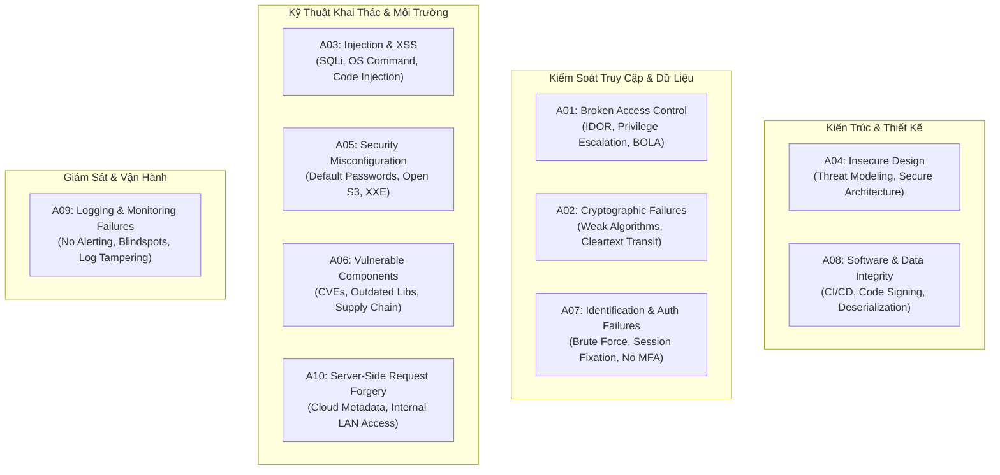

# Ma Trận Tiến Hóa & So Sánh Lịch Sử OWASP Top 10 (2003 - 2021)
*(OWASP Top 10 Historical Evolution Matrix, Category Mergers, and Strategic Remediation)*

---

## 1. Giới Thiệu & Bối Cảnh Lịch Sử OWASP Top 10

**Open Web Application Security Project (OWASP)** định kỳ công bố danh sách **OWASP Top 10** nhằm nhận diện các rủi ro bảo mật nghiêm trọng và phổ biến nhất đối với ứng dụng web trên toàn cầu. 

Qua các phiên bản **2003, 2004, 2007, 2010, 2013, 2017, và 2021**, cấu trúc danh mục đã trải qua nhiều lần sáp nhập (merger), chia tách (split), đổi tên (renaming), và bổ sung các nhóm rủi ro kiến trúc bậc cao (Insecure Design, SSRF, Integrity Failures).

---

## 2. Bảng So Sánh Chi Tiết Toàn Bộ Danh Mục Qua Các Phiên Bản

Bảng dưới đây mô tả sự chuyển dịch thứ tự xếp hạng (A1 - A10) của từng nhóm lỗ hổng qua 7 chu kỳ phát hành của OWASP:

| Danh Mục Lỗ Hổng Cốt Lõi | 2003 | 2004 | 2007 | 2010 | 2013 | 2017 | 2021 | Diễn Giải Sự Thay Đổi & Tiến Hóa |
| :--- | :---: | :---: | :---: | :---: | :---: | :---: | :---: | :--- |
| **Broken Access Control** | A2 | A2 | -- | -- | A4 | A5 | **A1** | Từ vị trí phân tán (IDOR, URL Access), vươn lên thành rủi ro số 1 do sự phát triển của kiến trúc Microservices và REST API thiếu xác thực RBAC/ABAC chặt chẽ. |
| **Cryptographic Failures** | A8 | A8 | A8 | A7 | A6 | A3 | **A2** | Trước đây mang tên *Insecure Cryptographic Storage* / *Sensitive Data Exposure*. Được mở rộng toàn diện bao gồm thuật toán yếu, rò rỉ khóa, và thiếu mã hóa dữ liệu At-Rest/In-Transit. |
| **Injection (SQLi, CMDi, LDAP, XPATH)** | A6 | A6 | A2 | A1 | A1 | A1 | **A3** | Giữ ngôi vị A1 trong hơn một thập kỷ (2010-2017). Tụt xuống A3 nhờ việc phổ cập ORM, Prepared Statements, và các framework tự động escape dữ liệu. |
| **Insecure Design** | -- | -- | -- | -- | -- | -- | **A4** | Danh mục mới xuất hiện tại bản 2021. Tập trung vào các sai sót từ khâu thiết kế kiến trúc hệ thống (Thiếu Threat Modeling, Secure Design Patterns) chứ không đơn thuần là lỗi coding. |
| **Security Misconfiguration** | -- | -- | -- | A6 | A5 | A6 | **A5** | Sáp nhập lỗi cấu hình đám mây (Cloud storage công khai, thiếu hardening, debug mode bật trên production, default credentials). Hấp thụ danh mục XML External Entity (XXE) từ 2017. |
| **Vulnerable & Outdated Components** | -- | -- | -- | -- | A9 | A9 | **A6** | Rủi ro chuỗi cung ứng phần mềm (Software Supply Chain Risk). Các thư viện bên thứ 3 (Log4Shell, Spring4Shell, npm packages) trở thành mục tiêu săn đón hàng đầu của Red Team. |
| **Identification & Authentication Failures** | A3 | A3 | A1 | A3 | A2 | A2 | **A7** | Trước đây là *Broken Authentication & Session Management*. Tụt từ A2 xuống A7 nhờ sự hỗ trợ của chuẩn xác thực mở rộng (OAuth2, OIDC, Multi-Factor Authentication - MFA, FIDO2). |
| **Software & Data Integrity Failures** | -- | -- | -- | -- | -- | A8 | **A8** | Mở rộng từ *Insecure Deserialization (2017)* sang toàn bộ chu trình CI/CD pipelines, auto-update mechanisms không ký số mật mã (Code Signing), và unverified CDN dependencies. |
| **Security Logging & Monitoring Failures** | -- | -- | -- | -- | -- | A10 | **A9** | Trước đây là *Insufficient Logging & Monitoring*. Yếu tố quyết định thời gian kẻ tấn công nằm vùng (Dwell Time). Thiếu khả năng cảnh báo thời gian thực dẫn đến vi phạm kéo dài hàng tháng. |
| **Server-Side Request Forgery (SSRF)** | -- | -- | -- | -- | -- | -- | **A10** | Danh mục do cộng đồng đề xuất và bình chọn (Top 10 Community Survey). Bùng nổ do kiến trúc Cloud/Kubernetes nơi SSRF cho phép kẻ tấn công trích xuất AWS IMDSv1 token hoặc truy cập metadata nhạy cảm. |
| *XML External Entity (XXE)* | -- | -- | -- | -- | -- | A4 | *(A5)* | Được tách thành A4 năm 2017 do bùng nổ phân tích XML parser. Năm 2021 được sáp nhập vào *Security Misconfiguration (A5)* do bản chất là parser configuration flag. |
| *Cross-Site Scripting (XSS)* | A4 | A1 | A1 | A2 | A3 | A7 | *(A3)* | Từng là lỗ hổng áp đảo giai đoạn 2004-2013. Tụt dần nhờ các Frontend framework hiện đại (React, Angular, Vue) mặc định mã hóa đầu ra (Contextual Output Encoding). Năm 2021 gộp vào *Injection (A3)*. |
| *Cross-Site Request Forgery (CSRF)* | A5 | -- | A5 | A5 | A8 | -- | -- | Bị loại khỏi Top 10 độc lập từ bản 2017 do các framework web hiện đại tích hợp sẵn CSRF token mặc định và thuộc tính cookie `SameSite=Lax/Strict`. |
| *Insecure Direct Object Reference (IDOR)* | -- | A4 | A4 | A4 | *(A4)* | *(A5)* | *(A1)* | Gộp vào *Broken Access Control (A1)*. |
| *Unvalidated Redirects and Forwards* | -- | -- | A10 | A10 | -- | -- | -- | Loại bỏ khỏi Top 10 độc lập từ 2013; quy về Broken Access Control / Phishing vectors. |

---

## 3. Phân Tích Chuyên Sâu Các Danh Mục Chủ Lực Của OWASP Top 10 (2021)

### 3.1. A01: Broken Access Control (Nguy cơ số 1)
- **Bản chất:** Kẻ tấn công có thể truy cập trái phép vào các tài nguyên/chức năng mà lẽ ra chỉ dành cho người dùng khác (Horizontal Escalation / IDOR) hoặc cấp quản trị viên (Vertical Escalation).
- **Phòng thủ chuẩn:**
  - Áp dụng nguyên tắc **Deny by Default** (Chặn mặc định).
  - Xác thực quyền sở hữu đối tượng ở tầng Controller/Service (ví dụ: `WHERE user_id = :current_user_id`).
  - Sử dụng Attribute-Based Access Control (ABAC) hoặc Role-Based Access Control (RBAC) được kiểm thử kỹ lưỡng.

### 3.2. A04: Insecure Design (Bước ngoặt tư duy an toàn)
- **Bản chất:** Một ứng dụng có thể được code sạch 100% không có lỗi SQLi hay XSS, nhưng vẫn bị hack nếu thiết kế nghiệp vụ sai sót (ví dụ: cho phép người dùng đặt lại mật khẩu chỉ bằng câu hỏi bí mật dễ đoán, hoặc quy trình hoàn tiền logic âm).
- **Phòng thủ chuẩn:**
  - Đưa hoạt động **Threat Modeling (STRIDE / PASTA)** vào giai đoạn phân tích yêu cầu (Shift-Left Security).
  - Thiết kế các giới hạn chống lạm dụng nghiệp vụ (Rate limiting, Anti-Automation).

### 3.3. A10: Server-Side Request Forgery (SSRF)
- **Bản chất:** Ứng dụng web nhận URL từ người dùng và thực hiện yêu cầu HTTP/gọi tài nguyên mà không xác thực địa chỉ đích. Kẻ tấn công lợi dụng việc này để thăm dò hạ tầng đám mây (AWS `http://169.254.169.254/latest/meta-data/`).
- **Phòng thủ chuẩn:**
  - Khử trùng và whitelist danh sách domain được phép tải.
  - Vô hiệu hóa tính năng chuyển hướng HTTP Redirect.
  - Sử dụng AWS IMDSv2 (yêu cầu session token) thay thế hoàn toàn IMDSv1.

---

## 4. Móc Nối OWASP Top 10 Với CEH & Hệ Thống Tài Liệu Repo

| OWASP Top 10 (2021) | CEH v12 Modules Tương Ứng | Tài Liệu & Cẩm Nang Nghiên Cứu Trong Repo |
| :--- | :--- | :--- |
| **A01: Broken Access Control** | Module 14 (Web App Hacking) | `docs/References/03_OWASP_Top_10_and_API_Security_DeepDive.md` (Chương 2) |
| **A02: Cryptographic Failures** | Module 20 (Cryptography) | `CEH-Notes/Module 20 - Cryptography/` |
| **A03: Injection** | Module 15 (SQL Injection) | `docs/References/03_OWASP_Top_10_and_API_Security_DeepDive.md` (Chương 3) |
| **A05: Security Misconfiguration**| Module 13 (Hacking Web Servers) | `CEH-Notes/Module 13 - Hacking web Servers/` |
| **A06: Vulnerable Components** | Module 05 (Vulnerability Analysis) | `docs/Matrix/03_Knowledge_Linkage_and_Cross_Reference_Matrix.md` |
| **A07: Auth Failures** | Module 06 (System Hacking), Module 11 | `docs/References/02_Active_Directory_Attack_and_Defense_Playbook.md` |
| **A10: SSRF** | Module 14 (Web App Hacking), Module 19 | `docs/References/03_OWASP_Top_10_and_API_Security_DeepDive.md` (Chương 4) |

---
*Tài liệu tổng hợp và biên soạn đối chiếu chuẩn hóa theo dữ liệu lịch sử dự án OWASP Foundation phục vụ giảng dạy và thực hành Red Team.*
