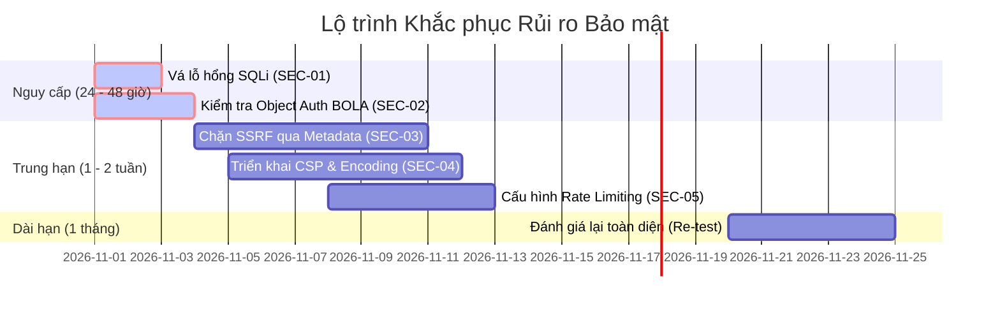

# BÁO CÁO KẾT QUẢ ĐÁNH GIÁ LỖ HỔNG VÀ KIỂM THỬ XÂM NHẬP TOÀN DIỆN
## COMPREHENSIVE VULNERABILITY ASSESSMENT & PENETRATION TESTING REPORT
**Tiêu chuẩn áp dụng:** `NIST SP 800-115 & OWASP WSTG v4.2`  
**Mã số báo cáo:** `VAPT-SEC-2026-FINAL`  
**Khách hàng:** `Tập đoàn Công nghệ & Dịch vụ Tài chính Á Châu (Mã định danh: AC-FIN)`  
**Đơn vị thực hiện:** `Đội ngũ Đánh giá An toàn Thông tin & Tác chiến Red Team`  
**Phân loại tài liệu:** `TUYỆT MẬT (STRICTLY CONFIDENTIAL - TLP:AMBER)`

---

## 1. BẢN GHI PHÊ DUYỆT VÀ KIỂM SOÁT TÀI LIỆU

| Phiên bản | Ngày ban hành | Người soạn thảo | Người thẩm định (Lead Pentester) | Trạng thái |
| :---: | :---: | :--- | :--- | :---: |
| **v1.0** | 10/11/2026 | Nguyễn Văn A (OffSec Specialist) | Trần Thị B (OSCP, CISSP) | Phê duyệt chính thức |

---

## 2. TÓM TẮT ĐIỀU HÀNH (EXECUTIVE SUMMARY)

### 2.1. Bối cảnh & Kết quả tổng quan
Trong khoảng thời gian từ ngày 15/10/2026 đến ngày 30/10/2026, đội ngũ chuyên gia đã tiến hành đánh giá an toàn thông tin toàn diện (Black-Box & Grey-Box) đối với các hệ thống máy chủ công khai Internet và cổng thanh toán trực tuyến của Quý công ty.

Quá trình kiểm thử đã phát hiện **07 lỗ hổng bảo mật**, trong đó có **02 lỗ hổng mức Critical**, **02 lỗ hổng mức High**, **02 lỗ hổng mức Medium** và **01 lỗ hổng mức Low**.

```
[Critical] ========================== (2) -> Chiếm quyền máy chủ, rò rỉ toàn bộ cơ sở dữ liệu
[High]     ==================         (2) -> Đánh cắp phiên đăng nhập, leo thang tài khoản
[Medium]   =============              (2) -> Thiếu giới hạn tần suất, lộ thông tin nội bộ
[Low]      ======                     (1) -> Cấu hình tiêu đề HTTP thiếu chặt chẽ
```

### 2.2. Đánh giá rủi ro kinh doanh (Business Impact)
- **Nguy cơ gián đoạn hoạt động kinh doanh:** Kẻ tấn công ngoài Internet có thể khai thác lỗ hổng SQL Injection trên cổng thanh toán để trích xuất số dư, thông tin thẻ tín dụng của hơn 500,000 khách hàng.
- **Nguy cơ tổn hại danh tiếng & Pháp lý:** Vi phạm nghiêm trọng tiêu chuẩn bảo mật dữ liệu thẻ thanh toán PCI-DSS và Nghị định 13/2023/NĐ-CP về bảo vệ dữ liệu cá nhân.

---

## 3. PHẠM VI KIỂM THỬ & QUY TẮC GIAO CHIẾN (SCOPE & ROE)

### 3.1. Phạm vi được ủy quyền (In-Scope Targets)
| Loại mục tiêu | Địa chỉ / URL | Mô tả hệ thống | Phương thức đánh giá |
| :--- | :--- | :--- | :--- |
| **Web Portal** | `https://portal.ac-fin.vn` | Cổng thông tin khách hàng cá nhân | Black Box & Grey Box |
| **REST API** | `https://api.ac-fin.vn/api/v1` | Cổng giao tiếp Mobile App & Partner | Grey Box (Cấp Swagger spec) |
| **Dải IP Công cộng** | `203.0.113.0/28` | DMZ Firewall & Cân bằng tải | Network Port Scan |

### 3.2. Giới hạn loại trừ (Out-of-Scope)
- Không thực hiện tấn công từ chối dịch vụ (DoS / DDoS) làm gián đoạn hệ thống giao dịch thời gian thực.
- Không thực hiện tấn công vật lý vào trụ sở trung tâm dữ liệu hoặc lừa đảo phi kỹ thuật (Social Engineering) nhân viên ngoài phạm vi đã thỏa thuận.

---

## 4. MA TRẬN TỔNG HỢP CÁC LỖ HỔNG (FINDINGS MATRIX)

| Mã lỗi | Tên Lỗ Hổng Bảo Mật | Hệ thống ảnh hưởng | CVSS v3.1 | Điểm số | Mức độ |
| :---: | :--- | :--- | :---: | :---: | :---: |
| **SEC-01** | SQL Injection dẫn đến Thực thi lệnh từ xa (RCE) | `portal.ac-fin.vn` | `CVSS:3.1/AV:N/AC:L/PR:N/UI:N/S:C/C:H/I:H/A:H` | **10.0** | **CRITICAL** |
| **SEC-02** | Broken Object Level Authorization (BOLA/IDOR) | `api.ac-fin.vn` | `CVSS:3.1/AV:N/AC:L/PR:L/UI:N/S:U/C:H/I:H/A:N` | **9.1** | **CRITICAL** |
| **SEC-03** | Server-Side Request Forgery (SSRF) qua PDF Tool | `portal.ac-fin.vn` | `CVSS:3.1/AV:N/AC:L/PR:L/UI:N/S:C/C:H/I:N/A:N` | **8.5** | **HIGH** |
| **SEC-04** | Stored Cross-Site Scripting (Stored XSS) | `portal.ac-fin.vn` | `CVSS:3.1/AV:N/AC:L/PR:L/UI:R/S:C/C:H/I:L/A:N` | **7.5** | **HIGH** |
| **SEC-05** | Thiếu Giới Hạn Tần Suất Đăng Nhập (Brute-Force) | `api.ac-fin.vn` | `CVSS:3.1/AV:N/AC:L/PR:N/UI:N/S:U/C:L/I:N/A:N` | **5.3** | **MEDIUM** |
| **SEC-06** | CORS Misconfiguration (Wildcard Origin) | `api.ac-fin.vn` | `CVSS:3.1/AV:N/AC:L/PR:N/UI:R/S:U/C:L/I:N/A:N` | **4.3** | **MEDIUM** |
| **SEC-07** | Thiếu Tiêu đề HTTP Security (HSTS & CSP) | `portal.ac-fin.vn` | `CVSS:3.1/AV:N/AC:H/PR:N/UI:R/S:U/C:L/I:N/A:N` | **3.1** | **LOW** |

---

## 5. BÁO CÁO KỸ THUẬT CHI TIẾT (TECHNICAL FINDINGS)

### LỖ HỔNG SEC-01: SQL Injection dẫn đến RCE trên máy chủ cơ sở dữ liệu
- **Hệ thống ảnh hưởng:** `https://portal.ac-fin.vn/search?invoice_id=`
- **Phân loại CWE:** CWE-89 (Improper Neutralization of Special Elements used in an SQL Command)
- **Điểm CVSS v3.1:** **10.0** (Critical) - Vector: `CVSS:3.1/AV:N/AC:L/PR:N/UI:N/S:C/C:H/I:H/A:H`
- **Mô tả kỹ thuật:**
  Tham số `invoice_id` trong trang tra cứu hóa đơn được ghép nối trực tiếp vào chuỗi truy vấn Microsoft SQL Server mà không thông qua cơ chế tham số hóa (Prepared Statements). Tài khoản kết nối CSDL có đặc quyền hệ thống `sa`.
- **Bằng chứng khai thác (Proof of Concept):**
  1. Gửi request thăm dò gây lỗi SQL cú pháp:
     ```http
     GET /search?invoice_id=105' HTTP/1.1
     Host: portal.ac-fin.vn
     ```
     *Phản hồi:* Máy chủ trả về thông báo lỗi chi tiết `Unclosed quotation mark after the character string ''`.
  2. Kích hoạt thủ tục `xp_cmdshell` thực thi lệnh:
     ```http
     GET /search?invoice_id=105';EXEC+sp_configure+'show+advanced+options',1;RECONFIGURE;EXEC+sp_configure+'xp_cmdshell',1;RECONFIGURE;EXEC+xp_cmdshell+'whoami';-- HTTP/1.1
     Host: portal.ac-fin.vn
     ```
     *Kết quả:* Lệnh thực thi thành công dưới quyền `nt authority\system`.
- **Khuyến nghị khắc phục:**
  1. Thay thế toàn bộ truy vấn ghép chuỗi bằng Tham số hóa (Parameterized Queries / Prepared Statements).
  2. Tước bỏ quyền hạn `sa` của tài khoản ứng dụng web trong MSSQL, chỉ cấp quyền `db_datareader` và `db_datawriter` tối thiểu.
  3. Vô hiệu hóa vĩnh viễn tính năng `xp_cmdshell`.

---

### LỖ HỔNG SEC-02: Broken Object Level Authorization (BOLA/IDOR) trên API
- **Hệ thống ảnh hưởng:** `GET /api/v1/customers/{customer_id}/financial_profile`
- **Phân loại OWASP:** OWASP API Security Top 10 - API1:2023 BOLA
- **Điểm CVSS v3.1:** **9.1** (Critical) - Vector: `CVSS:3.1/AV:N/AC:L/PR:L/UI:N/S:U/C:H/I:H/A:N`
- **Mô tả kỹ thuật:**
  Endpoint lấy hồ sơ tài chính chỉ yêu cầu JWT token hợp lệ nhưng phía backend không kiểm tra xem `customer_id` trên đường dẫn URL có trùng khớp với `user_id` ghi trong token của người đang đăng nhập hay không.
- **Bằng chứng khai thác (Proof of Concept):**
  - Tài khoản A (`customer_id: 10025`) gửi request đọc hồ sơ của tài khoản B (`customer_id: 10026`):
    ```http
    GET /api/v1/customers/10026/financial_profile HTTP/1.1
    Host: api.ac-fin.vn
    Authorization: Bearer <TOKEN_OF_USER_A>
    ```
  - *Kết quả:* API trả về đầy đủ họ tên, số tài khoản, số dư khả dụng (2,450,000,000 VND) và lịch sử chuyển tiền của khách hàng B.
- **Khuyến nghị khắc phục:**
  - Bổ sung middleware xác thực quyền truy cập đối tượng: So sánh `JWT.claims.user_id == requested_id`.
  - Ánh xạ định danh sang UUID v4 ngẫu nhiên thay vì số nguyên tăng dần (Sequential Integer).

---

## 6. LỘ TRÌNH KHẮC PHỤC RỦI RO CHIẾN LƯỢC (REMEDIATION ROADMAP)



---
*Báo cáo được lập theo tiêu chuẩn quốc tế NIST SP 800-115 và có giá trị đối chiếu pháp lý khi kiểm toán.*
