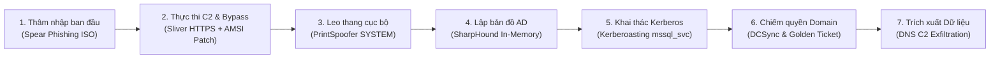
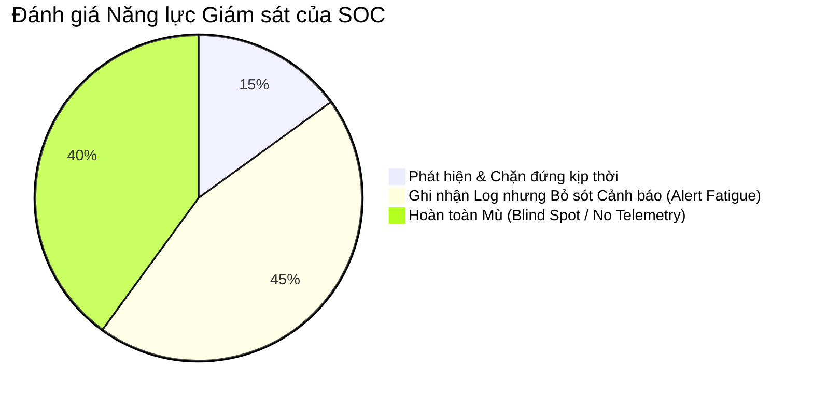

# BÁO CÁO TỔNG KẾT CHIẾN DỊCH DIỄN TẬP TÁC CHIẾN RED TEAM (RED TEAM ENGAGEMENT DEBRIEF)

> **Mã hiệu chiến dịch:** `OPERATION-APEX-DOMINANCE-2026`  
> **Mục tiêu diễn tập:** Giả lập đối thủ tấn công có chủ đích cấp độ cao (APT), kiểm tra năng lực phát hiện và phản ứng của Trung tâm điều hành an ninh mạng (SOC / Blue Team).  
> **Khách hàng giả định:** Ngân hàng & Tập đoàn Tài chính Quốc tế Apex Bank  
> **Thời gian diễn tập:** 3 tuần liên tục (01/10/2026 - 21/10/2026)  
> **Kết quả chung cuộc:** **CỜ CHIẾN THUẬT BỊ CHIẾM (FULL DOMAIN COMPROMISE & DATA EXFILTRATION)**

---

## 1. TÓM TẮT DIỄN BIẾN TÁC CHIẾN (ENGAGEMENT NARRATIVE)

---

## 2. DÒNG THỜI GIAN TÁC CHIẾN CHI TIẾT (ATTACK TIMELINE & MITRE ATT&CK MAPPING)

| Ngày & Giờ | Giai đoạn & Kỹ thuật | Chi tiết Tác chiến của Red Team | Phản ứng của Blue Team (SOC) | Kết quả |
| :---: | :--- | :--- | :--- | :---: |
| **02/10 09:15** | [T1566.001] Spearphishing Attachment | Gửi email giả mạo thông báo thanh tra thuế đính kèm tệp `Bao_Cao_Thue_Q3.iso` tới 5 nhân viên phòng Kế toán. | Email Gateway không chặn vì tệp ISO không bị coi là mã thực thi nguy hiểm. | **THÀNH CÔNG** (1 nhân viên nhấp mở) |
| **02/10 09:22** | [T1204.002] User Execution: Malicious File | Tệp ISO tự mount ổ đĩa ảo, nạn nhân bấm vào Shortcut `.lnk` ngụy trang tệp PDF, kích hoạt PowerShell ngầm tải payload C2. | Windows Defender quét nhưng bị bypass do script PowerShell đã patch byte `AmsiScanBuffer` trong RAM. | **THÀNH CÔNG** |
| **02/10 09:25** | [T1071.001] Application Layer Protocol: Web | Shell C2 Sliver thiết lập kết nối ngược HTTPS về máy chủ Redirector qua cổng 443 với cấu hình Jitter = 30%. | Firewall cho phép đi qua. Không có cảnh báo Beaconing từ proxy. | **C2 KẾT NỐI ỔN ĐỊNH** |
| **03/10 14:10** | [T1134.001] Access Token Manipulation | Máy trạm có tài khoản dịch vụ `Print Spooler` đang chạy với quyền `SeImpersonatePrivilege`. Red Team chạy công cụ PrintSpoofer. | EDR không cảnh báo vì PrintSpoofer sử dụng Named Pipe nội bộ hợp lệ của Windows. | **LEO LÊN SYSTEM THÀNH CÔNG** |
| **04/10 11:00** | [T1069.002] Domain Groups Discovery | Thực thi `SharpHound.exe` phản chiếu bộ nhớ (Reflective memory load) để thu thập toàn bộ đồ thị Active Directory. | SOC ghi nhận lượng truy vấn LDAP tăng nhẹ nhưng coi là hoạt động định kỳ của SCCM. | **THÀNH CÔNG** (Thu thập 1,200 users, 85 groups) |
| **05/10 16:30** | [T1558.003] Kerberoasting | Gửi truy vấn vé TGS cho tài khoản dịch vụ `MSSQL_PROD_SVC`. Bẻ khóa offline hash RC4 bằng Hashcat trong 42 phút (`MssqlP@ssw0rd2024`). | Event ID 4769 sinh ra trên DC với mã hóa RC4 nhưng không có alert tương quan trên SIEM. | **CHIẾM ĐƯỢC TÀI KHOẢN SERVICE** |
| **07/10 10:15** | [T1003.006] OS Credential Dumping: DCSync | Tài khoản `MSSQL_PROD_SVC` có quyền `DS-Replication-Get-Changes-All`. Red Team chạy `secretsdump.py` giả lập DC đồng bộ dữ liệu. | **SOC PHÁT HIỆN CẢNH BÁO** (DCSync Alert kích hoạt), tuy nhiên SOC phân loại là False Positive do nhầm với quá trình đồng bộ Azure AD Connect. | **CHIẾM TOÀN BỘ PASSWORD HASH (NTDS.DIT)** |
| **07/10 11:00** | [T1558.001] Forged Kerberos Tickets: Golden Ticket | Tạo vé Golden Ticket bằng NTLM hash của tài khoản `krbtgt` với thời hạn 10 năm. | Hoàn toàn vô hình đối với Domain Controller. | **CHIẾM QUYỀN TOÀN BỘ DOMAIN FOREST** |
| **12/10 15:45** | [T1048.003] Exfiltration Over Alternative Protocol | Đóng gói 2.5 GB tài liệu dự án tài chính, mã hóa AES và trích xuất ra ngoài thông qua kênh DNS Tunneling. | DNS Server nội bộ ghi nhận số lượng bản ghi TXT lớn, SOC bắt đầu mở điều tra sự cố (Incident Response). | **DỮ LIỆU ĐÃ BỊ TRÍCH XUẤT TRƯỚC KHI BỊ CHẶN** |

---

## 3. ĐÁNH GIÁ NĂNG LỰC BLUE TEAM (DEFENSE GAP ANALYSIS)

### 3.1. Các điểm mù nghiêm trọng (Critical Blind Spots)
1. **Thiếu tương quan sự kiện Kerberos:** Hệ thống SIEM chưa có quy tắc kích hoạt cảnh báo khi xuất hiện vé TGS yêu cầu mã hóa RC4 (Event ID 4769) từ các tài khoản không phải là máy tính.
2. **Quá phụ thuộc vào Chữ ký Antivirus tĩnh:** Khi Red Team sử dụng PowerShell In-Memory patching hoặc Reflective DLL, EDR đầu cuối không kích hoạt phân tích hành vi thời gian thực.
3. **Phân loại sai cảnh báo DCSync:** Cảnh báo có độ chính xác cao nhất (DCSync Event 4662) bị đóng lại quá vội vàng vì thiếu quy trình thẩm định danh tính nguồn (Source IP validation).

---

## 4. KHUYẾN NGHỊ BẢO MẬT CHIẾN LƯỢC DÀNH CHO BLUE TEAM

### 4.1. Kiến trúc phân tầng tài khoản (Tiered Administrative Model - Active Directory)
- **Tier 0 (Domain Controllers, PKI, ADFS):** Tuyệt đối cấm tài khoản Domain Admin đăng nhập vào máy trạm người dùng (Workstation Tier 2) để chống bị đánh cắp vé TGT trong LSASS.
- **Triển khai gMSA:** Chuyển đổi toàn bộ các tài khoản dịch vụ (đặc biệt là SQL, IIS) sang Group Managed Service Accounts (mật khẩu 128 ký tự ngẫu nhiên tự đổi định kỳ, triệt tiêu tấn công Kerberoasting).

### 4.2. Cấu hình giám sát Endpoint & Sysmon
- Bật tính năng **PowerShell Script Block Logging (Event ID 4104)** và gửi tập trung về SIEM.
- Triển khai tệp cấu hình Sysmon chuẩn SwiftOnSecurity để giám sát hành vi tiêm tiến trình (Process Injection - Sysmon Event 8, Event 10).

### 4.3. Đổi mật khẩu tài khoản `krbtgt`
- Thực hiện quy trình đặt lại mật khẩu tài khoản `krbtgt` **hai lần liên tiếp** (cách nhau 24 giờ) để vô hiệu hóa hoàn toàn vé Golden Ticket do Red Team tạo ra trong chiến dịch.
