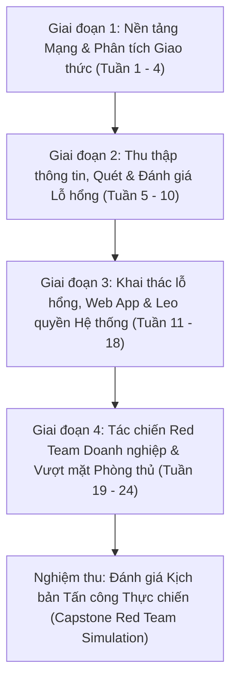

# LỘ TRÌNH ĐÀO TẠO VÀ NGHIÊN CỨU RED TEAM TOÀN DIỆN
## CHƯƠNG TRÌNH CHUẨN HÓA BỞI HỘI ĐỒNG SƯ PHẠM VÀ CHUYÊN GIA RED TEAM
**Mã hiệu:** `SEC-ROADMAP-REDTEAM-2026`  
**Phiên bản:** `v3.0 - Production Ready`  
**Đơn vị ban hành:** Ban Hội đồng Sư phạm Công nghệ Thông tin & Đội ngũ Chuyên gia Tác chiến An toàn Thông tin (Red Team Operations)  
**Mục tiêu tối thượng:** Đào tạo kỹ sư từ nền tảng mạng và bảo mật cơ bản lên trình độ Chuyên viên Tác chiến Red Team (Red Team Operator / Penetration Tester), làm chủ toàn bộ 20 module CEH, 8 chuyên đề Mạng máy tính và 20 kịch bản thực hành iLab.

---

## I. TỔNG QUAN KHUNG ĐÀO TẠO (EXECUTIVE OVERVIEW)

An toàn thông tin hiện đại không thể tiếp cận bằng việc học thuộc lòng các lỗ hổng rời rạc. Để duy trì và làm chủ toàn bộ kho tri thức trong hệ thống tài liệu, lộ trình học tập được thiết kế theo phương pháp luận **Cộng hưởng Sư phạm - Thực chiến (Pedagogical-Tactical Resonance)**:
1. **Gốc rễ (Root Cause):** Hiểu sâu giao thức mạng ở tầng nhị phân và gói tin (Packet & Protocol Level).
2. **Kỹ thuật dò quét & Phân tích (Discovery & Assessment):** Khảo sát mục tiêu, lập bản đồ mạng và phân tích bề mặt tấn công (Attack Surface Mapping).
3. **Khai thác lỗ hổng & Leo quyền (Exploitation & Privilege Escalation):** Thâm nhập từ tầng ứng dụng Web, dịch vụ mạng đến khai thác bộ nhớ (Buffer Overflow) và chiếm quyền hệ điều hành.
4. **Tác chiến Red Team nâng cao (Advanced Red Team Operations):** Vượt qua các giải pháp phòng thủ (EDR/AV/IDS/Firewall), tấn công hạ tầng Active Directory doanh nghiệp, triển khai hạ tầng C2 (Command & Control) và duy trì quyền truy cập bền bỉ.



---

## II. LỘ TRÌNH CHI TIẾT THEO TỪNG GIAI ĐOẠN

### GIAI ĐOẠN 1: NỀN TẢNG MẠNG VÀ PHÂN TÍCH GIAO THỨC (TUẦN 1 - 4)
*Mục tiêu:* Nắm vững mô hình 5 tầng TCP/IP và 7 tầng OSI, giải phẫu cấu trúc gói tin ở tầng nhị phân, làm chủ công cụ phân tích lưu lượng Wireshark và hiểu rõ cơ chế định tuyến/bảo vệ mạng.

#### Tuần 1: Kiến trúc Tầng Mạng & Tầng Vận chuyển (Network & Transport Layers)
- **Tài liệu nghiên cứu bắt buộc:**
  - `01_Computer_Networking/Book_and_Slides/study_guide.md`
  - `01_Computer_Networking/Cheatsheets_and_Notes/transport_layer.md`
  - `01_Computer_Networking/Cheatsheets_and_Notes/network_layer.md`
- **Nội dung trọng tâm:**
  - Bắt tay 3 bước TCP (Three-way Handshake: SYN -> SYN-ACK -> ACK), cơ chế kiểm soát luồng (Flow Control) và kiểm soát tắc nghẽn (Congestion Control).
  - So sánh chi tiết TCP vs UDP, cấu trúc TCP Header (Flags: SYN, ACK, FIN, RST, PSH, URG, CWR, ECE).
  - Phân tích địa chỉ IPv4/IPv6, mặt nạ mạng con (CIDR, VLSM), giao thức ICMP và xử lý định tuyến gói tin (TTL, Fragmentation).
- **Thực hành bắt buộc:**
  - Dùng Wireshark bắt và phân tích tiến trình thiết lập kết nối TCP, quá trình đóng kết nối và cờ RST.
  - Viết bộ lọc Wireshark lọc theo IP, Port và cờ TCP (`tcp.flags.syn == 1 && tcp.flags.ack == 0`).

#### Tuần 2: Tầng Liên kết dữ liệu, Chuyển mạch & Bảo mật Mạng (Link Layer & Security)
- **Tài liệu nghiên cứu bắt buộc:**
  - `01_Computer_Networking/Cheatsheets_and_Notes/link_physical_layer.md`
  - `01_Computer_Networking/Cheatsheets_and_Notes/security_network.md`
  - `01_Computer_Networking/Labs_and_Exercises/lab_security_network.md`
- **Nội dung trọng tâm:**
  - Khung Ethernet (Ethernet Frame), địa chỉ MAC, giao thức ARP (Address Resolution Protocol).
  - Lỗ hổng nguyên thủy của ARP: ARP Spoofing / ARP Poisoning, tấn công Man-in-the-Middle (MitM) trên mạng nội bộ.
  - Phân vùng VLAN, Trunking (802.1Q), giao thức Spanning Tree Protocol (STP).
  - Khái niệm về Tường lửa (Stateful vs Stateless Inspection), NAT/PAT, và mã hóa IPsec (AH/ESP).
- **Thực hành bắt buộc:**
  - Triển khai kịch bản ARP Poisoning trong môi trường Lab cô lập sử dụng `arpspoof` hoặc `Ettercap`.
  - Giám sát gói tin và phân tích bảng ARP (`arp -a`) của nạn nhân trước và sau khi bị tấn công.

#### Tuần 3: Dịch vụ Tầng Ứng dụng & Dò vết Mạng (Application Protocols)
- **Tài liệu nghiên cứu bắt buộc:**
  - `01_Computer_Networking/Book_and_Slides/lecture_outline.md`
  - `01_Computer_Networking/Cheatsheets_and_Notes/summary_5layer.md`
  - `CEH-Notes/Module 01 - Introduction.md`
- **Nội dung trọng tâm:**
  - Giao thức DNS (Domain Name System): Cấu trúc truy vấn, bản ghi A, AAAA, MX, NS, TXT, PTR, cơ chế DNS Zone Transfer (AXFR).
  - Giao thức HTTP/HTTPS: Phương thức (GET, POST, PUT, DELETE, OPTIONS), Header, mã trạng thái (Status Codes), cơ chế mã hóa TLS 1.2/1.3.
  - Giao thức DHCP: Quy trình DORA (Discover, Offer, Request, Acknowledge) và tấn công DHCP Starvation.
- **Thực hành bắt buộc:**
  - Thực hiện truy vấn DNS bằng `dig` và `nslookup`, thử nghiệm Zone Transfer trên máy chủ cấu hình mở.
  - Phân tích chu trình bắt tay TLS (Client Hello, Server Hello, Certificate Exchange, Key Exchange).

#### Tuần 4: Tổng kết Tầng Mạng, Đánh giá Kiến thức & Báo cáo Giai đoạn 1
- **Kiểm tra năng lực:** Hoàn thành bài kiểm tra trắc nghiệm và tình huống tại `01_Computer_Networking/Book_and_Slides/exam_questions.md`.
- **Tiêu chuẩn đầu ra (Acceptance Criteria):** Đạt tối thiểu 90% điểm bài thi lý thuyết; giải thích chính xác 100% các trường trong TCP/IP Header; phân tích thành thạo file pcap trên Wireshark.

---

### GIAI ĐOẠN 2: THU THẬP THÔNG TIN, QUÉT MẠNG & PHÂN TÍCH LỖ HỔNG (TUẦN 5 - 10)
*Mục tiêu:* Chuyển từ hiểu biết mạng sang tư duy trinh sát (Reconnaissance) và lập bản đồ bề mặt tấn công của đối tượng mục tiêu; làm chủ kỹ thuật quét không bị phát hiện và định danh dịch vụ chính xác.

#### Tuần 5: Thu thập thông tin thụ động và chủ động (Footprinting & Reconnaissance)
- **Tài liệu nghiên cứu bắt buộc:**
  - `CEH-Notes/Module 02 - FootPrinting.md`
  - `03_Ethical_Hacking_Lab_Reports/ilab 1 footprinting recconessaince_vi.docx`
- **Nội dung trọng tâm:**
  - OSINT (Open Source Intelligence): Kỹ thuật tìm kiếm nâng cao với Google Hacking (Dorks), Shodan, Censys, Whois, Maltego.
  - Thu thập thông tin mạng xã hội, rò rỉ mã nguồn (GitHub recon), rò rỉ mật khẩu và tài liệu metadata (FOCA, exiftool).
  - Thu thập DNS thụ động qua SecurityTrails, VirusTotal, crt.sh (Certificate Transparency Logs).
- **Thực hành bắt buộc:**
  - Lập hồ sơ trinh sát mục tiêu giả định, tìm kiếm subdomain, dải IP và email nhân sự chủ chốt.

#### Tuần 6: Quét mạng chuyên sâu & Định danh Dịch vụ (Network Scanning)
- **Tài liệu nghiên cứu bắt buộc:**
  - `CEH-Notes/Module 03 - Network Scanning.md`
  - `03_Ethical_Hacking_Lab_Reports/lab 3 network scanning_vi.docx`
- **Nội dung trọng tâm:**
  - Nmap Internals: Phân tích cơ chế hoạt động của TCP Connect Scan (`-sT`), SYN Stealth Scan (`-sS`), UDP Scan (`-sU`), FIN Scan (`-sF`), Xmas Scan (`-sX`), Null Scan (`-sN`).
  - Kỹ thuật xác định hệ điều hành (OS Fingerprinting) qua TTL, TCP Window Size, IP ID Sampling.
  - Quét dịch vụ và phiên bản (`-sV`), viết và tùy biến script Nmap NSE (`--script`).
- **Thực hành bắt buộc:**
  - Thực hành toàn bộ các bài tập trong `lab 3 network scanning_vi.docx`.
  - Phân tích sự khác biệt về lưu lượng sinh ra giữa `-sT` và `-sS` trên Wireshark.

#### Tuần 7: Định danh & Thu thập Thông tin Dịch vụ Mạng (Enumeration)
- **Tài liệu nghiên cứu bắt buộc:**
  - `CEH-Notes/Module 04 - Enumeration.md`
  - `03_Ethical_Hacking_Lab_Reports/lab 4 Ennumeration_vi.docx`
- **Nội dung trọng tâm:**
  - Định danh dịch vụ SMB/NetBIOS (Cổng 139/445): Liệt kê chia sẻ (Shares), người dùng, chính sách mật khẩu (`enum4linux`, `crackmapexec smb`, `smbclient`).
  - Định danh SNMP (Cổng 161/162): Community strings (public/private), MIB (Management Information Base), OID tree (`snmpwalk`, `snmp-check`).
  - Định danh LDAP (Cổng 389/636): Khảo sát người dùng, nhóm trong Domain Controller (`ldapsearch`).
  - Định danh RPC (Cổng 135) và NFS (Cổng 2049): `rpcclient`, `showmount -e`.
- **Thực hành bắt buộc:**
  - Thực thi toàn bộ bài lab Enumeration; trích xuất danh sách người dùng và cấu hình domain từ máy chủ thí nghiệm.

#### Tuần 8: Đánh giá & Quản trị Lỗ hổng (Vulnerability Analysis)
- **Tài liệu nghiên cứu bắt buộc:**
  - `CEH-Notes/Module 05 - Vulnerability Analysis.md`
  - `CEH-Notes/Module 05 - Vulnerability Analysis/`
- **Nội dung trọng tâm:**
  - Hệ thống định danh và tính điểm lỗ hổng: CVE, CWE, NVD, hệ thống chấm điểm CVSS v3.1 (Base, Temporal, Environmental Metrics).
  - Sử dụng công cụ quét lỗ hổng tự động: Nessus, OpenVAS/Greenbone, Nikto.
  - Phân tích và lọc bỏ kết quả dương tính giả (False Positives), lập ma trận ưu tiên vá lỗi (Risk-based Prioritization).
- **Thực hành bắt buộc:**
  - Cài đặt và cấu hình OpenVAS/Nessus quét hệ thống máy chủ lab, trích xuất báo cáo phân loại theo độ nghiêm trọng (Critical, High, Medium, Low).

#### Tuần 9 - 10: Tổng kết Giai đoạn 2 & Thực hành Tấn công Dò quét Toàn diện
- **Bài tập tích hợp:** Thực hiện bài lab tổng hợp từ Footprinting -> Scanning -> Enumeration -> Vulnerability Mapping cho toàn bộ dải mạng Lab.
- **Tiêu chuẩn đầu ra (Acceptance Criteria):** Xác định đúng 100% cổng mở, phiên bản dịch vụ và các CVE tương ứng của mục tiêu trong vòng 60 phút.

---

### GIAI ĐOẠN 3: KHAI THÁC LỖ HỔNG, ỨNG DỤNG WEB & LEO QUYỀN HỆ THỐNG (TUẦN 11 - 18)
*Mục tiêu:* Chuyển giao sang giai đoạn Khai thác (Exploitation), nắm vững nguyên lý tấn công hệ thống Windows/Linux, ứng dụng Web và khai thác bộ nhớ (Buffer Overflow).

#### Tuần 11: Chiếm quyền Hệ thống & Bẻ khóa Mật khẩu (System Hacking)
- **Tài liệu nghiên cứu bắt buộc:**
  - `CEH-Notes/Module 06 - System Hacking.md`
  - `03_Ethical_Hacking_Lab_Reports/ilab 6 system hacking_vi.docx`
- **Nội dung trọng tâm:**
  - Cơ chế lưu trữ mật khẩu trong Windows: SAM (Security Account Manager), LSASS (Local Security Authority Subsystem Service), định dạng NTLM hash.
  - Cơ chế lưu trữ mật khẩu Linux: `/etc/passwd` và `/etc/shadow` (sha512crypt, yescrypt).
  - Kỹ thuật bẻ khóa mật khẩu: Dictionary, Brute-force, Rule-based, Rainbow Tables (`hashcat`, `John the Ripper`).
  - Kỹ thuật nghe lén và trích xuất xác thực: LLMNR/NBT-NS Poisoning với `Responder`.
- **Thực hành bắt buộc:**
  - Dùng `Responder` bắt NTLMv2 hash trên mạng lab và dùng `hashcat` bẻ khóa mật khẩu với wordlist `rockyou.txt`.

#### Tuần 12: Khai thác Tràn bộ đệm Nhị phân (Buffer Overflow Fundamentals)
- **Tài liệu nghiên cứu bắt buộc:**
  - `CEH-Notes/Module-6-Buffer-Overflow/Buffer Instructions.md`
  - `CEH-Notes/Module-6-Buffer-Overflow/fuzzing.py`
  - `CEH-Notes/Module-6-Buffer-Overflow/exploit.py`
- **Nội dung trọng tâm:**
  - Cấu trúc bộ nhớ tiến trình (Stack, Heap, BSS, Data, Text), các thanh ghi x86 (ESP, EBP, EIP).
  - Vòng đời khai thác Stack Overflow: Fuzzing -> Xác định Offset (pattern create/offset) -> Ghi đè EIP -> Tìm ký tự xấu (Bad Characters) -> Tìm lệnh `JMP ESP` trong module không có bảo vệ -> Sinh Shellcode -> Chiếm quyền thực thi.
- **Thực hành bắt buộc:**
  - Thực hành từng bước khai thác phần mềm dịch vụ có lỗ hổng (như Vulnserver/Brainpan) trong môi trường x86 lab, tạo Reverse Shell thành công.

#### Tuần 13: Mối đe dọa Mã độc & Kỹ thuật Sniffing (Malware Threats & Sniffing)
- **Tài liệu nghiên cứu bắt buộc:**
  - `CEH-Notes/Module 07 - Malware Threats.md`
  - `CEH-Notes/Module 08 - Sniffing.md`
  - `03_Ethical_Hacking_Lab_Reports/ilab 7 Malware threat_vi.docx`
  - `03_Ethical_Hacking_Lab_Reports/ilab 8 sniffing_vi.docx`
- **Nội dung trọng tâm:**
  - Phân loại mã độc: Trojans, Backdoors, Ransomware, Worms, Rootkits (User-mode vs Kernel-mode).
  - Kỹ thuật né tránh chữ ký: Crypters, Packers, Obfuscation.
  - Tấn công Sniffing: MAC Flooding, DHCP Starvation, DNS Spoofing, SSL Stripping.
- **Thực hành bắt buộc:**
  - Phân tích động mã độc trong môi trường Sandbox (Any.Run, Cuckoo/Cape Sandbox), giám sát Registry và tiến trình bằng Process Hacker / Procmon.

#### Tuần 14: Kỹ thuật Xã hội & Tấn công Từ chối dịch vụ (Social Engineering & DoS)
- **Tài liệu nghiên cứu bắt buộc:**
  - `CEH-Notes/Module 09 - Social Engineering.md`
  - `CEH-Notes/Module 10 - DOS and DDOS.md`
  - `03_Ethical_Hacking_Lab_Reports/ilab 10 dos attack_vi.docx`
- **Nội dung trọng tâm:**
  - Social Engineering: Phishing, Spear Phishing, Vishing, Whaling, Pretexting, Baiting. Công cụ mô phỏng GoPhish.
  - Tấn công DoS/DDoS: SYN Flood, UDP Flood, ICMP Flood, Slowloris, HTTP Flood, Amplification Attacks (NTP, DNS, SSDP).
- **Thực hành bắt buộc:**
  - Dựng mô hình mô phỏng tấn công SYN Flood và Slowloris, quan sát trạng thái kiệt quệ tài nguyên máy chủ.

#### Tuần 15: Chiếm đoạt phiên làm việc & Tấn công Web Server (Session Hijacking & Web Servers)
- **Tài liệu nghiên cứu bắt buộc:**
  - `CEH-Notes/Module 11 - Session Hijacking.md`
  - `CEH-Notes/Module 13 - Hacking web Servers/`
  - `03_Ethical_Hacking_Lab_Reports/i lab 11 System hijack_vi.docx`
- **Nội dung trọng tâm:**
  - Chiếm đoạt phiên tầng mạng vs tầng ứng dụng: TCP Session Hijacking (Blind, In-path), Session Fixation, Session Prediction.
  - Lỗ hổng máy chủ web: Cấu hình sai (Misconfigurations), Lỗ hổng phiên bản Apache/Nginx/IIS, Directory Traversal, WebDAV exploitation.
- **Thực hành bắt buộc:**
  - Bắt gói tin phiên làm việc Telnet/HTTP và tiêm lệnh trực tiếp vào luồng dữ liệu TCP (TCP RST/Injection).

#### Tuần 16 - 17: Tấn công Ứng dụng Web & SQL Injection chuyên sâu (Web App Hacking & SQLi)
- **Tài liệu nghiên cứu bắt buộc:**
  - `CEH-Notes/Module 14 - Web Application Hacking.md`
  - `CEH-Notes/Module 15 - SQL Injection.md`
  - `docs/References/03_OWASP_Top_10_and_API_Security_DeepDive.md`
- **Nội dung trọng tâm:**
  - OWASP Top 10: XSS (Reflected, Stored, DOM), CSRF, IDOR (Broken Object Level Authorization), SSRF (Server-Side Request Forgery), File Inclusion (LFI/RFI), File Upload Vulnerabilities.
  - SQL Injection toàn diện: In-band (Error-based, UNION-based), Inferential (Boolean Blind, Time Blind), Out-of-band (OOB via DNS). Kỹ thuật trích xuất dữ liệu tự động với `sqlmap` và câu lệnh tay (Manual SQLi).
- **Thực hành bắt buộc:**
  - Khai thác thành thạo các bài lab PortSwigger Web Security Academy và DVWA ở mức độ High/Impossible.

#### Tuần 18: Bảo mật Mạng không dây & Nền tảng Di động (Wireless & Mobile)
- **Tài liệu nghiên cứu bắt buộc:**
  - `CEH-Notes/Module 16 - Wireless Networks.md`
  - `CEH-Notes/Module 17 - Mobile Platform/`
  - `03_Ethical_Hacking_Lab_Reports/ialb 17 Android_vi.docx`
- **Nội dung trọng tâm:**
  - Mã hóa không dây: WEP, WPA2-PSK (4-Way Handshake capture và cracking với Aircrack-ng), WPA3 (SAE - Simultaneous Authentication of Equals).
  - Tấn công Evil Twin, Rogue Access Point, Deauthentication attack.
  - Phân tích ứng dụng di động Android: Cấu trúc tệp APK, Reverse Engineering với JADX, Friddling với Frida/Objection.
- **Thực hành bắt buộc:**
  - Thực hành phân tích APK, sửa code Smali và bypass kiểm tra Root trên máy ảo Android.

---

### GIAI ĐOẠN 4: TÁC CHIẾN RED TEAM DOANH NGHIỆP, ACTIVE DIRECTORY & VƯỢT QUA PHÒNG THỦ (TUẦN 19 - 24)
*Mục tiêu:* Đạt cấp độ Red Team Operator thực thụ; làm chủ kỹ thuật vượt qua EDR/AV/Firewall, tấn công mạng doanh nghiệp Active Directory, chiếm quyền Domain Admin và thiết lập kênh C2.

#### Tuần 19: Vượt qua hệ thống phòng thủ (Evading IDS, Firewall and Honeypots)
- **Tài liệu nghiên cứu bắt buộc:**
  - `CEH-Notes/Module 12 - Evading IDS, Firewall and HoneyPots/`
  - `docs/References/05_EDR_Evasion_and_Living_Off_The_Land_LOLBAS.md`
- **Nội dung trọng tâm:**
  - Cơ chế nhận diện của IDS/IPS: Ký tự (Signature-based), Hành vi (Anomaly-based), Giao thức (Stateful protocol analysis).
  - Kỹ thuật phân mảnh gói tin (Packet Fragmentation), xáo trộn phiên bản (Decoy Scanning), giả mạo địa chỉ nguồn (IP Spoofing).
  - Kỹ thuật đường hầm (Tunneling): DNS Tunneling (dnscat2, iodine), ICMP Tunneling, SSH Dynamic Port Forwarding, Chisel, Ligolo-ng.
  - Nhận diện và thoát khỏi Honeypots.
- **Thực hành bắt buộc:**
  - Thiết lập kênh Socks5 Proxy ngầm qua giao thức DNS và ICMP để trích xuất dữ liệu qua mặt tường lửa kiểm soát nội dung.

#### Tuần 20 - 21: Tấn công Hạ tầng Doanh nghiệp Active Directory (Enterprise AD Exploitation)
- **Tài liệu nghiên cứu bắt buộc:**
  - `docs/References/02_Active_Directory_Attack_and_Defense_Playbook.md`
  - `docs/References/01_MITRE_ATTCK_Enterprise_Matrix_Guide.md`
- **Nội dung trọng tâm:**
  - Kiến trúc Active Directory: Domain Controller, Kerberos Authentication (AS-REQ, AS-REP, TGS-REQ, TGS-REP), NTLM, Group Policy (GPO).
  - Kỹ thuật tấn công Kerberos:
    - **AS-REP Roasting:** Nhắm vào các tài khoản bật thuộc tính `Do not require Kerberos preauthentication`.
    - **Kerberoasting:** Yêu cầu vé TGS cho tài khoản dịch vụ (SPN) và bẻ khóa mật khẩu offline.
    - **Pass-the-Hash / Pass-the-Ticket:** Tái sử dụng Hash NTLM hoặc vé Kerberos (Kirbi/ccache).
  - Thu thập bản đồ Active Directory bằng `BloodHound` và `SharpHound`: Phân tích đường dẫn ngắn nhất đến Domain Admin (Shortest Path to DA).
  - Leo quyền lên Domain Admin: GPO Abuse, ACL Abuse (GenericAll, WriteDacl), LAPS password extraction, và tấn công **DCSync** (mô phỏng đồng bộ dữ liệu DC để lấy toàn bộ NTLM hash của domain, bao gồm `krbtgt`).
- **Thực hành bắt buộc:**
  - Thiết lập phòng thí nghiệm Active Directory 1 Forest - 1 Domain, thực hiện trọn vẹn chuỗi tấn công: Initial Access -> BloodHound Recon -> Kerberoasting -> Lateral Movement -> DCSync lấy toàn bộ hash của Domain.

#### Tuần 22: Hạ tầng Chỉ huy & Kiểm soát (C2 Frameworks) và Kỹ thuật Né tránh EDR
- **Tài liệu nghiên cứu bắt buộc:**
  - `docs/References/05_EDR_Evasion_and_Living_Off_The_Land_LOLBAS.md`
- **Nội dung trọng tâm:**
  - Kiến trúc C2 (Command & Control): Listener, Stager, Payload, Beacon, Sleep Obfuscation (Malleable C2 profiles).
  - Thực hành các Framework C2 hiện đại mã nguồn mở: Sliver, Mythic, Havoc.
  - Kỹ thuật EDR Evasion cơ bản và nâng cao:
    - **AMSI Bypass:** Patching bộ nhớ thư viện `amsi.dll` (`AmsiScanBuffer`).
    - **ETW Patching:** Vô hiệu hóa Event Tracing for Windows để chặn ghi log telemetry.
    - **API Unhooking & Direct Syscalls:** Vượt qua các hàm API bị EDR đặt hook (inline hooking) trong `ntdll.dll`.
    - **Process Injection:** Process Hollowing, Early Bird APC Queue Injection.
- **Thực hành bắt buộc:**
  - Tạo một payload C2 tùy chỉnh qua Sliver C2, cấu hình malleable profile và thực thi vượt qua Windows Defender tiêu chuẩn.

#### Tuần 23: Bảo mật Điện toán Đám mây & Mật mã học Ứng dụng (Cloud & Cryptography)
- **Tài liệu nghiên cứu bắt buộc:**
  - `CEH-Notes/Module 19 - Cloud Computing/`
  - `CEH-Notes/Module 20 - Cryptography/`
  - `03_Ethical_Hacking_Lab_Reports/ila 19 cloud security_vi.docx`
- **Nội dung trọng tâm:**
  - Lỗ hổng đám mây (AWS/Azure/GCP): Rò rỉ S3 Bucket, khai thác Metadata Service (SSRF lấy AWS STS Credentials qua `169.254.169.254`), leo quyền IAM.
  - Mật mã học ứng dụng trong Red Team: Tấn công mã hóa bất đối xứng, rò rỉ khóa bí mật, tấn công hạ cấp giao thức (Downgrade attacks).
- **Thực hành bắt buộc:**
  - Thực hành bài lab khai thác IAM role và lấy cắp dữ liệu từ S3 Bucket cấu hình sai.

#### Tuần 24: Kịch bản Mô phỏng Red Team Toàn diện (Capstone Red Team Engagement)
- **Nội dung:**
  - Học viên đóng vai trò Red Team Operator, nhận mục tiêu là một hạ tầng doanh nghiệp giả lập hoàn chỉnh (Web Gateway -> DMZ -> Internal LAN -> Active Directory Domain Controller -> Database Server).
  - **Nhiệm vụ:**
    1. Trinh sát OSINT và quét dịch vụ từ bên ngoài.
    2. Khai thác lỗ hổng Web Application để lấy Initial Access.
    3. Leo quyền cục bộ (Local Privilege Escalation) lên SYSTEM/root.
    4. Thiết lập đường hầm bảo mật Pivot vào mạng nội bộ.
    5. Khảo sát Active Directory bằng BloodHound, xác định lỗ hổng ACL / Kerberoasting.
    6. Chiếm quyền Domain Controller thông qua DCSync.
    7. Trích xuất cờ (Flag) và lập báo cáo kỹ thuật chi tiết theo chuẩn quốc tế.
- **Đánh giá & Nghiệm thu:** Hội đồng sư phạm và Red Team Lead chấm điểm dựa trên:
  - Báo cáo lộ trình tấn công (Attack Path Narrative).
  - Bảng ánh xạ kỹ thuật tương ứng theo MITRE ATT&CK Matrix.
  - Khuyến nghị phòng thủ và khắc phục (Blue Team Remediation Guidance).

---

## III. BẢNG TIÊU CHUẨN THỜI LƯỢNG VÀ TỶ LỆ HỌC TẬP

| Giai đoạn | Thời lượng | Tỷ lệ Lý thuyết | Tỷ lệ Thực hành | Sản phẩm đầu ra bắt buộc |
|---|---|---|---|---|
| **Giai đoạn 1: Nền tảng Mạng** | 4 tuần (40 giờ) | 50% | 50% | Báo cáo phân tích Wireshark & Chứng chỉ Lý thuyết Mạng |
| **Giai đoạn 2: Trinh sát & Dò quét** | 6 tuần (60 giờ) | 30% | 70% | Hồ sơ OSINT & Báo cáo Đánh giá Lỗ hổng Mạng |
| **Giai đoạn 3: Khai thác Hệ thống & Web** | 8 tuần (80 giờ) | 25% | 75% | Báo cáo Pentest Web & Script khai thác Buffer Overflow |
| **Giai đoạn 4: Red Team AD & Evasion** | 6 tuần (60 giờ) | 20% | 80% | Báo cáo Kịch bản Tấn công Active Directory toàn diện |
| **Tổng cộng toàn khóa** | **24 tuần (240 giờ)** | **28%** | **72%** | **Bộ hồ sơ năng lực Red Team Operator hoàn chỉnh** |

---

## IV. BẢN ĐỒ CÔNG CỤ BẮT BUỘC THEO LỘ TRÌNH

```
[Mạng & Giao thức]  ---> Wireshark, tcpdump, ncat, iperf3
[Trinh sát & Quét]   ---> Nmap, Masscan, Amass, Sublist3r, theHarvester, Shodan
[Định danh Dịch vụ]  ---> enum4linux, rpcclient, snmpwalk, ldapsearch, crackmapexec
[Khai thác Web]     ---> Burp Suite Professional, sqlmap, ffuf, Gobuster, Nikto
[Hệ thống & Mật khẩu] ---> Metasploit Framework, Hashcat, John the Ripper, Responder, Mimikatz
[Đường hầm & Pivot]  ---> Chisel, Ligolo-ng, Proxychains, SSHuttle, dnscat2
[Active Directory]   ---> BloodHound/SharpHound, Impacket (secretsdump, psexec, wmiexec), Rubeus, Certipy
[Chỉ huy & Vượt EDR] ---> Sliver C2, Mythic, Process Hacker, Donut, Flang, InlineExecute-PE
```

---
*Tài liệu này là thành phần cốt lõi của bộ hồ sơ đào tạo Red Team. Mọi thay đổi về nội dung phải được thẩm định qua Ban Hội đồng Sư phạm và Chuyên gia Trưởng Red Team.*
